# 두산테스나 (131970) — 투자프레임

만든 날 2026-11-16 (3Q26 실적 반영본) · 0단계부터 상대가치 평가까지 전체 · 마지막 공시 분기 **3Q26**(2026 3분기보고서, 2026-11-13) · 기준 주가 **68,500원**(2026-11-16 종가) · 평가 기준일 2026-11-16 · 마지막 실적 분기 말 2026-09-30  
**다음 브리핑 예정일: 2026-12-01** (2주 드라이버 점검, 매월 1·15일) · 다음 투자프레임 갱신: 4Q26 실적(2026 사업보고서 기한 2027-03-31, 잠정실적·IR이 먼저면 그날)  
재무 숫자는 DART 별도 재무제표 원문, 금리는 한국은행 ECOS(사용자 제공), 주가·시장 숫자는 2차 자료. 단위 억원. 0~② 본문 서술은 2026-11-07 작성분(2Q26 기준)이며 표·그래프는 3Q26까지 갱신했다 — 3Q26의 새 사실은 맨 앞 '3Q26 실적 검증'에 모았다.

> [!NOTE]
> **결론 한눈에 (2026-11-16, 3Q26 실적 반영).**  
> • **3Q26 실적**: 매출 734억, 영업이익 10억(이익률 1.4%), 순이익 220억(법인세 수익 212억 — 세액공제). 사업 숫자는 **기본과 비관 사이**(ROIC 실현도 28%), 모든 컨센서스 아래. 새 장비 매출은 4Q26부터라 아이디어 판정은 아직이다.  
> • **③ 드라이버**: D1 **관찰 필요**(삼성 파운드리 가동률 상승·4Q 4나노 NPU 본격 양산 예고 vs 테스나 3Q 생산·가동률 감소 — 위치 경고, 4Q26이 시험) · D2 관찰 필요(테라다인 장비 입고는 확인) · D3 지속(안전여유율 1.4%, 위험 커짐) · D4 관찰 필요(신용 경계). **판단 변경 없음**.  
> • **현금**: 최근 4분기 이익 ↑·현금 ↑지만, 3Q26 한 분기는 이익 ↓·현금 ↓(영업현금흐름 489 → 316억). 장비 대금으로 FCF −1,146억, 순차입금 2,320억. 조달은 시설자금대출 약정 8,400억(2,170억 실행)으로 확인.  
> • **④ 12분기(4Q26~3Q29)**: 3Q29 ROE 낙관 22.2% · 기본 15.8% · 비관 -36.6%. 순차입금 정점 기본 5,066억.  
> • **3년 뒤 BPS**: 낙관 40,884 · 기본 30,343 · 비관 8,142원 (지금 24,587원).  
> • **오늘 적정 주가 (× 밴드 중앙값 2.09배)**: 낙관 61,711 · 기본 45,905 · 비관 12,617원 (11-10 파일: 59,267 · 45,818 · 11,463원). 현재가 68,500원(2026-11-16 종가)은 기본보다 +49%, 낙관(61,711원)보다도 10% 위.  
> • **68,500원에 사면 연 기대수익률**: 낙관 +8.1% · 기본 -2.5% · 비관 -37.8% (Ke 12.2%). 시장 기대 N: 낙관 약 6년 · 기본 약 12년 (11-10: 5년 · 9년).  
> • **다음 점검**: 2주 드라이버 점검 2026-12-01(매월 1·15일), 투자프레임 갱신은 4Q26 실적 때.  
> • **손익비** 해당 없음(낙관도 현재가 아래), 2:1 가격 28,982원 · 3:1 가격 24,891원. 매수·매도 판단은 사용자 몫.

## 이전 버전(2026-11-10) 대비 변경 사항

3Q26 분기보고서(2026-11-13 제출)가 나와 프레임 규칙('새 분기 실적이 나온 회차마다')대로 다시 만든 파일이다. 숫자는 모두 정해진 갱신이고, 판단 변경은 2주 점검 확인 지표 추가(사용자 동의) 하나다.

### A. 정해진 갱신 (동의 불필요)

<table><thead><tr><th>항목</th><th>이전 (11-10)</th><th>이후 (11-16)</th><th>근거</th></tr></thead><tbody><tr><td>마지막 실적 분기·추정 구간</td><td>2Q26 · 3Q26~2Q29</td><td><b>3Q26 · 4Q26~3Q29</b></td><td>DART 3Q26 분기보고서</td></tr><tr><td>기본 시나리오 출발점(최근 4개 분기)</td><td>3Q25~2Q26 (생산량 832·855·768·809억)</td><td><b>4Q25~3Q26</b> (855·768·809·734억, 3Q26 DP 3.3억 제외)</td><td>같은 분기 값 규칙</td></tr><tr><td>고정비·변동비율·매출채권 비율</td><td>3Q25 분기 값</td><td><b>3Q26 분기 값</b>(고정비 326.5억, 변동비율 2.0%, 매출채권 48%)</td><td>성격별 분류 주석 24</td></tr><tr><td>새로 들어온 12번째 분기(3Q29)</td><td>—</td><td>기본: 3Q26 생산량 × 생산능력 비율 / 낙관·비관: 1년 전 값 이어 쓰기 / 설비투자: 유지보수 수준</td><td>3단계 규칙</td></tr><tr><td>출발 잔액</td><td>순차입금 1,145억 · 자기자본 4,511억</td><td><b>순차입금 2,320억 · 자기자본 4,732억</b></td><td>재무상태표</td></tr><tr><td>증설 대금 진척</td><td>지급 744억(건설중인자산 − 미지급금)</td><td><b>지급 2,121억</b>(건설중 2,232 + 3Q 기계장치 직접 취득 962 − 미지급금 1,073), 남은 대금 4,144억: 테라다인분 4Q26 · 어드반테스트분 2Q27 · 공장 4Q26~4Q27 균등 (사업 규모 비례 배분 — 가정)</td><td>생산설비 표·주석 18</td></tr><tr><td>테라다인 장비 가동 시점</td><td>4Q26</td><td>4Q26 (사업 기간 10/30 종료, 정정 없음)</td><td>공시 진행사항</td></tr><tr><td>기존 기계장치 상각</td><td>장부 2,226억, 분기 300.5억</td><td>장부 약 1,926억(한 분기 상각 차감), 같은 속도 → 2Q28 종료</td><td>같은 규칙</td></tr><tr><td>유지보수 투자율</td><td>연 4.2% (1Q25~2Q26)</td><td><b>연 4.2% 그대로</b> — 3Q26은 테라다인 장비가 들어온 증설 분기라 "증설 없던 6분기"에서 뺀다</td><td>2/3 문서 유지보수 투자 규칙</td></tr><tr><td>미사용 세액공제</td><td>543.7억(2025 말)</td><td><b>약 789억</b>(+ 9M 법인세 수익 245.5억, 분기보고서에 잔액 없음 — 가정)</td><td>법인세 주석 29, 이연법인세자산</td></tr><tr><td>투자조합 출자</td><td>450억(분기 90억)</td><td><b>435억</b>(2호 400 + 1호 잔여 35, 분기 87억, 4Q26~4Q27)</td><td>약정 주석 22</td></tr><tr><td>배당 지급 분기</td><td>2Q (i%4=3)</td><td>2Q (구간 이동에 맞춤)</td><td>—</td></tr><tr><td>주가·평가 기준일</td><td>60,800원 (2026-11-06)</td><td><b>68,500원 (2026-11-16)</b></td><td>종가</td></tr><tr><td>PBR 밴드</td><td>주간 259개, 중앙값 2.080배</td><td>주간 261개, 중앙값 <b>2.086배</b> (2026-10 이후 주는 3Q26 BPS로 재계산)</td><td>밴드 규칙</td></tr><tr><td>Ke · WACC</td><td>12.18% · 10.85%</td><td><b>12.18% · 10.34%</b> (금리 재료 그대로, WACC는 부채·시가총액 갱신)</td><td>할인율 규칙</td></tr><tr><td>컨센서스 표</td><td>3Q26E까지</td><td>3Q26 실적 행 추가</td><td>—</td></tr><tr><td>TSR(1년)</td><td>2Q26 288%</td><td>3Q26 141% (코스닥 4.6%)</td><td>주간 주가(2차 자료)</td></tr></tbody></table>

### B. 판단 변경 (사용자 동의)

<table><thead><tr><th>항목</th><th>이전</th><th>이후</th><th>이유</th><th>동의</th></tr></thead><tbody><tr><td>D1·D2·D4 확인 지표</td><td>분기 실적·뉴스 중심</td><td><b>2주 점검용 선행 지표 추가</b>(시스템반도체 수출, KYEC·ASE 월매출, 삼성 수주·양산, 테스나 공시, 장비사 수주, CDS·스프레드·금리) — ③ 아래 표</td><td>테스나 숫자는 분기에 한 번뿐이라, 드라이버가 강해지는지 2주마다 보려면 먼저 움직이는 숫자가 필요</td><td>2026-11-16</td></tr><tr><td>브리핑 주기</td><td>실적 발표일</td><td><b>2주마다(매월 1·15일 알림)</b> + 실적 직후</td><td>사용자 결정</td><td>2026-11-16</td></tr></tbody></table>

시나리오 정의·입력값은 바꾸지 않았다(적정 주가 영향 없음). 3Q26 테스나 숫자는 약했지만 고객사 삼성의 시스템LSI·파운드리는 성장했고, 아이디어가 거는 새 장비 물량은 4Q26부터 판정할 수 있어 낙관·비관의 정의는 그대로 둔다.

### 결과에 준 영향

<table><thead><tr><th></th><th>이전 (11-10, 60,800원)</th><th>이후 (2026-11-16, 68,500원)</th></tr></thead><tbody><tr><td>3년 뒤 BPS 낙관 / 기본 / 비관</td><td align="right">38,368 / 29,601 / 7,206원 (2Q29)</td><td align="right">40,884 / 30,343 / 8,142원 (3Q29)</td></tr><tr><td>오늘 적정 주가 낙관 / 기본 / 비관</td><td align="right">59,267 / 45,818 / 11,463원</td><td align="right"><b>61,711 / 45,905 / 12,617원</b></td></tr><tr><td>손익비 · 2:1 가격</td><td align="right">해당 없음 · 27,398원</td><td align="right">해당 없음(낙관도 현재가 아래) · 28,982원</td></tr><tr><td>시장 기대 N 낙관 / 기본</td><td align="right">5년 / 9년</td><td align="right">6년 / 12년</td></tr></tbody></table>

**적정 주가가 어디서 바뀌었나 (3년 뒤 BPS 분해)**

<table><thead><tr><th>시나리오</th><th>이전 2Q29 BPS</th><th>① 같은 시점(2Q29) BPS — 3Q26 실적·출발점 갱신 반영</th><th>② 한 분기 밀린 3년 뒤(3Q29) BPS</th><th>적정 주가 변화</th></tr></thead><tbody><tr><td>낙관</td><td align="right">38,368</td><td align="right">38,835 (+467)</td><td align="right">40,884 (+2,050)</td><td align="right">59,267 → 61,711원 (+2,444)</td></tr><tr><td>기본</td><td align="right">29,601</td><td align="right">29,524 (-77)</td><td align="right">30,343 (+818)</td><td align="right">45,818 → 45,905원 (+87)</td></tr><tr><td>비관</td><td align="right">7,206</td><td align="right">9,099 (+1,893)</td><td align="right">8,142 (-957)</td><td align="right">11,463 → 12,617원 (+1,154)</td></tr></tbody></table>

① 같은 시점 비교: 3Q26 자기자본이 세액공제(법인세 수익 212억)로 경로보다 많았다(기본 경로 4,574억 → 실제 4,732억, +158억). 반대로 기본 출발점에 약한 3Q26(734억)이 3Q25(832억) 자리를 대신해 4Q26~2Q29 기본 순이익이 172억 줄었고, 장비 대금을 한 분기 일찍 내 이자가 늘었다 — 기본은 둘이 거의 상쇄됐다. 비관은 경로가 3Q26 적자를 예상했는데 세금 효과로 흑자여서 자본이 318억 많았다. ② 구간 밀기: 3년 뒤가 2Q29 → 3Q29로 바뀌어 낙관·기본은 이익이 나는 분기가 하나 더 들어갔고(+), 비관은 적자 분기가 하나 더 들어갔다(−). **적정 주가는 거의 그대로이고, 바뀐 것은 현재가**(60,800 → 68,500원, 실적 발표 전 일주일 동안 76,100원까지 오른 뒤 11/16 −10%)다.

## 3Q26 실적 검증 — 숫자로 찍힌 것 (분기보고서 2026-11-13 제출)

2026년 3분기 보고서(DART 접수 20261113001307, 별도 재무제표·주석·생산설비 표)를 직접 읽고, 직전 투자프레임(2026-11-10)의 3Q26 시나리오 경로와 나란히 놓았다. 잠정실적 공시는 없었다. 단위 억원.

<table><thead><tr><th>항목</th><th>3Q26 실적</th><th>직전 경로: 비관</th><th>기본</th><th>낙관</th><th>컨센서스·증권사 (3Q26E)</th><th>어디에 가까운가</th></tr></thead><tbody><tr><td><b>매출 = 테스트 생산량</b></td><td align="right"><b>734.3</b> (2Q26 809.3, 3Q25 832.1)</td><td align="right">607.2</td><td align="right">823.8</td><td align="right">944.5</td><td align="right">FnGuide 789 · 메리츠 770 · IBK 740</td><td align="right">기본과 비관 사이 (실현도 38%)</td></tr><tr><td>웨이퍼 가동률 (보고서)</td><td align="right">58.3% (2Q26 62.7%)</td><td align="right">45%(기존)</td><td align="right">작년 같은 분기 수준</td><td align="right">70%</td><td align="right">—</td><td align="right">기본 아래</td></tr><tr><td>패키지 테스트 생산</td><td align="right">22.3억 (2Q26 70.4억)</td><td align="right">—</td><td align="right">—</td><td align="right">—</td><td align="right">—</td><td align="right">급감(가동률 22.8%)</td></tr><tr><td>변동비 (소모품·부재료)</td><td align="right">14.6</td><td align="right">12.8</td><td align="right">17.4</td><td align="right">20.0</td><td align="right">—</td><td align="right">—</td></tr><tr><td>고정비 (감가상각 제외)</td><td align="right">326.5 (3Q25 348.0)</td><td align="right">348.0</td><td align="right">348.0</td><td align="right">348.0</td><td align="right">—</td><td align="right">예상보다 21억 적음</td></tr><tr><td>감가상각비</td><td align="right">383.0 (2Q26 363.1)</td><td align="right">363.1</td><td align="right">363.1</td><td align="right">363.1</td><td align="right">—</td><td align="right">예상보다 20억 많음(테라다인 일부 상각 시작 추정)</td></tr><tr><td><b>영업이익</b></td><td align="right"><b>10.2</b> (이익률 1.4%)</td><td align="right">-116.8</td><td align="right">95.2</td><td align="right">213.3</td><td align="right">FnGuide 52 · 메리츠 33 · IBK 22</td><td align="right">기본과 비관 사이, 모든 추정 아래</td></tr><tr><td>안전여유율</td><td align="right">1.4% (손익분기 매출 724억)</td><td align="right">-19.7%</td><td align="right">11.8%</td><td align="right">23.1%</td><td align="right">—</td><td align="right">손익분기 바로 위</td></tr><tr><td>순이익</td><td align="right">220.2 (법인세 수익 211.8 포함)</td><td align="right">-97.4</td><td align="right">63.4</td><td align="right">152.9</td><td align="right">FnGuide 38</td><td align="right">세금 효과로 낙관 위 — 사업 숫자는 아님</td></tr><tr><td>설비투자 (현금)</td><td align="right">1,475.8</td><td align="right">451.6</td><td align="right">451.6</td><td align="right">451.6</td><td align="right">—</td><td align="right">대금이 모델(4Q26)보다 한 분기 먼저 나감</td></tr><tr><td>FCF</td><td align="right">-1,145.8</td><td align="right">-94.4</td><td align="right">28.9</td><td align="right">97.6</td><td align="right">—</td><td align="right">지급 시점 차이</td></tr><tr><td>순차입금 (리스 포함)</td><td align="right">2,320.1</td><td align="right">1,251.0</td><td align="right">1,127.7</td><td align="right">1,059.0</td><td align="right">—</td><td align="right">지급 시점 차이</td></tr><tr><td><b>ROIC (최근 4분기)</b></td><td align="right"><b>3.71%</b> (2Q26 4.58%)</td><td align="right">2.5%</td><td align="right">5.3%</td><td align="right">6.8%</td><td align="right">—</td><td align="right"><b>실현도 28%</b> (기본과 비관 사이)</td></tr><tr><td>ROE (최근 4분기, 평균 자본)</td><td align="right">11.94% (조정 ROE 4.75%)</td><td align="right">5.0%</td><td align="right">8.6%</td><td align="right">10.5%</td><td align="right">—</td><td align="right">실현도 126% — 세액공제 효과(사업 숫자 아님)</td></tr><tr><td>BPS (원)</td><td align="right">24,587</td><td align="right">22,933</td><td align="right">23,769</td><td align="right">24,234</td><td align="right">—</td><td align="right">세금 효과로 낙관 근처</td></tr></tbody></table>

**3Q26 실제 vs 직전 투자프레임의 세 경로 (억원)**

🟧 비관 · 🟦 기본 · 🟩 낙관 · 🟨 실제 3Q26

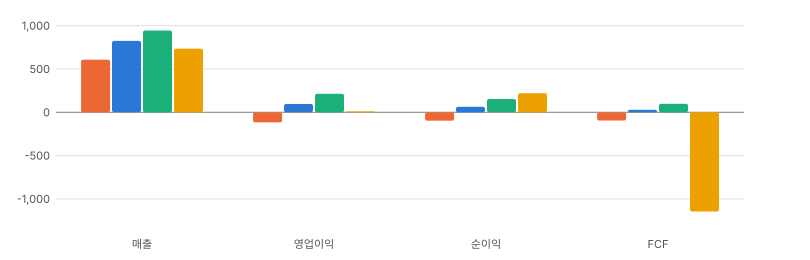

직전 투자프레임 = 2026-11-10 파일(마지막 실적 2Q26). 순이익의 실제값에는 법인세 수익 212억(세액공제)이 들어 있다. FCF의 실제값에는 테라다인 장비·공장 대금이 3Q에 먼저 나간 것이 들어 있다(모델은 4Q26 지급으로 둠).

> [!NOTE]
> **한 줄 판정.** 사업 숫자(매출·영업이익·ROIC)는 **기본과 비관 사이**에 있다 — 시나리오 실현도 ROIC 기준 **28%**(0% = 비관, 100% = 낙관), 매출 기준 38%. 순이익·ROE·BPS가 좋아 보이는 것은 **법인세 수익 212억(장비 투자 세액공제)** 때문이고, 영업이익은 10억(이익률 1.4%)으로 컨센서스(52억)와 증권사 추정(22~33억)을 모두 밑돌았다. 새 장비는 아직 매출을 내기 전이므로 아이디어(새 장비 물량)의 판정은 4Q26부터다.

### 무엇이 숫자를 만들었나 (드라이버로 나눠 보기)

- **물량(D1)**: 웨이퍼 테스트 생산 709억(2Q26 733억, −3%), 패키지 테스트 22억(2Q26 70억, −68%), DP 3억(7월 사업 중단). 웨이퍼 가동률 58.3%(2Q26 62.7%). 증권사는 실적 전에 "모바일 CIS·SoC 계절 비수기 + 차량용(ADAS) 칩을 2분기에 미리 생산한 영향"을 이유로 들었다(메리츠 10/13, 보도 인용 — 2차 자료). 같은 분기 고객사 삼성은 시스템LSI 매출 증가(하반기 신모델 SoC·이미지센서), 파운드리 전반 가동률 상승과 매출·이익 개선을 발표했다(10/29 IR 자료) — 고객은 좋아졌는데 테스나 물량은 줄어든 엇갈림이다(③ D1 참고). 회사는 분기보고서에서 이유를 밝히지 않는다(분·반기는 경영진 분석 생략).
- **비용(D3)**: 고정비(인건비 + 기타)는 326억으로 1년 전(348억)보다 줄었지만, 감가상각비가 383억으로 2Q26보다 20억 늘었다(9개월 기계장치 취득 1,071억 — 테라다인 장비 일부가 3Q에 상각을 시작한 것으로 보인다). 매출이 손익분기 매출 724억을 겨우 넘어 **안전여유율 1.4%**(2Q26 12.5%)까지 떨어졌다. 영업레버리지가 거꾸로 작동한 분기다: 매출이 2Q26보다 9% 줄자 영업이익은 90% 줄었다.
- **세금**: 법인세 수익 211.8억 → 순이익 220.3억. 이연법인세자산이 9개월간 437.9억 → 713.6억(+275.7억)으로 늘었다 — 대규모 장비 투자의 세액공제를 자산으로 잡은 것으로 보인다. **현금 세금 부담이 몇 년간 작아진다는 뜻(현금에는 좋음)**이지만 사업 수익성과는 무관하다. 그래서 조정 ROE(세액공제·처분손익 제외) 4.8%를 함께 본다.
- **현금**: 영업현금흐름 316억(1년 전 489억), 설비투자 1,476억 → FCF −1,146억. 순차입금 1,145억 → **2,320억**. 아래 '현금 추적'에서 나눠 본다.
- **조달 — 남아 있던 쟁점이 숫자로 풀림**: 주석 22에 **시설자금대출 약정 8,400억(산업은행 외)**이 새로 나왔다. 실행 2,170억, 남은 한도 약 6,230억 — 남은 증설 대금(약 4,144억)을 충분히 덮는다. 담보로 토지·건물·기계장치 장부가 2,578억과 보험 5,217억에 질권. 일반대출 약정 1,390억 중 950억 실행(단기). 차입 금리 3.5~4.55%.
- **공시 일정 변화 없음**(주석·'공시내용 진행사항'): 테라다인 장비 1,909억(2026-04-28 ~ 10-30), 어드반테스트 장비 2,053억(~2027-03-31), 평택 2공장 2,303억(~2027-11-30). 정정 공시 없음.
- **생산능력**: 3Q26 분기 웨이퍼 생산능력 1,216억(연 환산 4,865억, 1H26 연 5,006억 수준)으로 줄었지만 기계장치 처분은 장부가 8.6억뿐이다 — 생산능력은 장비 대수 × 장비·고객별 단가로 산정되므로 프레임 규칙대로 **기록만 하고 빼지 않는다**.

### (기록) 이전 버전들의 변경 사항

2026-11-10 판은 프레임 개정(현금 추적) 반영본이었다(가치 계산 변화 없음). 아래는 2026-11-08 판의 변경 기록이다.

같은 날 앞서 만든 버전(오전)에서 사용자 동의로 아래를 바꿨다. 바뀐 칸은 본문 연결 표에 **노란색**, 이전 값은 옆에 작게 남겼다.

### A. 정해진 갱신 (동의 불필요)

<table><thead><tr><th>항목</th><th>이전</th><th>이후</th><th>근거</th></tr></thead><tbody><tr><td>국고채 10년</td><td>4.16% (10/21, 대체값)</td><td><b>4.21%</b> (2026년 10월 평균)</td><td>ECOS(사용자 제공)</td></tr><tr><td>신용 스프레드 변화</td><td>0 (자료 없음)</td><td><b>+0.187%p</b> (1월 0.501 → 10월 0.688)</td><td>ECOS 회사채 AA− 3년 − 국고채 3년</td></tr><tr><td>Ke · WACC</td><td>11.97% · 10.8%</td><td><b>12.18% · 10.34%</b></td><td>위 두 재료</td></tr></tbody></table>

### B. 판단 변경 (사용자 동의 2026-11-07·08)

<table><thead><tr><th>항목</th><th>이전</th><th>이후</th><th>이유</th></tr></thead><tbody><tr><td>가치평가 구조</td><td>절대가치 = 잔여이익모델(ω·g), 상대가치 = 1년 뒤 BPS·EPS × 방식별 배수(비교 기업 2곳·추세선·과거 PER)</td><td><b>절대가치 = 시나리오별 3년 뒤 BPS·ROE</b>(+ ROE로 본 적정 PBR 점검) / <b>상대가치 = 3년 뒤 BPS × 자기 PBR 밴드 중앙값을 오늘로 할인, 연 기대수익률</b></td><td>시나리오마다 정해야 할 숫자(ω·g·배수 위치)를 없애고, 시나리오 차이를 드라이버 → BPS로만 만든다. 비교 기업·추세선은 신뢰도가 낮다</td></tr><tr><td>유지보수 투자</td><td>상각 끝난 장비 재취득 없음</td><td><b>재투자 = 기계장치(리스 장비 포함) 취득원가 × 연 4.2%(돌아가는 장비의 양에 비례, 매 분기 최근 6분기 실적으로 갱신, 증설분 혼입 가능성 표시), 생산능력은 지금 수준 유지 — 폐기는 넣지 않고 3Q26부터 추적</b></td><td>DART 2025·1H26 생산설비 표(리스 포함으로 맞춤, 1H26 신규 리스 64억 포함): 투자/취득원가 연 4.2%. 1H26 기계장치 처분은 사실상 0 — 처음 본 "1H26 폐기 646억"은 1H26 표부터 사용권자산이 별도 칸으로 빠진 효과였다. 생산능력 감소는 1H26 한 번뿐이고 장비 처분 없이 일어남(생산능력 = 장비 대수 × 장비·고객별 단가). 처음엔 기존 상각 × 28%로 잡았으나 상각이 끝나면 유지보수가 0이 되어 "장비는 계속 돌리는데 유지비는 없다"는 모순 → 취득원가 기준으로 바꿈. 사용자 동의 2026-11-08</td></tr><tr><td>변동비율</td><td>8%(회귀 기울기, 11/7 합의) · 민감도 2%</td><td><b>성격별 분류(소모품·부재료), 작년 같은 분기 비율 1.5~2.5%</b>. 고정비 = 감가상각 전 비용 − 그 분기 변동비</td><td>회귀 8%는 10개 분기 p = 0.10, 95% 구간 −2%~18%로 유의하지 않음 — 할인율 k와 같은 기준(유의하지 않으면 쓰지 않는다)으로 공시 분류를 쓴다. 기타 비용 속 전력·수선비가 가동률과 움직일 가능성은 남아 있어, 분기가 쌓여 회귀가 유의해지면 다시 본다. 사용자 동의 2026-11-08</td></tr><tr><td>리스</td><td>리스는 만기표대로 소진(약 7분기) → 같은 날 "상각 분기 36억 유지 + 같은 금액 신규 리스"</td><td><b>리스 장비를 유지보수 투자율에 함께 넣고(투자율 4.0% → 4.2%), 기존 리스는 장부가대로 상각 소진</b></td><td>리스는 장비를 들이는 또 하나의 방법(리스 = 부채, 재투자율에 신규 리스를 넣는 프레임 선례). "36억 갱신"은 측정값이 아닌 가정이었고 실제 신규 리스는 6분기 평균 분기 약 11억 — 데이터로 하나의 규칙에 맞춤. 사용자 동의 2026-11-08</td></tr><tr><td>증설 고정비 규칙</td><td>"데이터가 있을 때만, 없으면 0"(같은 날 앞선 결정)</td><td><b>생산능력에 비례</b>: 회사 2021~2025년 연간 (감가상각 전 고정비 ÷ 생산능력) 평균 약 20.8%(해마다 19.7~23.5%) × 새 생산능력 → 새 장비 전부 가동 시 분기 약 +109억. 증설 분기 실적이 나오면 실측값으로 대체(정해진 갱신)</td><td>0은 가장 유리한 쪽을 고른 가정이고(기본 오늘 적정 주가 약 13% 차이), 매출은 새 장비가 기존 장비만큼 번다고 보면서 비용은 안 든다고 보는 비대칭이었다. 생산능력이 2.1배로 느는 동안 비율이 거의 일정 → 고정비는 매출이 아니라 장비 규모에 비례(가동률에는 고정이라 영업레버리지는 그대로). 직원 수(장비 100억당 약 5~6.5명 증가)로도 비슷한 크기. 사용자 결정 2026-11-08</td></tr><tr><td>가치 계산의 ROE 분모</td><td>적정 PBR 점검·N에 평균 자기자본 ROE</td><td><b>기초 자기자본 ROE</b>(표시용 ROE는 평균 그대로, 표에 라벨로 구분)</td><td>프레임 ROE 분모 규칙(가치 계산 = 기초)과 식의 짝: N의 초과이익 = (ROE − Ke) × 직전 BPS, 적정 PBR = (ROE − g) ÷ (Ke − g)의 ROE도 기초 장부가 대비. 적정 주가는 밴드 중앙값으로 계산하므로 바뀌지 않음. 사용자 동의 2026-11-08</td></tr><tr><td>N의 도착점 ROE</td><td>2Q29 ROE 그대로</td><td><b>정상화 ROE</b>(기계장치 상각 → 유지보수 투자 수준)</td><td>프레임 규칙(상대가치 4번)대로. 정상화하지 않은 N도 참고로 함께 표시. 사용자 동의 2026-11-08</td></tr><tr><td>PBR 밴드 기준</td><td>월말 60개(중앙값 2.10배, 최고 6.84배)</td><td><b>주간 259개</b>(중앙값 2.08배, 최고 7.73배)</td><td>그래프(주간)와 통계(월말)의 기준이 달라 최고치가 어긋났음. 적정 주가 영향 −1% 미만</td></tr><tr><td>기본 시나리오</td><td>새 장비 물량 0</td><td><b>새 장비도 기존과 같은 가동률</b></td><td>증설의 비용만 넣고 물량을 빼면 앞뒤가 맞지 않음</td></tr><tr><td>새 장비 생산능력 비율</td><td>0.49 → 1,950억</td><td><b>0.53</b>((웨이퍼 + 패키지) ÷ 기계장치) → <b>2,100억</b></td><td>분자·분모 범위를 맞춤</td></tr></tbody></table>

### 결과에 준 영향

<table><thead><tr><th></th><th>이전(오전)</th><th>이후</th></tr></thead><tbody><tr><td>낙관 / 기본 / 비관 (오늘 기준 원)</td><td align="right">절대 51,124 / 19,504 / 0 · 상대 72,622 / 20,229 / 17,657</td><td align="right">61,711 / 45,905 / 12,617 (가치평가 하나로 통일)</td></tr><tr><td>손익비</td><td align="right">상대 0.27 : 1 / 절대 낙관 대비 −16%</td><td align="right">해당 없음(낙관도 현재가 아래)</td></tr><tr><td>2:1 가격</td><td align="right">상대 35,979 / 절대 17,041</td><td align="right">28,982</td></tr></tbody></table>

### 3단계에서 제가 채운 세부 가정 — 확인해 주세요

<table><thead><tr><th>항목</th><th>쓴 값</th><th>근거</th><th>바꾸면</th></tr></thead><tbody><tr><td>이미 지급한 증설 대금</td><td>2,121억 (사업 규모 비례 배분)</td><td>건설중인자산 1,421억 − 설비 미지급금 677억(2Q26)</td><td>순차입금 경로</td></tr><tr><td>남은 대금 지급 시점</td><td>테라다인 1,263억 4Q26 · 어드반테스트 1,358억 2Q27 · 공장 1,523억 3Q26~4Q27 균등</td><td>"입고·셋업 후 지급", 공시된 완료일</td><td>순차입금 정점 시기</td></tr><tr><td>공장 내용연수</td><td>30년 정액, 1Q28부터 (분기 19억)</td><td>주석상 건물 20·40년, 구축물 10·20년 — 30년은 그 사이 값(40년이면 분기 약 14억)</td><td>감가상각비(작음)</td></tr><tr><td>리스(대부분 기계장치)</td><td>기존 리스는 장부가 338억을 분기 약 36억씩 상각해 소진(약 9분기). 교체는 유지보수 투자에 포함, 증설에 딸린 새 리스는 없음</td><td>리스는 장비를 들이는 또 하나의 방법(리스 = 부채) — 사든 빌리든 하나의 유지보수 투자율로 잰다. 실제 신규 리스: 2025년 3.7억, 1H26 64억</td><td>감가상각·순차입금(작음)</td></tr><tr><td>유지보수 설비투자</td><td>기계장치(리스 장비 포함) 취득원가 × 연 4.2% (분기 약 113억 → 새 장비 입고 후 약 155억)</td><td>2025~1H26 DART 실적(리스 장비 포함, 신규 리스 포함). 매 분기 최근 6분기로 갱신(정해진 갱신). (증설분이 섞였을 가능성 큼 — 6분기 투자의 거의 전부가 어드반테스트 사업 시작 뒤. 잠정 유지, 3Q26 보고서로 확인). 생산능력 폐기는 넣지 않음</td><td>BPS·FCF</td></tr><tr><td>투자조합 출자 450억</td><td>4Q26~4Q27 분기 90억, 수익 0</td><td>2호 400억 + 1호 잔여 50억</td><td>순차입금·이자</td></tr></tbody></table>

> [!NOTE]
> **한 문단 요약.** 두산테스나는 삼성전자 파운드리·시스템LSI가 만든 시스템 반도체를 "테스트 장비 시간" 단위로 검사해 주고 돈을 받는 회사다(매출의 약 95%가 삼성 관련). 비용의 절반이 장비 감가상각비이고 나머지도 대부분 인건비·전력 같은 고정비라서, **가동률이 이익을 거의 전부 결정한다**. 2025년 가동률이 45%까지 떨어지자 ROIC가 −2%까지 내려갔고, 2026년 2분기 가동률 63%에서 ROIC(최근 4분기)는 4.6%로 회복했다. 다만 아직 자본비용(Ke 12.2%, WACC 10.9%)에는 한참 못 미친다. 앞으로를 좌우할 두 가지 새 사실이 있다: ① 기존 기계장치는 이미 78%가 상각되어 감가상각비가 빠르게 줄고 있고(분기 489억 → 363억), ② 회사는 지금 자기자본(4,511억)보다 큰 **6,265억 규모의 공장·장비 투자**를 진행 중이다. 즉 "낡은 장비의 상각이 끝나며 이익이 좋아지는 힘"과 "새 장비 상각과 고정비가 늘어나는 힘"이 2027년에 겹친다.

## 0. 밸류체인 지도와 유동성

### 돈이 흐르는 길

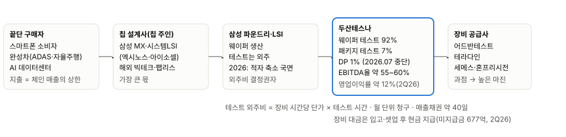

테스나는 스스로 칩을 팔지 않는다. 삼성이 만든 웨이퍼를 받아 테스트 장비에 올려 검사하고, **장비를 쓴 시간만큼** 돈을 받는다. 그래서 테스나의 매출은 "삼성 공장에서 테스나에 맡긴 물량 × 그 칩을 검사하는 데 걸리는 시간 × 장비별 단가"로 정해진다. 재료를 사지 않으니 재고가 거의 없고(2Q26 재고 1억), 원가의 대부분은 장비(감가상각)와 사람이다.

돈의 원천은 맨 앞의 끝단 구매자다. 다만 테스나에게 직접 영향을 주는 끝단은 메모리를 사는 하이퍼스케일러가 아니라 **삼성 시스템 반도체가 들어가는 스마트폰(엑시노스 AP, 이미지센서)과 자동차, 그리고 새로 늘고 있는 AI용 주문형 칩**이다. 삼성은 2026년 3분기 실적에서 파운드리가 HBM 베이스다이와 첨단 공정 판매로 개선됐고, 하이퍼스케일러를 포함한 2나노 고성능 칩 고객 수주가 이어졌으며, 시스템LSI는 모바일 SoC와 이미지센서 공급을 늘렸다고 밝혔다(보도 인용: 비즈워치 2026-10-29).

### 0-1. 유동성 점검

**끝단 구매자의 지갑.** 두 갈래가 반대로 움직인다. AI 쪽은 넉넉하다 — 하이퍼스케일러 4사 설비투자는 2025년 약 4,100억 달러에서 2026년 약 7,500억 달러 추적치로 늘었다. 반면 스마트폰 쪽은 약하다 — 2026년 3분기 글로벌 출하가 전년 대비 22% 줄었다(IDC, 보도 인용). 테스나 매출의 큰 몫이 아직 스마트폰 칩이므로, 숫자상으로는 약한 쪽에 더 많이 걸려 있다.

**하이퍼스케일러 4사 설비투자 (십억 달러)**

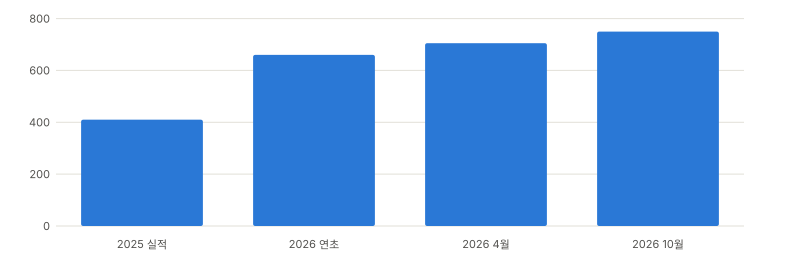

**글로벌 스마트폰 출하 증감률 (%, 전년 대비)**

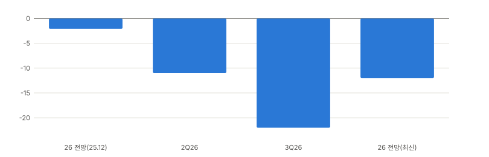

**신용 지표.** AI 투자를 빚으로 대는 쪽의 위험 신호가 커지고 있다. 오라클 5년 CDS는 연초 144bp에서 10월 295bp로 두 배가 됐다(보도 인용). 재무가 탄탄한 마이크로소프트도 35bp → 53bp(7월)로 올랐다. 테스나에게는 간접적이지만, AI 칩 주문이 줄어드는 선행 신호로 계속 본다.

**오라클 5년 CDS (bp, 보도 시점)**

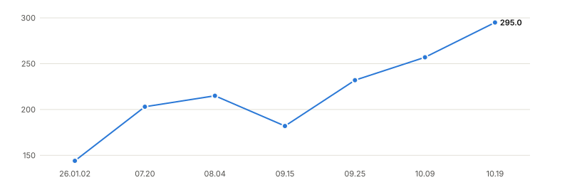

**이 기업의 통화 금리.** 한국 기준금리는 2026년 7·8월 두 차례 올라 3.00%가 됐고, 국고채 10년은 4%대 초반이다(보도 인용). 테스나의 실효 차입금리는 약 4.1%(자본화 이자 포함)로, 금리 인상은 대규모 투자 재원의 이자 부담을 늘린다.

**한국 기준금리 · 국고채 10년 (%, 결정·보도 시점)**

🟦 기준금리 · 🟧 국고채 10년

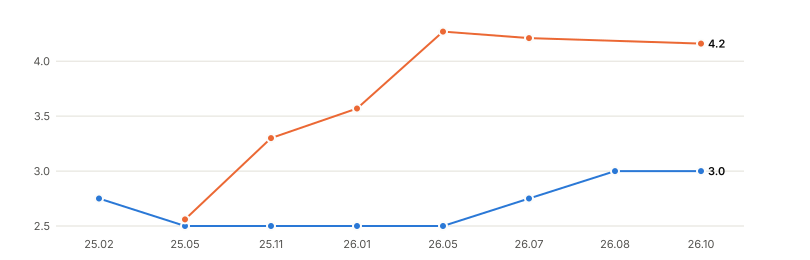

> [!WARNING]
> **유동성 결론.** 테스나의 직접 끝단(스마트폰)은 약하고, 성장 기대가 걸린 AI 쪽은 넉넉하지만 신용 비용이 오르고 있다. 그래서 테스나 물량의 방향은 "삼성 파운드리가 AI·고성능 칩 수주를 실제 테스트 물량으로 얼마나 바꾸느냐"에 달려 있다. 이 연결은 아직 숫자로 확인되지 않았다(3Q26 실적에서 첫 확인).

## ① 지금까지 만들어온 가치 (분기별 숫자)

### 손익

**분기 매출과 영업이익 (억원)**

🟦 매출 · 🟧 영업이익

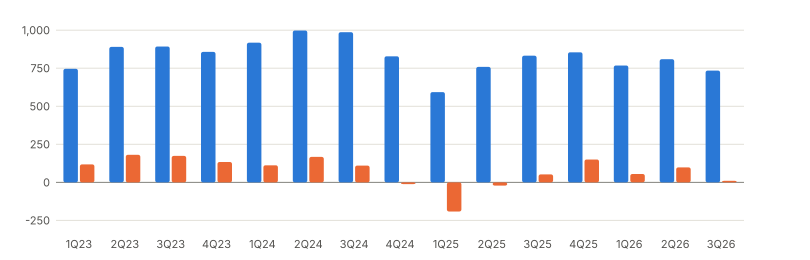

**분기 영업이익률 (%)**

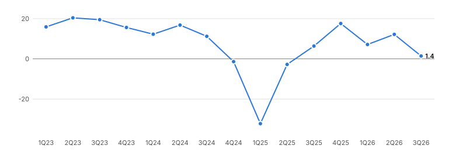

매출은 2024년 2분기 998억을 정점으로 2025년 1분기 593억까지 41% 줄었다. 같은 기간 영업이익은 168억에서 −191억으로 359억 줄었다 — 매출이 405억 줄 때 이익이 359억 줄었다는 것은, **매출 감소분의 약 89%가 그대로 이익 감소로 이어졌다**는 뜻이다(비용이 거의 고정이기 때문). 반대로 2026년 2분기에는 매출 809억으로 2024년 정점의 81% 수준인데도 영업이익률이 12%까지 회복했다. 감가상각비가 줄어든 덕이다(아래 비용 구조).

<table><thead><tr><th>분기</th><th>매출</th><th>영업이익</th><th>이익률</th><th>순이익</th><th>영업CF</th><th>설비투자</th><th>FCF</th><th>FCF(리스 상환 후)</th><th>순차입금</th><th>자기자본</th><th>투하자본</th></tr></thead><tbody><tr><td>1Q23</td><td align="right">746.3</td><td align="right">118.5</td><td align="right">15.9%</td><td align="right">55.8</td><td align="right">569.2</td><td align="right">973.4</td><td align="right">-404.1</td><td align="right">-479.8</td><td align="right">2,816.0</td><td align="right">3,132.1</td><td align="right">5,948.1</td></tr><tr><td>2Q23</td><td align="right">889.9</td><td align="right">181.6</td><td align="right">20.4%</td><td align="right">164.5</td><td align="right">520.6</td><td align="right">357.2</td><td align="right">181.3</td><td align="right">109.4</td><td align="right">2,732.0</td><td align="right">3,299.3</td><td align="right">6,031.4</td></tr><tr><td>3Q23</td><td align="right">892.9</td><td align="right">173.9</td><td align="right">19.5%</td><td align="right">157.2</td><td align="right">490.7</td><td align="right">90.6</td><td align="right">400.0</td><td align="right">313.2</td><td align="right">2,343.2</td><td align="right">3,457.1</td><td align="right">5,800.3</td></tr><tr><td>4Q23</td><td align="right">857.4</td><td align="right">133.7</td><td align="right">15.6%</td><td align="right">113.2</td><td align="right">525.0</td><td align="right">319.1</td><td align="right">209.9</td><td align="right">122.2</td><td align="right">2,405.7</td><td align="right">4,036.4</td><td align="right">6,442.1</td></tr><tr><td>1Q24</td><td align="right">917.8</td><td align="right">112.5</td><td align="right">12.3%</td><td align="right">68.6</td><td align="right">494.5</td><td align="right">249.3</td><td align="right">284.8</td><td align="right">211.3</td><td align="right">2,068.1</td><td align="right">4,071.0</td><td align="right">6,139.0</td></tr><tr><td>2Q24</td><td align="right">998.1</td><td align="right">167.7</td><td align="right">16.8%</td><td align="right">235.5</td><td align="right">498.8</td><td align="right">791.7</td><td align="right">-101.0</td><td align="right">-175.3</td><td align="right">2,465.3</td><td align="right">4,306.4</td><td align="right">6,771.7</td></tr><tr><td>3Q24</td><td align="right">987.0</td><td align="right">110.5</td><td align="right">11.2%</td><td align="right">59.5</td><td align="right">746.7</td><td align="right">575.0</td><td align="right">172.8</td><td align="right">81.9</td><td align="right">2,333.4</td><td align="right">4,368.1</td><td align="right">6,701.6</td></tr><tr><td>4Q24</td><td align="right">828.3</td><td align="right">-11.5</td><td align="right">-1.4%</td><td align="right">4.2</td><td align="right">452.4</td><td align="right">219.9</td><td align="right">236.9</td><td align="right">109.9</td><td align="right">2,505.3</td><td align="right">4,376.7</td><td align="right">6,881.9</td></tr><tr><td>1Q25</td><td align="right">593.0</td><td align="right">-191.3</td><td align="right">-32.3%</td><td align="right">-163.9</td><td align="right">168.5</td><td align="right">53.1</td><td align="right">190.8</td><td align="right">120.7</td><td align="right">2,335.5</td><td align="right">4,191.9</td><td align="right">6,527.5</td></tr><tr><td>2Q25</td><td align="right">759.0</td><td align="right">-21.2</td><td align="right">-2.8%</td><td align="right">-8.4</td><td align="right">369.2</td><td align="right">83.3</td><td align="right">361.1</td><td align="right">262.0</td><td align="right">1,978.2</td><td align="right">4,176.9</td><td align="right">6,155.1</td></tr><tr><td>3Q25</td><td align="right">832.1</td><td align="right">52.9</td><td align="right">6.4%</td><td align="right">28.8</td><td align="right">488.7</td><td align="right">36.3</td><td align="right">454.8</td><td align="right">407.6</td><td align="right">1,552.4</td><td align="right">4,206.6</td><td align="right">5,759.0</td></tr><tr><td>4Q25</td><td align="right">854.6</td><td align="right">150.2</td><td align="right">17.6%</td><td align="right">158.6</td><td align="right">445.7</td><td align="right">75.3</td><td align="right">374.0</td><td align="right">326.8</td><td align="right">1,192.9</td><td align="right">4,370.8</td><td align="right">5,563.7</td></tr><tr><td>1Q26</td><td align="right">768.3</td><td align="right">54.8</td><td align="right">7.1%</td><td align="right">84.5</td><td align="right">383.5</td><td align="right">279.6</td><td align="right">106.4</td><td align="right">58.8</td><td align="right">1,135.0</td><td align="right">4,428.7</td><td align="right">5,563.7</td></tr><tr><td>2Q26</td><td align="right">809.3</td><td align="right">98.5</td><td align="right">12.2%</td><td align="right">70.4</td><td align="right">476.2</td><td align="right">434.3</td><td align="right">54.7</td><td align="right">7.0</td><td align="right">1,145.0</td><td align="right">4,511.0</td><td align="right">5,656.0</td></tr><tr><td>3Q26</td><td align="right">734.3</td><td align="right">10.2</td><td align="right">1.4%</td><td align="right">220.2</td><td align="right">316.2</td><td align="right">1,475.8</td><td align="right">-1,145.8</td><td align="right">-1,194.0</td><td align="right">2,320.1</td><td align="right">4,731.9</td><td align="right">7,052.0</td></tr></tbody></table>

### 현금흐름: 이익보다 현금이 훨씬 많다

**영업현금흐름 · 설비투자 · FCF (억원, 분기)**

🟦 영업현금흐름 · 🟧 설비투자(현금) · 🟩 FCF

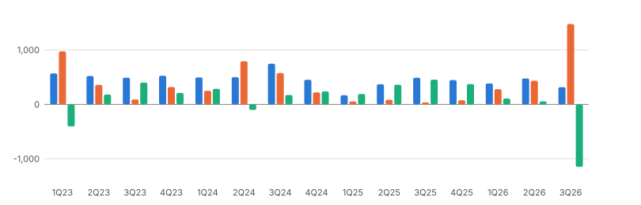

테스나는 이익이 적자인 분기에도 영업현금흐름이 플러스였다(1Q25 영업손실 −191억, 영업현금흐름 +169억). 비용의 절반이 현금이 나가지 않는 감가상각비이기 때문이다. 그래서 이 회사는 "영업이익"보다 **"영업이익 + 감가상각비(EBITDA)"와 "설비투자"의 차이**로 보는 게 맞다.

- 2025년: 영업현금흐름 1,472억, 설비투자 248억 → FCF 1,381억. 투자를 거의 멈추고 현금을 빚 갚는 데 썼다(순차입금 2,505억 → 1,193억).
- 2026년 상반기: 설비투자 현금 714억, 여기에 아직 대금을 안 준 장비(미지급금이 271억 → 677억으로 406억 증가)까지 합치면 실제 유형자산 취득(사용권자산 포함)은 약 1,152억이다. FCF는 161억으로 줄었다.
- 리스 상환(분기 약 48억)까지 빼면 2Q26 FCF는 7억으로 사실상 0이다.

**현금 전환율: 최근 4분기 영업현금흐름 ÷ (영업이익 + 감가상각비) (%)**

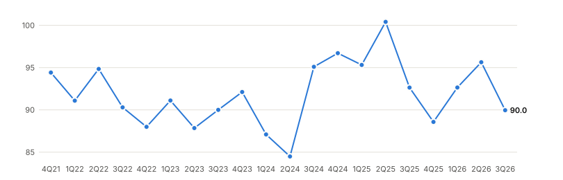

2021~2023년은 DART 분기·반기·사업보고서(별도) 현금흐름표·주석 원문, 감가상각비는 현금흐름 주석의 감가상각비.

현금 전환율이 90%대로 높다는 것은 이익(감가상각 전)이 거의 그대로 현금으로 들어온다는 뜻이다. 매출채권이 약 40일치로 일정하고 재고가 없어서 운전자본이 현금을 잡아먹지 않는다.

### 현금 추적 — 이익이 현금으로 뒷받침되나 (2026-11-10 프레임 개정)

프레임이 바뀌어 **현금이 분석의 중심**이 됐다. 회계 이익(세후 영업이익)과 현금(주주 이익)을 나란히 놓고, 같은 방향이면 지금 시나리오 경로를 확인하는 근거로, 갈라지면 경로가 바뀔 수 있다는 선행 신호로 읽는다. 통과·실패 같은 기준값은 두지 않는다.

**주주 이익** = 영업현금흐름 − 유지보수 투자. 증설 투자는 빼지 않는다 — 지금처럼 장비를 대량으로 들이는 시기에 FCF만 보면 "현금이 안 나온다"로 잘못 읽히기 때문이다. 유지보수 투자는 회사가 따로 공시하지 않아, ④와 같은 규칙(기계장치 취득원가 × 연 4.2%)을 과거 분기에도 적용했다.

<table><thead><tr><th>분기</th><th>4Q24</th><th>1Q25</th><th>2Q25</th><th>3Q25</th><th>4Q25</th><th>1Q26</th><th>2Q26</th><th>3Q26</th></tr></thead><tbody><tr><td>영업현금흐름</td><td align="right">452.4</td><td align="right">168.5</td><td align="right">369.2</td><td align="right">488.7</td><td align="right">445.7</td><td align="right">383.5</td><td align="right">476.2</td><td align="right">316.2</td></tr><tr><td>설비투자</td><td align="right">219.9</td><td align="right">53.1</td><td align="right">83.3</td><td align="right">36.3</td><td align="right">75.3</td><td align="right">279.6</td><td align="right">434.3</td><td align="right">1,475.8</td></tr><tr><td>  유지보수 (규칙 추정)</td><td align="right">110.6</td><td align="right">120.5</td><td align="right">119.5</td><td align="right">118.6</td><td align="right">117.6</td><td align="right">116.6</td><td align="right">115.0</td><td align="right">113.3</td></tr><tr><td>  증설 (나머지)</td><td align="right">109.3</td><td align="right">0.0</td><td align="right">0.0</td><td align="right">0.0</td><td align="right">0.0</td><td align="right">162.9</td><td align="right">319.3</td><td align="right">1,362.5</td></tr><tr><td>FCF</td><td align="right">236.9</td><td align="right">190.8</td><td align="right">361.1</td><td align="right">454.8</td><td align="right">374.0</td><td align="right">106.4</td><td align="right">54.7</td><td align="right">-1,145.8</td></tr><tr><td><b>주주 이익</b></td><td align="right">341.7</td><td align="right">48.0</td><td align="right">249.7</td><td align="right">370.1</td><td align="right">328.2</td><td align="right">266.9</td><td align="right">361.3</td><td align="right">202.9</td></tr><tr><td>세후 영업이익</td><td align="right">-8.7</td><td align="right">-145.0</td><td align="right">-16.1</td><td align="right">40.1</td><td align="right">113.9</td><td align="right">41.6</td><td align="right">74.7</td><td align="right">7.7</td></tr><tr><td>현금 전환율 (최근 4분기)</td><td align="right">6.2배</td><td align="right">해석 불가</td><td align="right">해석 불가</td><td align="right">해석 불가</td><td align="right">해석 불가</td><td align="right">6.8배</td><td align="right">4.9배</td><td align="right">4.9배</td></tr><tr><td>현금 전환율 (최근 12분기 누적)</td><td align="right">3.9배</td><td align="right">4.6배</td><td align="right">5.0배</td><td align="right">5.6배</td><td align="right">6.1배</td><td align="right">6.2배</td><td align="right">6.7배</td><td align="right">8.0배</td></tr><tr><td>매출채권 일수 (CCC 상한)</td><td align="right">39일</td><td align="right">53일</td><td align="right">44일</td><td align="right">37일</td><td align="right">39일</td><td align="right">44일</td><td align="right">40일</td><td align="right">44일</td></tr><tr><td>실제 납부 세금</td><td align="right">확인 안 됨</td><td align="right">확인 안 됨</td><td align="right">확인 안 됨</td><td align="right">확인 안 됨</td><td align="right">확인 안 됨</td><td align="right">확인 안 됨</td><td align="right">확인 안 됨</td><td align="right">9M 누적 18.2</td></tr><tr><td>순차입금 (리스 포함)</td><td align="right">2,505.3</td><td align="right">2,335.5</td><td align="right">1,978.2</td><td align="right">1,552.4</td><td align="right">1,192.9</td><td align="right">1,135.0</td><td align="right">1,145.0</td><td align="right">2,320.1</td></tr></tbody></table>

**현금 추적 ① — 최근 4분기 합계 (억원): 영업현금흐름·주주 이익·FCF vs 세후 영업이익**

🟦 영업현금흐름 · 🟩 주주 이익 (영업현금흐름 − 유지보수 투자) · 🟧 FCF · 🟨 세후 영업이익(NOPAT)

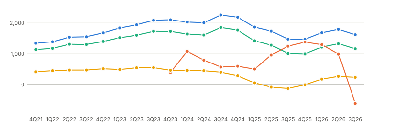

DART 분기 현금흐름표(1Q21~3Q26). FCF는 분기 설비투자 자료가 있는 1Q23부터(그래서 최근 4분기 합계는 4Q23부터). 유지보수 투자 = 기계장치 취득원가 × 연 4.2% ÷ 4(④와 같은 규칙, 과거 분기에 적용한 추정 — 회사는 유지보수·증설을 나눠 공시하지 않는다). 지난 브리핑 시점 표시: 없음(첫 현금 추적).

> [!NOTE]
> **읽기 표 — 3Q26 최근 4분기, 1년 전(3Q25)과 비교**  
> • **이익 ↑**: 세후 영업이익 -130억 → **238억**  
> • **현금 ↑**: 주주 이익 1,010억 → **1,159억** (+15%), 영업현금흐름 1,479억 → 1,622억  
> → 최근 4분기 합계로는 표의 **"이익 ↑ · 현금 ↑ = 현재 경로 확인"** 칸이다. 다만 영업이익 개선 485억 중 **279억(57%)은 감가상각비 감소**(오래된 장비 상각 종료)이고 EBITDA는 206억만 늘었다 — 회복의 절반 이상이 회계 효과다.  
> • **3Q26 한 분기만 보면 방향이 갈린다**: 영업이익 53억 → **10억**(−81%), 주주 이익 370억 → **203억**(−45%) → 분기 기준으로는 **"이익 ↓ · 현금 ↓ = 악화, 반증 신호 점검"** 칸이다. 최근 4분기 합계가 아직 좋아 보이는 것은 4Q25~2Q26의 회복이 남아 있어서다. 4Q26에 테라다인 장비 매출이 붙지 않으면 합계도 꺾인다.

**원인 나눠 보기**

- **영업현금흐름이 줄었다**(3Q25 489억 → 3Q26 316억): 영업이익 감소(−43억)에 더해 **'기타 유동자산'이 9개월간 124억 늘었다**(현금흐름 주석 32). 같은 기간 장비 매입이 2,185억이라 매입 부가세 환급 대기분으로 보이지만 주석에 내역이 없어 **확인 안 됨** — 환급되면 4Q26 영업현금흐름으로 돌아온다. 매출채권(약 44일)은 1년 전(37일)과 비슷하고 재고는 사실상 0이다(CCC 정보량은 여전히 작다).
- **FCF가 크게 마이너스**(3Q26 -1,146억): **증설 투자** 약 1,362억(테라다인 장비 입고 + 평택 2공장 공사)이 원인이다. 프레임 규칙대로 그 자체는 나쁜 신호가 아니며 주주 이익으로 판단한다. 대금은 차입으로 냈다(순차입금 2Q26 1,145억 → 3Q26 2,320억, 시설자금대출 약정 8,400억 중 2,170억 실행).
- **세금**: 3Q26 순이익 220억은 **법인세 수익 212억**(세액공제 인식 — 이연법인세자산 9개월 +276억) 덕분이다. 현금으로 낸 세금은 9개월 18.2억뿐이다. 장비 투자가 새 세액공제를 만들어, 이익이 나도 몇 년간 현금 세금이 작을 가능성이 크다(남은 공제 금액은 분기보고서에 없어 **가정**: 2025 말 543.7억 + 9M 법인세 수익 245.5억 ≈ 789억).

**현금 추적 ② — 분기 설비투자: 유지보수 vs 증설 (억원)**

🟦 유지보수 (규칙 추정) · 🟧 증설 (나머지)

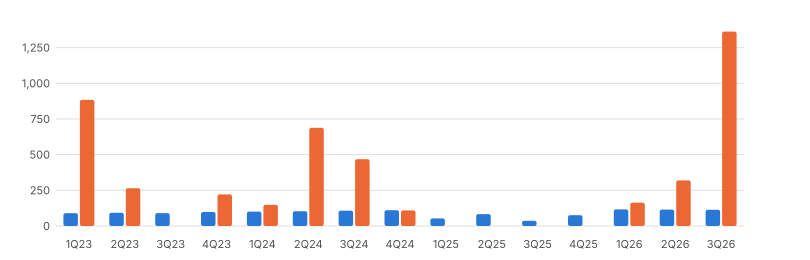

설비투자 = 유형·무형자산 취득 현금(DART). 증설 = 설비투자 − 유지보수 추정(0 아래면 0). 2025년엔 투자가 유지보수 추정보다도 적었다 — 투자를 멈추고 빚을 갚은 해.

**현금 추적 ③ — 현금 전환율 (주주 이익 ÷ 세후 영업이익, 배)**

🟦 최근 4분기 · 🟩 최근 12분기 누적

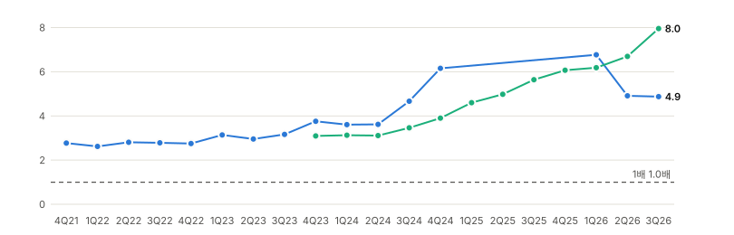

1배 = 이익만큼 현금이 들어옴. 세후 영업이익이 50억 이하(2025년 적자 구간)거나 15배를 넘으면 비율이 의미 없어 비웠다. 이 회사는 감가상각비(분기 360~490억)가 유지보수 투자(분기 약 115억)보다 훨씬 커서 비율이 늘 1배를 크게 넘는다.

> **가정 표시 — 유지보수 투자율 4.2%** (프레임 '데이터 우선'의 세 가지)  
> ① **가정**: 유지보수 투자 = 기계장치(리스 포함) 취득원가 × 연 4.2%. 2025~1H26(증설 거의 없던 6분기) 실측이지만(3Q26은 테라다인 장비가 들어온 증설 분기라 측정에서 뺐다) **투자를 일부러 줄인 시기**라 낮게 잡혔을 수 있다(장비 내용연수 5년이면 교체 속도는 연 20%).  
> ② **민감도**: 장비를 상각 속도대로 모두 교체한다고 보면(유지보수 = 감가상각비) 3Q26 최근 4분기 주주 이익은 1,159억 → **133억**, 현금 전환율은 4.9배 → **0.6배**. 진짜 현금 창출력은 이 둘 사이 어딘가다.  
> ③ **바뀌는 조건**: 실적이 나올 때마다 '증설 없던' 최근 6분기로 다시 잰다(정해진 갱신). 증설이 끝난 뒤(2Q27 이후, 공장 4Q27) 분기의 투자가 가장 깨끗한 측정값이 된다.

**현금 추적 ④ — 현금 전환 주기 CCC (일): 지금은 매출채권 일수만**

CCC = 매출채권 일수 + 재고 일수 − 매입채무 일수 − 선수금 일수(일수 = 분기 매출 대비 비율 × 91일). 재고는 0(테스트 서비스), 매입채무·선수금은 아직 분기 값을 모으지 않아 "확인 안 됨 — 자료 요청함". 고객 한 곳(삼성전자)이 결제 조건을 정하는 구조라 CCC의 정보량은 작다.

### 운전자본

**매출채권 회전일수 (일, 분기 매출 기준)**

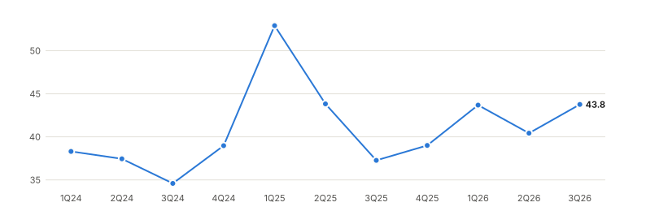

매출채권은 분기 매출의 35~45일치에서 움직인다(1Q25의 53일은 매출이 급감한 분기라 분모가 작아진 효과). 매입채무·재고·선수금은 각각 1억 안팎으로 의미가 없다. 운전자본에서 눈여겨볼 것은 영업 항목이 아니라 **설비 미지급금**이다 — 장비 대금을 입고·셋업 뒤에 주기 때문에, 대규모 증설기에는 미지급금이 늘었다가 한꺼번에 현금으로 나간다.

### 비용 구조 (성격별 분류)

**비용의 성격별 분류 (억원, 분기 3개월 값)**

🟦 감가상각비 · 🟧 인건비 · 🟩 기타 비용(전력·수선 등) · 🟨 변동비(소모품·부재료)

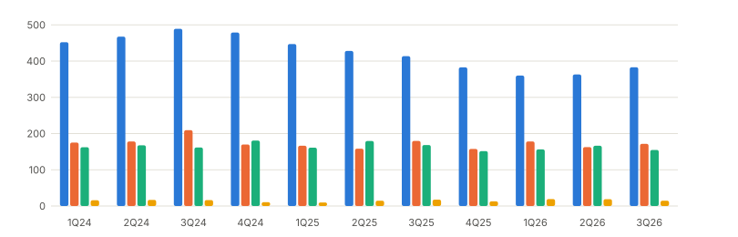

2Q26 기준 비용 711억 중 감가상각비 363억(51%), 인건비 163억(23%), 기타 비용 166억(23%), 장비임차료·소모품과 부재료가 19억(3%)이다. 분류 방법(분기 3개월 값, 4분기는 연간 − 3분기 누적, 2024년은 재작성 비교수치)으로 만든 10개 분기 모두 손익계산서의 매출원가 + 판관비와 0.01억 이내로 일치했다.

> **나눈 결과**
>
> - 감가상각비(유·무형, 사용권자산): 따로 둔다.
> - 고정비: 인건비 + 기타 비용(전력·수선·외주용역 등이 섞여 있음 — 주석에서 더 쪼개지지 않음). 분기 약 310~370억.
> - 변동비: 장비임차료·소모품, 부재료·재고 변동. 매출의 약 1.3~2.5%.
> - 애매한 항목: **기타 비용 안의 전력비**는 가동률에 따라 움직일 수 있는데 분리 공시가 없어 고정비로 넣었다.
>
> **회귀로 확인**
>
> : 감가상각비를 뺀 비용을 분기 매출에 회귀하면(10개 분기)
>
> 비용 = 287.5억 + 0.080 × 매출
>
> , R² = 0.29. 기울기 8%는 분류(약 2%)보다 높다. 이유: ① 2025년에 장비를 매각·정리해 생산능력이 바뀐 구간이 섞였고, ② 기타 비용 속 전력비가 가동률과 함께 움직였을 가능성이 있다. R²가 낮아 회귀는 참고로만 보고,
>
> **"변동비율 2~8%, 나머지는 고정"**
>
> 이라는 범위를 2단계에서 정한다.
>
> 2026-11-08: 기울기는 p = 0.10(95% 구간 −2%~18%)으로 유의하지 않아, 공시 분류(약 2%)를 쓰기로 바꿨다.

### 영업레버리지 (설명 도구)

`손익분기 매출 = (고정비 + 감가상각비) ÷ (1 − 변동비율)`  `안전여유율 = (매출 − 손익분기 매출) ÷ 매출`  `영업레버리지 배수 = (매출 − 변동비) ÷ 영업이익`

**손익분기 매출 vs 실제 매출 (억원, 분기)**

🟦 실제 매출 · 🟧 손익분기 매출

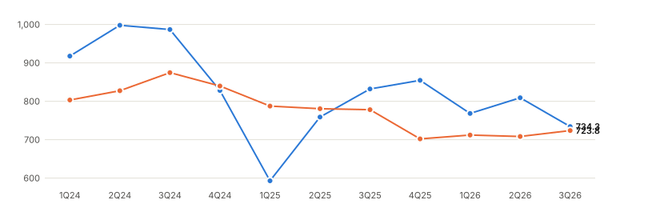

**안전여유율 (%) = (매출 − 손익분기 매출) ÷ 매출**

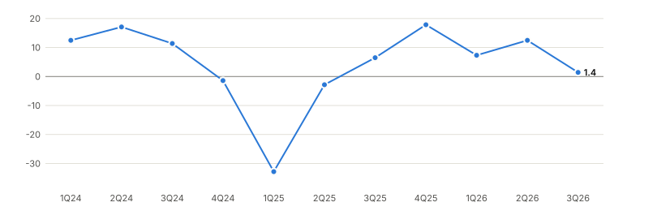

<table><thead><tr><th>분기</th><th>매출</th><th>고정비(인건비+기타)</th><th>감가상각비</th><th>변동비율</th><th>손익분기 매출</th><th>안전여유율</th><th>영업레버리지 배수</th></tr></thead><tbody><tr><td>1Q24</td><td align="right">917.8</td><td align="right">337.3</td><td align="right">452.1</td><td align="right">1.7%</td><td align="right">803.3</td><td align="right">12.5%</td><td align="right">8.0</td></tr><tr><td>2Q24</td><td align="right">998.1</td><td align="right">345.9</td><td align="right">467.6</td><td align="right">1.7%</td><td align="right">827.5</td><td align="right">17.1%</td><td align="right">5.9</td></tr><tr><td>3Q24</td><td align="right">987.0</td><td align="right">370.9</td><td align="right">489.3</td><td align="right">1.7%</td><td align="right">874.7</td><td align="right">11.4%</td><td align="right">8.8</td></tr><tr><td>4Q24</td><td align="right">828.3</td><td align="right">350.5</td><td align="right">478.7</td><td align="right">1.3%</td><td align="right">839.9</td><td align="right">-1.4%</td><td align="right">해석 불가(이익 0 근처)</td></tr><tr><td>1Q25</td><td align="right">593.0</td><td align="right">327.3</td><td align="right">447.1</td><td align="right">1.7%</td><td align="right">787.5</td><td align="right">-32.8%</td><td align="right">-3.0</td></tr><tr><td>2Q25</td><td align="right">759.0</td><td align="right">337.7</td><td align="right">427.9</td><td align="right">1.9%</td><td align="right">780.6</td><td align="right">-2.8%</td><td align="right">-35.1</td></tr><tr><td>3Q25</td><td align="right">832.1</td><td align="right">348.0</td><td align="right">413.7</td><td align="right">2.1%</td><td align="right">778.2</td><td align="right">6.5%</td><td align="right">15.4</td></tr><tr><td>4Q25</td><td align="right">854.6</td><td align="right">308.9</td><td align="right">382.7</td><td align="right">1.5%</td><td align="right">702.1</td><td align="right">17.8%</td><td align="right">5.6</td></tr><tr><td>1Q26</td><td align="right">768.3</td><td align="right">334.4</td><td align="right">360.0</td><td align="right">2.5%</td><td align="right">712.0</td><td align="right">7.3%</td><td align="right">13.7</td></tr><tr><td>2Q26</td><td align="right">809.3</td><td align="right">328.8</td><td align="right">363.1</td><td align="right">2.3%</td><td align="right">708.4</td><td align="right">12.5%</td><td align="right">8.0</td></tr><tr><td>3Q26</td><td align="right">734.3</td><td align="right">326.5</td><td align="right">383.0</td><td align="right">2.0%</td><td align="right">723.8</td><td align="right">1.4%</td><td align="right">해석 불가(이익 0 근처)</td></tr></tbody></table>

손익분기 매출은 2024년 분기 840~875억에서 2026년 710억 안팎으로 약 150억 내려왔다. 고정비(인건비+기타)는 거의 그대로이고, **내려온 것은 감가상각비**다. 그래서 같은 800억대 매출이라도 2024년에는 이익률 11~17%, 2026년 2분기에는 12%가 나온다. 2Q26 영업레버리지 배수는 약 8배 — 매출이 1% 늘면 영업이익이 약 8% 늘고, 줄면 같은 배수로 준다.

### 기존 설비의 상각 현황 — 2027년의 숨은 변수

<table><thead><tr><th>자산(2Q26 말)</th><th>취득원가</th><th>감가상각누계액</th><th>장부금액</th><th>상각 비율</th><th>1H26 상각비</th><th>장부금액 ÷ 연 상각비</th><th>내용연수</th></tr></thead><tbody><tr><td>기계장치</td><td align="right">10,171</td><td align="right">7,945</td><td align="right">2,226</td><td align="right">78%</td><td align="right">601</td><td align="right">약 1.9년</td><td align="right">3~5년, 일부 10년</td></tr><tr><td>건물·구축물</td><td align="right">1,237</td><td align="right">506</td><td align="right">731</td><td align="right">41%</td><td align="right">43</td><td align="right">약 8.4년</td><td align="right">건물 20·40년, 구축물 10·20년</td></tr><tr><td>기타유형자산</td><td align="right">171</td><td align="right">123</td><td align="right">48</td><td align="right">72%</td><td align="right">10</td><td align="right">약 2.5년</td><td align="right">5년</td></tr><tr><td>사용권자산(리스)</td><td align="right">623</td><td align="right">284</td><td align="right">338</td><td align="right">46%</td><td align="right">62</td><td align="right">약 2.7년</td><td align="right">리스기간</td></tr><tr><td>건설중인자산</td><td align="right">1,421</td><td align="right">—</td><td align="right">1,421</td><td align="right">—</td><td align="right">—</td><td align="right">—</td><td align="right">완공 후 상각 시작</td></tr><tr><td>토지</td><td align="right">225</td><td align="right">—</td><td align="right">225</td><td align="right">—</td><td align="right">—</td><td align="right">—</td><td align="right">상각 없음</td></tr></tbody></table>

기계장치는 취득원가 10,171억 중 7,945억(78%)이 이미 상각됐다. 남은 장부금액 2,226억을 지금 속도(상반기 601억, 연 약 1,200억)로 나누면 약 1.9년이다. 내용연수가 3~5년(일부 10년)이므로, **2025년 이전에 산 장비의 상각은 2027~2028년에 대부분 끝날 가능성이 높다**. 실제로 분기 감가상각비는 489억(3Q24)에서 363억(2Q26)으로 이미 26% 줄었다.

장비별 취득 연도는 공시되지 않지만, 기계장치 장부가(2Q26 2,226억)를 최근 분기 상각비(약 300억)로 나누면 **기존 기계장치 상각은 2Q28 무렵 끝난다**(④ 감가상각 계획에 반영). 그리고 같은 시기에 새 장비 3,962억(2개 양수 건)이 들어온다. 이 장비를 5년 정액으로 상각하면 연 약 790억(분기 약 200억)의 새 감가상각비가 생긴다. 이 둘이 어떻게 겹치는지가 2027년 이익률을 정한다 — 2단계 토의 항목이다.

### 이자와 차입 구조

**차입금 · 리스부채 · 현금 · 순차입금 (억원, 분기 말)**

🟦 차입금 · 🟧 리스부채 · 🟩 현금 · 🟨 순차입금

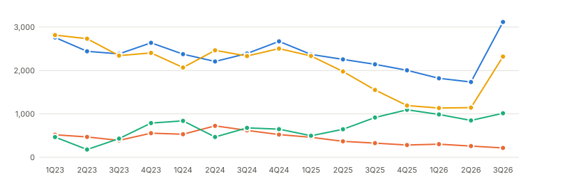

<table><thead><tr><th>항목</th><th>값</th><th>출처·비고</th></tr></thead><tbody><tr><td>차입금(2Q26)</td><td>1,735억 (단기 150, 유동성장기 412, 장기 1,173)</td><td>반기보고서 주석 19 · 산업은행 외 시설자금, 신한·산은 일반대출</td></tr><tr><td>리스부채</td><td>260억 (1년 내 212)</td><td>주석 15</td></tr><tr><td>현금</td><td>850억 (단기금융상품 없음, 예치금 0.05억)</td><td>주석 7·8</td></tr><tr><td>순차입금</td><td>1,145억 (2025년 말 1,193억, 2024년 말 2,505억)</td><td>차입금 + 리스부채 − 현금 − 금융상품</td></tr><tr><td>실효 차입 금리</td><td>약 4.06% (상반기 이자비용 32.3억 + 자본화 이자 11.2억, 연환산 ÷ 평균 차입금·리스)</td><td>약정 금리 3.50~4.55%</td></tr><tr><td>실효 예금 금리</td><td>약 2.8% (이자수익 13.7억, 연환산 ÷ 평균 현금)</td><td>주석 27</td></tr><tr><td>장기차입금 만기(2025년 말)</td><td>1년 내 360 · 1~3년 1,035 · 3~5년 300 · 5년 초과 60억</td><td>사업보고서 주석 19</td></tr><tr><td>약정 한도</td><td>일반대출 한도 690억 중 150억 사용(여유 약 540억), 시설자금 1,585억 전액 실행</td><td>주석 22 · 유형자산 담보 3,270억 설정</td></tr><tr><td>설비 미지급금</td><td>677억 (2025년 말 271억)</td><td>주석 18 · 장비 입고 후 지급</td></tr><tr><td>투자조합 출자 약정</td><td>1호 200억 중 미납 50억, 2호 400억(2026-11부터 분할 납입)</td><td>주석 22, 2026-10-27 공시</td></tr></tbody></table>

### 세율과 현금 세금

- **적용 세율 24.2%**(이연법인세 측정 세율: 감가상각 일시적 차이 6,395백만원 → 이연법인세자산 1,548백만원). 세후 영업이익·세후 차입비용에 쓴다.
- 2024·2025년, 2026년 상반기 모두 세액공제로 **법인세 수익(환급)**이 났다. 유효세율은 의미 없음.
- 미사용 세액공제 543.7억(이연법인세자산 423.8억 인식), 미인식 세액공제 14.0억·결손금 152.1억(2025년 말). 지금 이익 수준이면 **현금 세금은 몇 년간 거의 0**이다. 대규모 장비 투자는 새 투자세액공제를 더 만든다.
- 그래서 순이익이 영업이익과 비슷하거나 더 크다(2Q26 최근 4분기: 영업이익 356억, 순이익 342억). ROE − ROIC 스프레드의 "나머지" 대부분이 이 세금 효과다.

### 주식 수와 희석 증권

발행주식 19,327,238주, 자기주식 81,610주(2026년 2월 RSU 지급으로 7,095주 처분 후) → 유통주식 19,245,628주. 희석 증권은 임원 RSU 33,358주(자기주식 교부, 0.17%)뿐이고, 검토한 주석 범위에서 전환사채·신주인수권부사채는 찾지 못했다. 계산에 넣지 않는다.

### 주주환원 실적 (최근 5년)

<table><thead><tr><th>사업연도</th><th>주당배당금</th><th>배당총액(억)</th><th>순이익(억)</th><th>배당성향</th><th>자사주 매입</th></tr></thead><tbody><tr><td>2021</td><td align="right">160원</td><td align="right">27.2</td><td align="right">471.7</td><td align="right">5.8%</td><td align="right">없음</td></tr><tr><td>2022</td><td align="right">160원</td><td align="right">27.2</td><td align="right">523.3</td><td align="right">5.2%</td><td align="right">없음</td></tr><tr><td>2023</td><td align="right">160원</td><td align="right">30.8</td><td align="right">490.8</td><td align="right">6.3%</td><td align="right">없음</td></tr><tr><td>2024</td><td align="right">160원</td><td align="right">30.8</td><td align="right">367.8*</td><td align="right">8.4%</td><td align="right">없음</td></tr><tr><td>2025</td><td align="right">160원</td><td align="right">30.8</td><td align="right">15.1</td><td align="right">203.8%</td><td align="right">없음</td></tr></tbody></table>

\* 2024년 순이익은 합병 재작성 기준(원보고 440.2억). 배당성향은 보고서 공시값. 배당은 매년 4~5월 지급.

### 확정된 미래 숫자 (④ 기본·비관 시나리오의 근거)

<table><thead><tr><th>항목</th><th>금액</th><th>시기</th><th>근거</th></tr></thead><tbody><tr><td>공장 시설 투자</td><td>2,303억(총액)</td><td>2024.07 ~ 2027.11</td><td>신규시설투자 공시(2024-07-04, 2026-04-28 정정) · 반기보고서 투자현황</td></tr><tr><td>테스트 장비 양수(어드반테스트·세메스 등)</td><td>2,053억(2025.10 결정 1,714억 → 증액)</td><td>입고 완료 예정 2027.03</td><td>주요사항보고서 정정(2026-04-28) · 장비 입고 후 현금 지급</td></tr><tr><td>테스트 장비 양수(테라다인·세메스·혼프리시전 등)</td><td>1,909억</td><td>입고 2026.04 ~ 2026.10</td><td>주요사항보고서(2026-04-28) · 재원: 내부자금 또는 차입</td></tr><tr><td>건설중인자산(2Q26)</td><td>1,421억</td><td>—</td><td>주석 14 · 집행액 중 아직 상각 전</td></tr><tr><td>DP 사업 영업 중단</td><td>2025년 매출 49억, 1H26 18억</td><td>2026-07-09 이사회</td><td>보고기간 후 사건(주석 34) · 영향 추정 불가로 공시</td></tr><tr><td>매각예정 장비</td><td>장부 48억</td><td>2026년 중 인도</td><td>주석 33 · 2025-12-23 매매계약</td></tr><tr><td>투자조합 출자 약정</td><td>400억 + 잔여 50억</td><td>2026-11부터</td><td>공정위 공시(2026-10-27)</td></tr><tr><td>수주잔고</td><td>없음(공시 안 함)</td><td>—</td><td>고객 연간 계획·월 3개월 forecast로 운영</td></tr><tr><td>장부 리스크</td><td>소송·지급보증 중요 사항 없음(제공받은 이행보증 11.8억)</td><td>—</td><td>주석 22</td></tr></tbody></table>

### 수익성: ROA · ROIC · ROE · TSR

정의: `ROIC = 최근 4분기 영업이익 × (1 − 24.2%) ÷ 평균 투하자본`, 투하자본 = 자기자본 + 순차입금(차입금 + 리스부채 − 현금 − 단기금융상품). `ROE = 최근 4분기 순이익 ÷ 평균 자기자본`(표시용), 조정 ROE는 최근 4분기 조정순이익(유형자산 처분손익 등 일회성 제외) ÷ 4분기 전 자기자본(가치 계산용).

**ROA · ROIC · ROE · 조정 ROE (최근 4분기, %) — 기준선: Ke 12.2%, WACC 10.9%**

🟦 ROA · 🟧 ROIC · 🟩 ROE(평균 자본) · 🟨 조정 ROE(기초 자본)

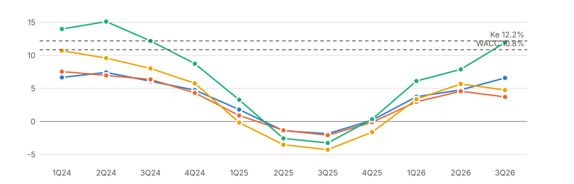

<table><thead><tr><th>분기</th><th>ROA</th><th>ROIC</th><th>ROE</th><th>조정 ROE</th><th>ROE−ROIC</th><th>레버리지 효과</th><th>나머지</th></tr></thead><tbody><tr><td>1Q24</td><td align="right">6.7</td><td align="right">7.5</td><td align="right">14.0</td><td align="right">10.7</td><td align="right">6.4</td><td align="right">3.0</td><td align="right">3.4</td></tr><tr><td>2Q24</td><td align="right">7.4</td><td align="right">7.0</td><td align="right">15.1</td><td align="right">9.6</td><td align="right">8.1</td><td align="right">2.7</td><td align="right">5.5</td></tr><tr><td>3Q24</td><td align="right">6.1</td><td align="right">6.4</td><td align="right">12.2</td><td align="right">8.0</td><td align="right">5.8</td><td align="right">2.0</td><td align="right">3.9</td></tr><tr><td>4Q24</td><td align="right">4.7</td><td align="right">4.3</td><td align="right">8.7</td><td align="right">5.8</td><td align="right">4.4</td><td align="right">0.7</td><td align="right">3.7</td></tr><tr><td>1Q25</td><td align="right">1.8</td><td align="right">0.9</td><td align="right">3.3</td><td align="right">-0.2</td><td align="right">2.4</td><td align="right">-1.2</td><td align="right">3.5</td></tr><tr><td>2Q25</td><td align="right">-1.4</td><td align="right">-1.3</td><td align="right">-2.6</td><td align="right">-3.5</td><td align="right">-1.2</td><td align="right">-2.3</td><td align="right">1.1</td></tr><tr><td>3Q25</td><td align="right">-1.8</td><td align="right">-2.1</td><td align="right">-3.2</td><td align="right">-4.3</td><td align="right">-1.2</td><td align="right">-2.3</td><td align="right">1.2</td></tr><tr><td>4Q25</td><td align="right">0.2</td><td align="right">-0.1</td><td align="right">0.3</td><td align="right">-1.6</td><td align="right">0.5</td><td align="right">-1.3</td><td align="right">1.8</td></tr><tr><td>1Q26</td><td align="right">3.7</td><td align="right">3.0</td><td align="right">6.1</td><td align="right">3.4</td><td align="right">3.1</td><td align="right">-0.0</td><td align="right">3.2</td></tr><tr><td>2Q26</td><td align="right">4.8</td><td align="right">4.6</td><td align="right">7.9</td><td align="right">5.7</td><td align="right">3.3</td><td align="right">0.5</td><td align="right">2.8</td></tr><tr><td>3Q26</td><td align="right">6.6</td><td align="right">3.7</td><td align="right">11.9</td><td align="right">4.8</td><td align="right">8.2</td><td align="right">0.3</td><td align="right">8.0</td></tr></tbody></table>

**과거와 비교한 개선 정도.** 2Q26 ROIC 4.6%는 1년 전(−1.3%)보다 5.9%p, ROE 7.9%는 10.4%p 좋아졌다. 그래도 2024년 1분기(ROIC 7.6%, ROE 14.0%)에는 아직 못 미친다. ROIC = 세후 영업이익률(8.3%) × 투하자본 회전율(0.56배)로 나누면, 회전율은 0.55배 근처에서 거의 그대로이고 개선은 대부분 **이익률(가동률 회복 + 감가상각비 감소)**에서 왔다.

**증분 ROIC**는 지금 해석이 어렵다. 4Q23 → 2Q26 사이 세후 영업이익(최근 4분기)은 461억 → 270억으로, 투하자본은 6,442억 → 5,656억으로 둘 다 줄었다(투자를 줄이고 빚을 갚은 구간). 분모·분자가 함께 마이너스라 비율(24%)은 의미가 없다. 2026년부터 투하자본이 다시 늘기 시작했으므로(2Q26 +92억 전 분기 대비), 증분 ROIC는 새 장비가 매출을 내기 시작하는 2027년부터 의미 있게 볼 수 있다.

**재투자율**: 2025년 순투자 = 설비투자 248억 − 감가상각비 1,671억 = −1,423억(투하자본을 줄임). 2026년 상반기는 유형자산 취득(사용권자산 64억·미지급분 포함) 1,152억 − 감가상각비 723억 = +429억으로, 재투자 국면으로 돌아섰다.

**ROE − ROIC 스프레드**: `ROE − ROIC = (ROIC − 세후 차입비용) × 순차입금/자기자본 + 나머지`. 세후 차입비용 3.1%(실효 4.06% × (1 − 24.2%)). 2Q26 스프레드 3.3%p 중 레버리지 효과는 0.5%p뿐이고 2.8%p가 "나머지"(세액공제로 인한 법인세 수익, 처분이익)다. 2025년에는 ROIC가 차입비용보다 낮아 **레버리지 효과가 마이너스(−2.3%p, 빚이 ROE를 깎음)**였다 — 반증 신호에 해당했던 구간이다.

**ROE − ROIC 스프레드 분해 (%p)**

🟦 레버리지 효과 · 🟧 영업 외·세금 등 나머지

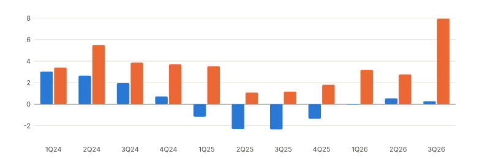

**TSR**(주가 + 배당, 1년 롤링)은 사업 성과와 크게 벌어져 있다. ROIC가 4.6%로 자본비용에 못 미치는데도 1년 TSR은 +288%(2Q26 시점)였다. 시장이 지금 숫자가 아니라 앞으로(신규 고객·증설)를 가격에 넣었다는 뜻이다. 이 괴리는 상대가치 평가에서 다룬다.

**TSR(1년 롤링, %) vs 코스닥**

🟦 두산테스나 TSR · 🟧 코스닥

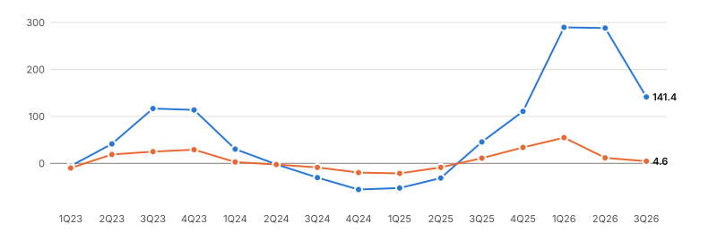

> **기준선**: 자기자본비용 `Ke = 4.21% + 0.93 × 8.57% = 12.18%`(국고채 10년 2026년 10월 평균, MRP = 한공회 2026 8.383% + 회사채 AA− 스프레드 변화 +0.187%p, ECOS), `WACC = 10.34%`(시가총액 1.32조원, 2026-11-16 종가 68,500원, 차입금·리스 3,334억(3Q26) 기준 — 3Q26 갱신). Ke ≥ WACC 확인. k = 1(대체값), β 2년 주간 조정 0.93 — 상관계수 0.37로 0.5 미만이라 **추정이 불안정**(β ±0.2면 Ke ±1.7%p).

## ② 지금까지 가치를 만들어온 구조 — Value Driver

### 비즈니스 모델: 무엇을, 누구에게, 어떻게 파나

<table><thead><tr><th>사업</th><th>매출(억) 2024 / 2025 / 1H26</th><th>비중(1H26)</th><th>무엇을</th><th>누구에게</th><th>어떻게</th></tr></thead><tbody><tr><td>웨이퍼 테스트</td><td>3,455 / 2,810 / 1,446</td><td>91.7%</td><td>웨이퍼 상태 칩의 전기적 검사(AP·이미지센서·차량용·AI 칩)</td><td>삼성 파운드리·시스템LSI(간접수출 포함), 팹리스</td><td>장비 시간 단가 × 테스트 시간, 월 청구</td></tr><tr><td>패키지 테스트</td><td>183 / 180 / 114</td><td>7.2%</td><td>패키징 후 최종 검사</td><td>동일</td><td>동일</td></tr><tr><td>DP(다이 준비)</td><td>105 / 49 / 18</td><td>1.1%</td><td>웨이퍼 절단·가공(구 엔지온)</td><td>팹리스·후공정</td><td>2026-07 영업 중단 결정</td></tr></tbody></table>

매출의 80%는 간접수출(영세율, 원화 청구). 상위 고객 비중 94.8%(1H26). 비교 기업 선정 시 20% 이상 사업은 웨이퍼 테스트 하나다.

모든 매출이 "장비 시간"을 파는 서비스다(일회성 판매나 소모품 반복 판매가 아님). 장기 계약 대신 고객의 연간 계획과 월별 3개월 forecast를 받아 생산능력을 관리한다(사업보고서: 수주현황 별도 작성 안 함). 즉 **수주잔고가 없고, 삼성의 생산 계획이 곧 테스나의 매출 계획**이다. 돈은 매월 청구해 약 40일 뒤 받는다.

### Value Driver (이 회사에 고유한 것, 3개 + 외부 사이클 1개)

> [!NOTE]
> **D1. 삼성 시스템 반도체의 테스트 외주 물량 → 가동률.** 매출의 약 95%가 삼성 관련이다. 삼성이 웨이퍼를 많이 만들고 그 테스트를 밖에 맡기면 가동률이 오른다. 가동률(가중)은 2Q24 67.5% → 1Q25 35.6% → 2Q26 62.7%로 움직였고, 영업이익은 같은 방향으로 +168억 → −191억 → +99억이 됐다. **①의 숫자 변동 대부분을 이 드라이버 하나가 설명한다.**

**가동률 (%, 보고서 기준 가중)**

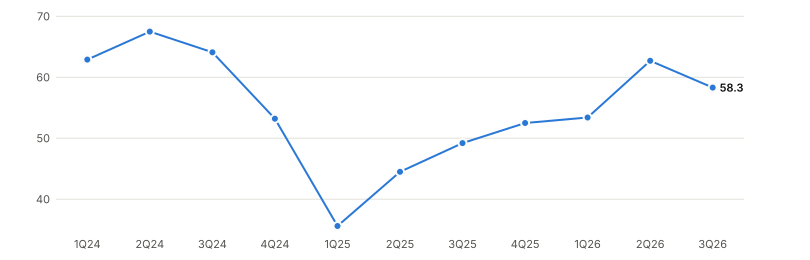

> [!NOTE]
> **D2. 장비 포트폴리오(생산능력)와 고객·제품 믹스.** 회사가 공시하는 생산능력은 "장비 대수 × 장비별 단가 × 고객별 단가 × 월 720시간"이라 **원 단위**다. 그래서 고사양 장비가 늘거나 단가 높은 제품(이미지센서·고성능 SoC·AI 칩)이 늘면 생산능력 숫자 자체가 커진다. 웨이퍼 테스트 생산능력은 2024년 5,584억 → 2025년 6,180억 → 2026년 상반기 2,503억(연환산 약 5,006억)이었다. 2025년에 오래된 장비를 매각·정리했고, 지금 진행 중인 장비 투자 3,962억(어드반테스트·테라다인 테스터 등)은 이 숫자를 크게 늘린다. 회사는 투자 목적을 "테스트 수요 증가 대응"으로 공시했다.

> [!NOTE]
> **D3. 체인 내 위치: 삼성 생태계의 외주 테스트 파트너(고객 계획 연동 선투자).** 삼성이 forecast를 주면 테스나가 장비를 먼저 사서 대응하는 구조다. 테스나가 협상력을 가진 증거는 ① 재고가 없고 ② 매출채권 회수가 40일로 일정하며 ③ 정상 가동률에서 EBITDA율 60%대를 낸다는 점이다. 약점은 고객이 사실상 하나라 **장비를 먼저 사고 물량은 고객이 정한다**는 점 — 가동률 리스크를 테스나가 진다(2025년이 그 예).

> **D4(외부 사이클). 끝단 수요: 스마트폰 AP·이미지센서, 차량용 칩, AI 주문형 칩.** 2025년 부진은 스마트폰 AP 판매 부진과 차량용 수요 약세 때문이었다(증권사 리포트 인용). 2026년 들어 삼성 LSI의 모바일 SoC·이미지센서 공급 확대와 파운드리 첨단 공정 수주가 회복을 이끌고 있다(삼성 3Q26 실적, 보도 인용). 이 사이클은 D1을 통해 테스나 숫자로 들어온다.

### 드라이버 → 숫자의 인과

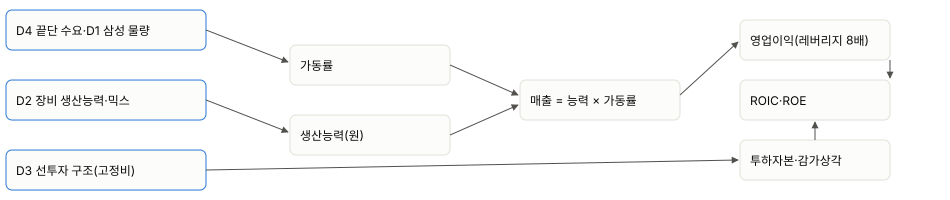

짧게 말하면: **매출 = 생산능력(원) × 가동률**이고, 비용은 거의 고정이라 **이익은 가동률에 8배로 반응**한다. 생산능력을 늘리면(D2) 투하자본과 감가상각비가 먼저 늘고, 가동률(D1)이 따라오면 ROIC가 오르고, 안 따라오면 ROIC가 떨어진다. 2023~2024년 증설(설비투자 연 1,740~1,840억) 뒤 2025년 가동률 급락이 ROIC −2%를 만든 것이 그 예다.

### 드라이버 후보와 과거 값 (④ 계산 구조의 입력 칸 후보)

<table><thead><tr><th>연도/분기</th><th>웨이퍼 테스트 생산능력(억, 원 기준)</th><th>웨이퍼 가동률</th><th>패키지 테스트 가동률</th><th>매출(억)</th></tr></thead><tbody><tr><td>2024</td><td align="right">5,584</td><td align="right">61.9%</td><td align="right">53.8%</td><td align="right">3,731</td></tr><tr><td>2025</td><td align="right">6,180</td><td align="right">45.5%</td><td align="right">58.9%</td><td align="right">3,039</td></tr><tr><td>1H26</td><td align="right">2,503 (연환산 5,006)</td><td align="right">57.8%</td><td align="right">58.2%</td><td align="right">1,578</td></tr><tr><td>1Q24</td><td align="right">1,328</td><td align="right">62.9%</td><td align="right">45.3%</td><td align="right">917.8</td></tr><tr><td>2Q24</td><td align="right">1,385</td><td align="right">67.5%</td><td align="right">41.0%</td><td align="right">998.1</td></tr><tr><td>3Q24</td><td align="right">1,428</td><td align="right">64.1%</td><td align="right">72.9%</td><td align="right">987.0</td></tr><tr><td>4Q24</td><td align="right">1,443</td><td align="right">53.2%</td><td align="right">72.1%</td><td align="right">828.3</td></tr><tr><td>1Q25</td><td align="right">1,530</td><td align="right">35.6%</td><td align="right">62.2%</td><td align="right">593.0</td></tr><tr><td>2Q25</td><td align="right">1,575</td><td align="right">44.5%</td><td align="right">72.5%</td><td align="right">759.0</td></tr><tr><td>3Q25</td><td align="right">1,576</td><td align="right">49.2%</td><td align="right">54.7%</td><td align="right">832.1</td></tr><tr><td>4Q25</td><td align="right">1,500</td><td align="right">52.5%</td><td align="right">52.3%</td><td align="right">854.6</td></tr><tr><td>1Q26</td><td align="right">1,335</td><td align="right">53.4%</td><td align="right">44.3%</td><td align="right">768.3</td></tr><tr><td>2Q26</td><td align="right">1,168</td><td align="right">62.7%</td><td align="right">72.0%</td><td align="right">809.3</td></tr><tr><td>3Q26</td><td align="right">1,216</td><td align="right">58.3%</td><td align="right">22.8%</td><td align="right">734.3</td></tr></tbody></table>

④에서는 "웨이퍼 테스트 생산능력(원, 분기) × 가동률 + 패키지 테스트"로 매출을 만드는 구조가 자연스럽다. 분기별 생산능력·가동률은 분기·반기·사업보고서의 누적값을 차감해 구했다(DART II-3). 어떤 드라이버를 쓸지는 2단계에서 정한다.

### 자본 배분 패턴

- **고정형 배당**: 주당 160원을 2021~2025년 5년째 유지. 이익이 523억(2022)이든 15억(2025)이든 같다. 배당성향은 2023년 6.3% ~ 2025년 204%.
- `주주환원율(5년) = 배당 합계 146.7억 ÷ 순이익 합계 1,868.7억 = 7.9%`. 자사주 매입·소각은 없다(자기주식은 RSU 지급용).
- 환원 연동성: 환원이 고정이라 0에 가깝다(이익과 함께 움직이지 않음).
- 2026년 기업가치 제고 계획에도 숫자로 된 환원 목표는 없다("성장 투자와 재무여건을 종합 고려한 주주환원").
- 남는 현금의 쓰임: ① 장비 투자, ② 차입 상환(2025년), ③ **계열 투자조합 출자** — 두산신기술투자조합1호 200억(약정, 150억 납입), 2호 400억(2026-10-27 결의, 11월부터 분할 납입). ROE가 Ke보다 낮은 시기에 영업과 무관한 벤처 투자로 600억을 약정한 점은 2단계에서 짚을 쟁점이다.

### 왜 이 수준의 ROIC인가

테스나는 정상 가동률(60%대 후반)에서 EBITDA율 60%대를 내지만, 투하자본 회전율이 0.5~0.6배로 낮은 장치 산업이라 ROIC는 정점에서도 7~8%였다. 자본비용(10~12%)을 넘으려면 **가동률 70% 이상이 오래 유지되거나, 같은 장비로 더 비싼 테스트(고사양 칩)를 하거나, 상각이 끝난 장비로 계속 매출을 내야** 한다. 세 번째가 지금 진행 중인 "감가상각비 감소" 효과이고, 첫째·둘째가 새 고객·AI 칩에 거는 기대다. 과거 실적은 금리보다 삼성 비메모리 사이클(2022~2023 호황, 2024 하반기~2025 불황)과 함께 움직였다.

## 질문

> [!NOTE]
> **이 기업에 대해 생각하고 계신 투자 아이디어는 무엇인가요?**  
> 이전에 말씀하신 아이디어는 ① 삼성 파운드리 성장(기업들의 자체 칩 개발 증가, 피지컬 AI) + 자율주행 확대로 차량용 반도체 증가의 수혜, ② TSMC 생산능력 포화의 낙수가 삼성 파운드리를 거쳐 테스나로 온다는 것이었습니다. 이 둘을 그대로 2단계 토의에 올릴지, 바꾸거나 더할 것이 있는지 알려 주세요. 위 분석에서 아이디어와 직접 맞닿는 지점은 D1(삼성 물량 → 가동률)과 D2(증설 6,265억이 채워지는지)입니다.

## 2단계 토의 기록

### 2026-11-07 — 이전 세션의 투자 아이디어 확인

출처: 이전 작업으로 만든 「두산테스나 기업분석 보고서」(Claude Docs, 2026-11-07 갱신본)의 '투자 아이디어와 검증 계획'. 2단계 토의의 출발점으로 그대로 옮긴다.

> [!NOTE]
> **가설 한 줄**: 삼성 파운드리가 TSMC의 대안으로 한국 팹에서 대형 프로젝트(엔비디아 LPU, 북미 고객 이미지센서, 차세대 차량용 칩)를 따내고, 두산테스나가 그 외주 테스트를 맡아 **가동률이 구조적으로 오른다**. 중장기에는 칩 종류의 다양화와 한국 팹 증설이 이를 넓힌다. → 이번 1단계 기준으로 **D1(삼성 물량 → 가동률)**에 걸고, 수단은 **D2(증설 6,265억)**다.

<table><thead><tr><th>아이디어</th><th>지지 근거</th><th>반대 근거</th></tr></thead><tbody> <tr><td>① 자체 칩·피지컬 AI·차량 반도체가 삼성 파운드리를 키운다</td><td>빅테크 자체 칩 증가, 삼성·테슬라 협업, 차량당 반도체 탑재량 증가</td><td>새 칩이 삼성으로 온다는 보장 없음, 차량용은 양산까지 수년</td></tr> <tr><td>② TSMC 생산능력 부족이 삼성으로 넘친다</td><td>선단 파운드리가 사실상 두 곳, 엔비디아 LPU 수주</td><td>TSMC도 증설 중, 고객은 수율이 검증된 TSMC 선호</td></tr> <tr><td>③ 대규모 투자는 수주 언질을 받았다는 신호다</td><td>자기자본보다 큰 6,265억, LPU·이미지센서 전용 투자</td><td>수주잔고 미공시, 2023~2024년 투자 뒤 가동률 하락 전례</td></tr> <tr><td>④ 한국 반도체 생산량이 늘어난다(호남 클러스터 포함)</td><td>건설 중인 팹, 정부 클러스터 계획</td><td>새 공간이 메모리로 갈 수 있음, 테일러 팹이면 테스트도 현지로</td></tr> <tr><td>⑤ 칩 종류가 다양해진다(저·중성능 맞춤형)</td><td>피지컬 AI는 용도별 맞춤 칩, 종류가 많을수록 외주 테스트 수요 증가</td><td>성숙 공정 칩은 중국·대만 파운드리가 더 쌈</td></tr> </tbody></table>

**가설이 맞으려면 참이어야 하는 것**: (1) 새 프로젝트가 한국 팹에서 생산 (2) 삼성이 테스트를 외주 (3) 새 장비 1원당 매출이 기존 장비보다 높음(ROIC가 자본비용을 넘으려면) (4) 삼성이 한국의 새 공간을 파운드리에 배정.

**반증 신호**: 시설투자 공시의 하향·연기 정정 / 삼성 파운드리 점유율 연속 하락 / 삼성 파운드리 투자 축소 / 신규 장비 입고 뒤에도 가동률 60%대를 못 넘음 / 오라클 등 차입 의존 AI 투자사 CDS 급등, 하이퍼스케일러 설비투자 가이던스 하향.

**첫 검증**: 3Q26 실적(이전 보고서는 11월 12일 발표로 기록; 분기보고서 제출 기한 11월 16일) — 매출·영업이익(메리츠 추정 770억·33억 대비), 가동률·감가상각비, 영업현금흐름·설비투자·차입금, LPU 셋업·양산 언급(11월 양산 예정으로 기록).

**이번 1단계에서 새로 생긴 토의 거리**(사용자 판단 대기): ⓐ 기존 기계장치 상각 종료(78% 상각)로 생기는 이익 개선이 아이디어와 별개로 기본 시나리오에 들어간다 ⓑ 새 장비 3,962억의 상각(분기 약 200억)을 메우려면 가동률이 얼마나 올라야 하나(조건 3과 직결) ⓒ DP 사업 중단 ⓓ 투자조합 출자 600억 약정의 의미.

### 2026-11-07 — 과거 호황기 가동률 확인 (가동률 경로 정하기 전 참고)

출처: DART 사업보고서 '생산능력 및 생산실적'(FY2013 정정·FY2016·FY2019·FY2022·FY2025, 2026 반기). 생산능력은 원 기준(장비 단가 × 대수 × 고객 단가 × 월 720시간). 매출·영업이익은 FY2019·FY2022 요약재무정보와 기존 계산값.

<table><thead><tr><th>연도</th><th>웨이퍼 테스트 생산능력(억)</th><th>웨이퍼 가동률</th><th>패키지 가동률</th><th>매출(억)</th><th>영업이익률</th></tr></thead><tbody> <tr><td>2010</td><td align="right">271</td><td align="right">83.5%</td><td align="right">59.2%</td><td align="right">—</td><td align="right">—</td></tr> <tr><td>2011</td><td align="right">558</td><td align="right">75.3%</td><td align="right">69.6%</td><td align="right">—</td><td align="right">—</td></tr> <tr><td>2012</td><td align="right">748</td><td align="right">68.9%</td><td align="right">52.7%</td><td align="right">—</td><td align="right">—</td></tr> <tr><td>2013</td><td align="right">870</td><td align="right">73.2%</td><td align="right">53.1%</td><td align="right">—</td><td align="right">—</td></tr> <tr><td>2014</td><td align="right">889</td><td align="right">49.8%</td><td align="right">47.3%</td><td align="right">—</td><td align="right">—</td></tr> <tr><td>2015</td><td align="right">970</td><td align="right">30.6%</td><td align="right">54.9%</td><td align="right">—</td><td align="right">—</td></tr> <tr><td>2016</td><td align="right">959</td><td align="right">27.0%</td><td align="right">46.4%</td><td align="right">—</td><td align="right">—</td></tr> <tr><td>2017</td><td align="right">1,022</td><td align="right">40.6%</td><td align="right">56.8%</td><td align="right">472</td><td align="right">20.9%</td></tr> <tr><td>2018</td><td align="right">1,036</td><td align="right">56.5%</td><td align="right">43.1%</td><td align="right">653</td><td align="right">28.7%</td></tr> <tr><td>2019</td><td align="right">1,271</td><td align="right">60.9%</td><td align="right">67.8%</td><td align="right">968</td><td align="right">25.0%</td></tr> <tr><td>2020</td><td align="right">1,870</td><td align="right">62.0%</td><td align="right">39.9%</td><td align="right">1,325</td><td align="right">23.1%</td></tr> <tr><td>2021</td><td align="right">2,786</td><td align="right">68.7%</td><td align="right">49.6%</td><td align="right">2,076</td><td align="right">26.0%</td></tr> <tr><td>2022</td><td align="right">3,615</td><td align="right">71.1%</td><td align="right">46.4%</td><td align="right">2,777</td><td align="right">24.2%</td></tr> <tr><td>2023</td><td align="right">4,640</td><td align="right">69.7%</td><td align="right">34.4%</td><td align="right">3,387</td><td align="right">17.9%</td></tr> <tr><td>2024</td><td align="right">5,584</td><td align="right">61.9%</td><td align="right">53.8%</td><td align="right">3,731</td><td align="right">10.2%</td></tr> <tr><td>2025</td><td align="right">6,180</td><td align="right">45.5%</td><td align="right">58.9%</td><td align="right">3,039</td><td align="right">−0.3%</td></tr> <tr><td>2026 상반기</td><td align="right">2,503(연환산 5,006)</td><td align="right">57.8%</td><td align="right">58.2%</td><td align="right">1,578</td><td align="right">9.7%</td></tr> </tbody></table>

읽은 것: ① 2019~2022년 호황기에 생산능력이 2.8배(1,271억 → 3,615억)로 늘었는데도 웨이퍼 가동률은 61% → 71%로 올랐다. 연간 가동률의 실제 상한은 약 70~75%다(2010년 83.5%는 생산능력이 지금의 5% 규모일 때). ② 불황기 바닥은 27~31%(2015~2016)와 45.5%(2025). ③ 2023~2024년 생산능력을 5,584억까지 늘린 뒤 수요가 꺾이자 가동률이 45%로 떨어졌다 — 증설 뒤 물량이 안 따라오면 가동률 분모가 커져서 떨어진다. 2019~2022년 상승의 원인(삼성 시스템LSI의 AP·이미지센서 외주 확대 등)은 사업보고서 본문으로 추가 확인이 필요하다.

### 2026-11-07 — 합의: 웨이퍼 테스트 가동률 경로 (연결 표 초안)

<table><thead><tr><th>가정</th><th>입력 칸</th><th>낙관</th><th>기본</th><th>비관</th><th>확인 지표·기준</th><th>구분</th></tr></thead><tbody> <tr><td>삼성 신규 프로젝트(LPU·이미지센서·차량용) 물량이 새 장비를 채운다</td><td>웨이퍼 테스트 가동률(생산능력 원 기준)</td><td>새 장비 입고 완료(2027-03) 후 2027년 2분기부터 <b>70%</b> (호황기 최고 2022년 71.1%)</td><td>최근 4개 분기 값 유지(3Q25 49.2% · 4Q25 52.5% · 1Q26 53.4% · 2Q26 62.7%, 같은 분기 값 사용)</td><td><b>45%</b> (2025년 바닥 45.5%), 민감도 30%(2015~16년 바닥)</td><td>실제 분기 가동률이 세 경로 중 어디에 가까운지 — 기준값은 따로 두지 않고 시나리오 경로를 그대로 쓴다</td><td>합의</td></tr> </tbody></table>

해석 참고(규칙 아님): 생산능력/기계장치 취득원가 비율(약 0.49배)로 개략 추정하면 증설 후 웨이퍼 생산능력은 연 약 6,900억 — 70%면 분기 매출 약 1,270억(새 투자가 자본비용을 버는 수준), 50%면 약 910억(새 감가상각비 반영 손익분기 근처). 생산능력 증가분은 추정이며 확인 필요.

### 2026-11-07 — 합의: 기존 설비 상각 종료 처리

<table><thead><tr><th>항목</th><th>규칙</th><th>근거</th></tr></thead><tbody> <tr><td>기존 설비 감가상각비</td><td>자산 종류별로 최근 분기 상각비를 유지하다가 남은 장부가가 소진되면 0. 기계장치 분기 약 300억(장부가 2,226억 → 약 7분기), 기타유형자산 분기 약 5억(48억 → 약 10분기), 건물은 12분기 안에 소진되지 않음</td><td>남은 상각 총액은 공시된 장부가로 확정 — 사용자 판단값 없음</td></tr> <tr><td>사용권자산(리스)</td><td>리스부채 만기표대로 감소(1년 내 212억 상환)</td><td>리스 주석 만기 분석</td></tr> <tr><td>재취득(유지보수 투자)·폐기</td><td><b>유지보수 투자 = 기계장치(리스 장비 포함) 취득원가 × 연 4.2%(2025~1H26 실적: 연평균 투자 + 신규 리스 약 447억 ÷ 평균 취득원가 약 1조 640억 — 6분기 투자의 거의 전부가 어드반테스트 사업 시작(2025-10-15) 뒤라 증설분이 섞였을 가능성이 크다, 잠정 유지·3Q26 확인). 장비 나이가 아니라 돌아가는 장비의 양에 비례하므로 새 장비가 들어오면 같이 늘고, 상각이 끝나도 0이 되지 않음. 유지보수 투자는 교체분이라 생산능력을 늘리지 않음. 생산능력 폐기는 추정에 넣지 않음(1H26 기계장치 처분은 사실상 0 — 생산능력 감소는 장비 처분 없이 일어났고, 생산능력이 장비·고객별 단가로 산정되기 때문일 수 있음, 3Q26부터 추적). 과거 최고 가동률 71%는 매출의 물리적 천장으로만 사용. 매 분기 최근 6분기 실적으로 갱신</b>(이전: 상각 끝난 장비 재취득 없음 → 기존 상각 × 28% → 취득원가 × 3.8% → 리스 장비를 함께 넣어 4.2%). 증설은 공시된 3건만</td><td>DART 생산설비 표: 2025년 투자 275억/상각 1,536억/취득원가 1조 486억, 1H26 331억/601억/1조 171억, 1H26 기계장치 처분 사실상 0(2025년 표는 기계장치 칸에 리스 포함, 1H26 표부터 리스 별도 칸 — 처음 본 '1H26 폐기 646억'은 이 칸 분리 효과), 분기별 기계장치 투자 1Q~3Q25 약 6.5억 · 4Q25 약 269억 · 1Q26 약 321억 · 2Q26 약 10억, 생산능력 2025년 6,487억 → 1H26 연환산 5,397억(−17%)</td></tr> <tr><td>신규 장비</td><td>입고(가동) 시점부터 5년 정액</td><td>회계정책 기계장치 내용연수 3~5년(일부 10년)</td></tr> <tr><td>알려진 한계</td><td colspan="2">실제로는 점진적으로 줄지만 이 규칙은 약 7분기 뒤 한 번에 감소 → 2027년 이익은 다소 낮게, 2028년 초는 다소 높게 나옴. 12분기 총액은 공시와 일치하고, 매 분기 실적으로 바로잡음.</td></tr> </tbody></table>

### 2026-11-07 — 합의: 지속계수(ω) (2026-11-08 폐지 — 가치평가 구조 변경, 연결 표 참고)

프레임 값 유지: 낙관 0.9(새 경쟁력 미확인, 고객 사실상 1곳) · 기본 0.9 · 비관 0.8, 초과이익이 마이너스인 시나리오는 프레임대로 해석을 뒤집는다. 사용자 제안(전부 −0.1)은 이 회사만의 별도 판단이 필요하고 초과이익 마이너스 구간에서는 오히려 가치를 올리므로 채택하지 않음 — 대신 시나리오별 ω ±0.1 민감도 줄로 확인한다.

(2026-11-07 당시 기록 — 지금 값은 연결 표 참고) 확인 대기 중인 제안값: 증설 고정비 증가 0 · 설비투자 일정은 공시 날짜(셋업 후 지급) · 신규 리스 0 · 미사용 세액공제 543.7억 소진까지 반영 · 주당배당 160원 고정 · DP 3Q26부터 제외 · 투자조합 약정 450억 2027년까지 균등 납입.

### 2026-11-07 — 합의: 매출 드라이버를 '생산량(원 기준 생산실적)'으로 변경

위의 '웨이퍼 테스트 가동률 경로' 표를 대체한다. 이유: 회사가 생산실적을 원 단위로 공시해 생산량 = 사업별 매출이고, 증설기에 가동률의 분모(생산능력)가 바뀌어 해석이 흔들리는 문제를 없애기 위해서다. 시나리오 값은 결과 숫자의 추정이 아니라 시나리오를 정의하는 가정이다(프레임 원칙과 충돌 없음).

<table><thead><tr><th>가정</th><th>입력 칸</th><th>낙관</th><th>기본</th><th>비관</th><th>확인 지표</th><th>구분</th></tr></thead><tbody> <tr><td>삼성 신규 프로젝트 물량이 새 장비를 채운다</td><td>분기 테스트 생산량(웨이퍼 + 패키지, 원 기준 = 매출)</td><td>증설 후 전체 생산능력(연 약 6,900억, 추정)의 70%(2022년 71.1%) → 분기 약 1,265억. 장비 입고 일정에 맞춰 단계 적용: 테라다인분(1,909억) 4Q26부터, 전체 2Q27부터</td><td>최근 4개 분기 생산량을 같은 분기 값으로 유지(3Q25 832 · 4Q25 855 · 1Q26 768 · 2Q26 809억, 3Q26부터 DP 제외). 새 장비분은 확인된 물량이 없어 0</td><td>기존 생산능력(연 약 5,006억 + 패키지 약 391억)의 45%(2025년 45.5%) → 분기 약 607억. 민감도 30%</td><td>실제 분기 매출이 세 경로 중 어디에 가까운지. 가동률은 공시될 때 참고로만 기록</td><td>합의</td></tr> </tbody></table>

'채워서 늘었나, 늘려서 늘었나'는 손익분기 매출·안전여유율·투하자본 회전율로 본다. 새 장비 생산능력 연 약 1,900억은 생산능력 ÷ 기계장치 취득원가(약 0.49배) 추정 — 장비 입고 후 반기·사업보고서의 생산능력 공시로 확인한다.

### 2026-11-07 — 합의: 변동비율

**기본 8%(회귀 기울기), 민감도 2%(성격별 분류)**. 이유: 공시 항목 '기타 비용'(분기 약 160억)에 전력·수선·외주용역처럼 가동 시간에 따라 움직이는 비용이 섞여 있어 이름 기준 분류(2%)는 실제 변동비를 과소 계상한다. 실제 움직임 기준으로는 정점 vs 바닥 6.3%(2Q24 vs 1Q25), 4.8%(2Q26 vs 1Q25), 회귀 8%(R² 0.29, 10개 분기). 고정비는 '감가상각 전 비용 − 8% × 매출'로 다시 계산한다(예: 2Q26 347.6 − 64.7 = 약 283억). 매 분기 실적이 나오면 회귀를 다시 돌려 갱신한다.

### 2026-11-08 — 변경: 변동비율은 공시 분류로

**작년 같은 분기의 소모품·부재료 ÷ 매출(1.5~2.5%)**, 고정비 = 감가상각 전 비용 − 그 분기 변동비. 이유: 원칙(데이터로 정하고 가정은 최소로, 실적이 나오면 갱신)에 따라 통계적으로 확인된 값만 쓴다. 회귀 8%는 10개 분기로 p = 0.10이라 할인율의 k와 같은 기준으로는 쓸 수 없다. 기타 비용 속 전력·수선비가 가동률과 움직일 가능성은 남아 있으므로, 분기가 쌓여 회귀가 유의해지면 다시 본다. 영향: 매출이 늘 때 이익이 더 많이 늘고, 줄 때 더 많이 준다(비관 손실이 커짐).

## 2단계 연결 표 (2026-11-07 확정, 같은 날 판단 변경 반영 — 노란 칸)

<table><thead><tr><th>가정</th><th>입력 칸</th><th>낙관</th><th>기본</th><th>비관</th><th>근거</th><th>구분</th></tr></thead><tbody> <tr><td>삼성 신규 프로젝트(LPU·이미지센서·차량용) 물량이 새 장비를 채운다</td><td>분기 테스트 생산량(원 기준 = 매출)</td><td><b>증설 후 전체 생산능력(기존 5,397억 + 새 장비 약 2,100억)의 70% — 분기 약 1,312억(과거 최고 가동률 71% 천장 안)</b>. 테라다인분 4Q26, 전체 2Q27부터</td><td><b>작년 같은 분기 생산량(768~855억, DP 제외) × (그 분기 생산능력 ÷ 기존 생산능력) — 새 장비도 기존과 같은 가동률로 돈다</b>(이전: 새 장비분 0)</td><td>기존 생산능력의 45% → 분기 약 607억 (민감도 30%)</td><td>2022년 71.1%, 2025년 45.5%, 2015~16년 27~31%</td><td>합의(아이디어 쪽 값은 낙관)</td></tr> <tr><td>비용 구조</td><td>변동비율 · 고정비</td><td colspan="3"><b>변동비율 = 작년 같은 분기 소모품·부재료 ÷ 매출(1.5~2.5%), 고정비 = 감가상각 전 비용 − 그 분기 변동비(분기 약 310~350억)</b>(이전: 회귀 8%, 민감도 2%), 작년 같은 분기 금액 사용, <b>증설에 따른 고정비 증가는 생산능력에 비례 — 회사 2021~2025년 연간 (감가상각 전 고정비 ÷ 생산능력)이 19.7~23.5%로 거의 일정(평균 약 20.8%)해 그 비율 × 새 생산능력, 새 장비 전부 가동 시 분기 약 +109억. 4Q26(테라다인분 가동) 실적의 인건비·기타 비용 증가분이 나오면 실측값으로 바로 대체(정해진 갱신). 민감도: 0(가장 유리), 2023→2024년 한 구간 비례(분기 약 +198억)</b>, 물가 미반영</td><td>비용 성격별 분류 주석. 회귀 8%는 p = 0.10으로 유의하지 않음</td><td>합의</td></tr> <tr><td>기존 설비 상각</td><td>감가상각비</td><td colspan="3">자산별 최근 분기 상각비 유지 → 장부가 소진 시 0(기계장치 약 7분기, 기타 약 10분기), <b>리스(대부분 기계장치)는 장부가 338억대로 상각 소진, 교체는 유지보수 투자에 포함</b>. <b>유지보수 투자분은 20분기 상각</b>(이전: 재취득 없음)</td><td>공시 장부가, 2025~1H26 유지보수 투자율(리스 포함 취득원가 대비 연 4.2%)</td><td>합의(2026-11-08 변경)</td></tr> <tr><td>설비투자 일정</td><td>설비투자 · 신규 상각</td><td>공시 3건 + 이후 추가 증설 없음(공시 없음)</td><td colspan="2">테라다인 1,909억(2026-10), 어드반테스트 2,053억(2027-03), 공장 2,303억(2027-11), 셋업 후 지급, 장비 5년·건물 내용연수 정액</td><td>주요사항보고서·투자현황</td><td>합의</td></tr> <tr><td>운전자본·이자</td><td>매출채권 등 · 순이자</td><td colspan="3">작년 같은 분기의 매출 대비 비율, 순차입금 × 실효 차입금리 약 4.06% / 순현금 × 예금금리 약 2.8%, <b>신규 리스 0(교체는 유지보수 투자에 포함, 증설에 딸린 새 리스 없음)</b></td><td>프레임 기본 규칙</td><td>합의</td></tr> <tr><td>세금</td><td>현금 세금</td><td colspan="3">적용 세율 24.2%, 미사용 세액공제 543.7억 소진까지 현금 세금 감소, 새 공제는 넣지 않음</td><td>법인세 주석</td><td>합의</td></tr> <tr><td>주주환원·기타 현금</td><td>배당 · 투자조합</td><td colspan="3">주당 160원 고정(4~5월), 자사주 없음(비관의 적자 기간 배당: 과거 적자 해가 없어 데이터로 판단 불가 — 기존 패턴 유지, 연 약 31억) / 투자조합 약정 450억 2027년까지 균등 납입(일정 미공시 — 가정)</td><td>5년 연속 160원, 2026-10-27 공시</td><td>합의</td></tr> <tr><td>가치평가 배수</td><td>상대가치</td><td colspan="3"><b>모든 시나리오 같은 배수 — 3년 뒤(2Q29) BPS × 자기 PBR 밴드 중앙값(2.08배), Ke로 오늘까지 할인</b>(이전: 지속계수 ω 0.9/0.9/0.8 + 잔존가치 g)</td><td>시나리오 차이는 드라이버 → BPS로만. ROE로 본 적정 PBR은 점검용</td><td>합의</td></tr> </tbody></table>

<table><thead><tr><th>질문</th><th>확인 지표</th><th>반증 신호</th></tr></thead><tbody> <tr><td>수요</td><td>삼성 파운드리·LSI 실적 코멘트, 스마트폰 출하, 하이퍼스케일러 설비투자</td><td>삼성 파운드리 투자 축소, 하이퍼스케일러 가이던스 하향, 오라클 등 CDS 급등</td></tr> <tr><td>위치</td><td>분기 매출이 세 경로 중 어디에 가까운지, 상위 고객 비중</td><td>시설투자 공시 하향·연기 정정, 삼성 파운드리 점유율 연속 하락</td></tr> <tr><td>경제성</td><td>안전여유율, 증설 후 증분 ROIC</td><td>새 장비 입고 완료 뒤에도 매출이 기본 경로 수준에 머묾</td></tr> </tbody></table>

남은 쟁점·확인 과제: 새 장비 생산능력은 2026년 상반기 공시 기준 비율(**(웨이퍼 5,006억 + 패키지 391억) ÷ 기계장치 취득원가 10,171억 = 0.53**(이전: 웨이퍼만 0.49)) × 새 장비 3,962억 = 약 2,100억으로 추정(과거 비율 범위 0.42~0.61 → 낙관 분기 매출 약 1,236~1,367억). 매 분기 실적 때 최신 생산능력 ÷ 최신 기계장치 취득원가로 비율을 다시 계산해 아직 입고되지 않은 장비분에만 적용(정해진 갱신 — 변경 표 A), 마지막 입고(2027-03) 뒤에는 공시값만 사용 / 2019~2022 호황의 원인(삼성 LSI AP·이미지센서 외주 확대 여부)은 본문 확인 필요 / 첫 검증은 3Q26 실적.

## ③ 미래에 가치가 생기는 구조 — 드라이버 판정 (2026-11-16, 3Q26 실적 반영)

> **아이디어가 거는 드라이버**: D1(삼성 시스템 반도체 테스트 외주 물량) × D2(새 장비 3,962억의 생산능력). 삼성 파운드리의 새 프로젝트(LPU·이미지센서·차량용·HPC)가 새 장비를 채운다는 가설이다. 판정 기준선은 세 시나리오 경로다(4Q26 분기 매출: 낙관 1,122억 / 기본 1,005억 / 비관 607억, 2Q27 이후: 낙관 1,312억 / 기본 약 1,113억 / 비관 607억).

<table><thead><tr><th>드라이버</th><th>① 수요</th><th>② 위치</th><th>③ 경제성</th><th>판정 (이전 → 이번)</th><th>숫자가 나올 시점</th></tr></thead><tbody><tr><td><b>D1 삼성 시스템 반도체 외주 물량</b> (아이디어의 핵심)</td><td><b>+</b> 삼성 3Q26 IR 자료(10/29 컨퍼런스콜, 사용자 제공 PDF): "시스템반도체는 <b>Foundry 전반적인 가동률 상승</b> 및 선단 공정 수요 증가로 실적 개선세 지속", S.LSI는 "SoC 및 센서 하반기 신모델 진입으로 매출 성장", Foundry는 "HBM B-Die 매출 성장과 선단 공정 확판으로 매출 및 실적 대폭 개선". <b>4Q26: "2나노 2세대 모바일향 신제품 및 4나노 NPU 본격 양산" 등으로 두 자릿수 이상 매출 확대</b>(테스나 LPU 테스트와 직접 연결). 2027: 4/2나노 중심 매출 성장, 美 Taylor 첫 Fab 가동</td><td><b>?</b> 삼성 파운드리 가동률은 올랐는데 테스나 3Q26 생산은 734억으로 줄었다(웨이퍼 테스트 가동률 62.7% → 58.3%). 삼성 성장분(HBM 베이스다이·2나노 HPC)은 테스나 주력(SoC·CIS·MCU) 밖이고, 웨이퍼 테스트는 삼성 매출보다 한두 분기 앞서 일어난다 — 몫이 줄었다는 증거는 아직 없음(삼성 비중 미기재)</td><td><b>−</b> 영업이익률 1.4%, 안전여유율 1.4%</td><td>관찰 필요 → <b>관찰 필요</b> (수요 +, 위치 미확인, 경제성 −) — 삼성 자료 확인 전 잠정 판정 "약화 신호"는 철회</td><td>4Q26 실적: 삼성이 말한 4나노 NPU 양산 확대가 테스나 LPU 물량으로 찍히는지</td></tr><tr><td><b>D2 장비 생산능력(원 기준)</b></td><td>—</td><td>테라다인 장비 입고 숫자로 확인: 9개월 기계장치 취득 1,071억(3Q 약 962억), 사업 기간 10/30 종료·정정 없음. 어드반테스트 ~2027-03, 공장 ~2027-11 그대로</td><td>새 장비 증분 ROIC는 4Q26부터 측정</td><td>관찰 필요 → <b>관찰 필요</b> (입고는 확인, 가동·매출은 미확인)</td><td>4Q26 생산능력·가동률, 2Q27</td></tr><tr><td><b>D3 선투자 구조(고정비)</b></td><td>—</td><td>매출채권 약 44일, 재고 0 — 결제 조건 변화 없음</td><td><b>−</b> 손익분기 매출 724억(실제 734억). 4Q26부터 테라다인 상각(분기 약 95억)이 붙어 손익분기 약 834억으로 오름</td><td>지속 → <b>지속 (위험 커짐)</b></td><td>매 분기</td></tr><tr><td><b>D4 끝단 수요</b></td><td>하이퍼스케일러 설비투자 2026년 약 7,500억 달러 유지(10월 보도). 오라클 5년 CDS 295bp(10/19) 뒤 새 숫자 확인 안 됨. 11월 IFR "AI 신용등급 하향 경고" 기사(제목만 확인)</td><td>—</td><td>—</td><td>관찰 필요 → <b>관찰 필요 (신용 경계)</b></td><td>하이퍼스케일러 4Q 실적(1~2월), CDS 매 브리핑</td></tr></tbody></table>

**현실은 어느 쪽으로?** 3Q26 사업 숫자는 **기본과 비관 사이**(ROIC 실현도 28%)다. 다만 이번 분기는 새 장비가 들어오기 전이라 비관의 정의("새 장비가 놂")를 아직 시험하지 않았다 — 기존 설비의 물량이 계절·선행 생산 탓으로 줄어든 분기다. 반증 신호 "새 장비 입고 뒤에도 매출이 기존 설비 수준(분기 800억대)에 머묾"은 **4Q26 실적이 첫 시험**이다(기본 경로 4Q26 매출 1,005억 = 작년 같은 분기 855억 × 생산능력 증가 비율).

**고객사(삼성) 쪽과 맞춰 본 것**: 테스나 숫자만 보면 D1은 "수요·경제성 두 질문이 기본 경로보다 나쁨" → 약화로 읽힌다. 그러나 끝단 고객인 삼성 시스템LSI·파운드리는 3Q26에 매출이 늘고 **파운드리 전반 가동률이 올랐으며**, 4Q26에 4나노 NPU 본격 양산 등으로 두 자릿수 이상 매출 확대를 예고했다(삼성전자 3Q26 IR 자료·보도자료, 2026-10-29). 그래서 수요는 기준값보다 **좋고**, 나쁜 것은 경제성(테스나의 이익률) 하나다 — 규칙상 약화가 아니라 **관찰 필요**다. 삼성은 늘고 테스나는 줄어든 엇갈림은 ① 삼성 성장분이 테스나가 주로 하지 않는 제품(HBM 베이스다이, 2나노 HPC)이라는 점 ② 웨이퍼 테스트가 칩 판매보다 앞서 일어나는 시차(2분기 선행 생산)로 설명될 수 있지만, 테스나의 삼성 내 몫이 줄었을 가능성도 배제하지 못한다(위치 미확인). 특히 삼성이 "파운드리 전반 가동률 상승"을 밝힌 분기에 테스나 웨이퍼 테스트 가동률이 내렸다는 점은 위치 쪽 경고로 적어 둔다. **4Q26이 결정적인 시험**이다 — 삼성이 말한 "4나노 NPU 양산 확대"가 테스나 LPU 매출로 찍히면 낙관 쪽, 삼성 파운드리가 두 자릿수 성장하는데도 테스나 매출이 800억대에 머물면 위치 약화(반증 신호)다. 삼성전자 3Q26 분기보고서(가동률·생산실적 표)는 오늘까지 DART에 제출되지 않아 확인 안 됨 — 제출되면 반영한다. **판단 변경 없음.**

### 2주 드라이버 점검 — 확인 지표 (2026-11-16 추가, 사용자 동의)

테스나 숫자는 분기에 한 번 나오므로, 2주마다 드라이버의 방향을 **테스나 실적보다 먼저 움직이는 숫자**로 점검한다. 숫자로 확인되는 것만 강화·약화 근거로 쓰고, 뉴스뿐이면 방향(+/−)과 함께 '관찰 필요'로 둔다. 2주 점검은 짧은 브리핑 파일(드라이버 판정 · 유동성 · 새 소식·공시 · 주가와 손익비 한 줄)로 남기고, 적정 주가는 분기 실적 때만 다시 계산한다.

<table><thead><tr><th>드라이버</th><th>2주마다 볼 숫자</th><th>무엇을 판정하나</th><th>기준</th></tr></thead><tbody><tr><td>D1 삼성 외주 물량</td><td>한국 시스템반도체 수출(관세청 10일·월), 대만 테스트 전문업체 KYEC·ASE 월매출, 삼성 파운드리·S.LSI 수주·양산 소식(IR·보도), 갤럭시 등 고객 신제품 일정</td><td>수요: 업황이 좋아지나 / 위치: 업황은 좋은데 테스나만 약한가</td><td>직전 점검 대비 방향(전년 같은 달 대비). 4Q26 실적 전까지는 4나노 NPU 양산 소식이 핵심</td></tr><tr><td>D2 장비 생산능력</td><td>테스나 DART 공시(시설투자 정정·신규, 단일판매·공급계약, 차입), 어드반테스트·테라다인 수주 소식</td><td>증설 일정이 지켜지나, 새 계약이 생겼나</td><td>공시된 일정(어드반테스트 ~2027-03, 공장 ~2027-11) 대비</td></tr><tr><td>D3 선투자 구조</td><td>분기 숫자뿐 — 2주 점검에서는 차입·조달 공시만 확인</td><td>—</td><td>—</td></tr><tr><td>D4 끝단 수요</td><td>하이퍼스케일러 설비투자 발표, 오라클 5년 CDS, 회사채 AA− 스프레드, 국고채 10년</td><td>끝단 지출이 이어지나, 신용 경계가 커지나</td><td>CDS 295bp(10/19), 스프레드 0.69%p 대비 변화 속도</td></tr></tbody></table>

**일정**: 매월 1일·15일 모바일 알림만 보낸다(첫 알림 2026-12-01). 브리핑은 알림을 보고 사용자가 요청할 때 실행한다(프레임 '정기 브리핑' 실행 방식). 테스나·삼성전자 실적 발표 직후에는 따로 브리핑한다.

**유동성 가정**: 기준금리 3.00%, 국고채 10년 4.21%(10월 평균, 11월 자료 미수신 — 대체값), 회사채 AA− 스프레드 0.69%p, 실효 차입금리 4.06%(3Q26 약정 금리 3.5~4.55%). **남은 쟁점**: 2019~2022 호황의 원인, 새 장비 생산능력 비율(0.42~0.61), 투자조합 출자(남은 약정 435억)의 자본 배분 의미. **풀린 쟁점**: 증설 조달 방법(시설자금대출 약정 8,400억).

## ④ 기업이 미래에 만들어낼 가치 — 12분기 추정 (4Q26~3Q29)

연결 표의 입력값만 넣었다. 계산 순서: `매출 = 분기 테스트 생산량` → `영업이익 = 매출 − 변동비율(작년 같은 분기, 1.5~2.5%) × 매출 − 고정비(작년 같은 분기) − 감가상각비` → `FCF = 영업이익 − 현금 세금 − (설비투자 − 감가상각비 + 운전자본 증가)` → `순차입금t = 순차입금t−1 − FCF − 순이자 + 배당 + 투자조합 납입` → `순이익 = (영업이익 + 순이자)(1 − 24.2%)` → `자기자본t = 자기자본t−1 + 순이익 − 배당`.

**새 장비 생산능력**: (웨이퍼 5,006억 + 패키지 391억) ÷ 기계장치 취득원가 10,171억 = **0.53** × 새 장비 3,962억 = **연 약 2,100억**(테라다인분 1,013억 4Q26부터, 어드반테스트분 1,089억 2Q27부터 — 3Q26 보고서로 일정 확인). 증설 후 전체 생산능력은 연 약 7,500억(기존 대비 +39%).

**④ 분기 매출(=테스트 생산량) — 실적과 세 시나리오 (억원)**

🟩 낙관 · 🟦 기본 · 🟧 비관 · 🟨 실적

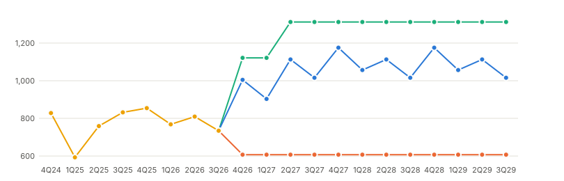

낙관: 증설 후 전체 생산능력의 70%. 기본: 작년 같은 분기 생산량 × 생산능력 증가 비율(새 장비도 기존과 같은 가동률). 비관: 기존 생산능력의 45%(새 장비는 놂).

**감가상각비: 기존 설비 vs 새 설비 (억원, 모든 시나리오 공통)**

🟦 기존 설비(기계장치 2Q28 종료) · 🟧 새 설비(테라다인 4Q26·어드반테스트 2Q27·공장 1Q28부터)

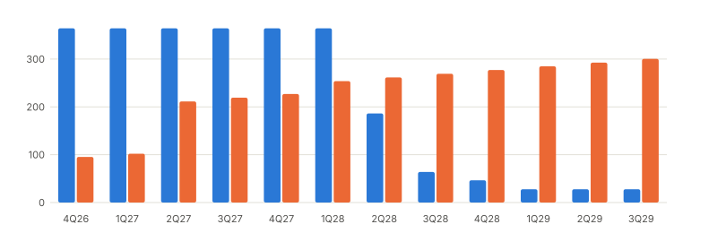

**감가상각비가 12분기를 정한다.** 기존 기계장치(3Q26 말 장부금액 약 1,926억, 테라다인 장비 제외)는 분기 약 300억씩 상각되어 2Q28에 끝난다. 새 설비 상각은 4Q26(테라다인 분기 95억), 2Q27(어드반테스트 +103억), 1Q28(공장 +19억)에 붙는다. 그래서 감가상각비는 383억(3Q26) → 최고 618억(1Q28) → 328억(3Q29)으로 움직인다. 2027년이 가장 힘든 해이고 2Q28 무렵부터 이익이 크게 오른다.

**④ 분기 영업이익 (억원)**

🟩 낙관 · 🟦 기본 · 🟧 비관 · 🟨 실적

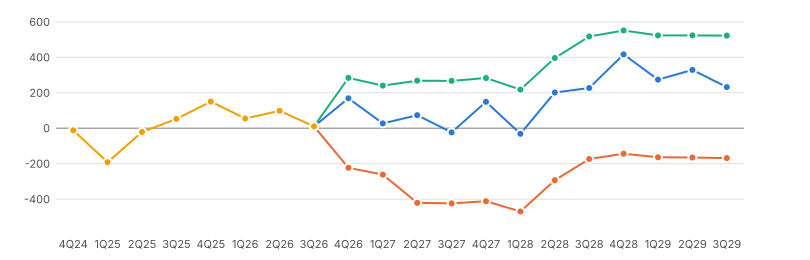

**기본 시나리오: 손익분기 매출 vs 매출 (억원)**

🟦 매출 · 🟧 손익분기 매출

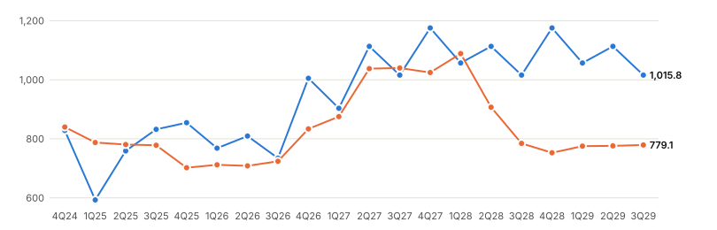

### 기본 시나리오 전체 표 (최근 8분기 실적 + 12분기 추정)

<table><thead><tr><th>항목</th><th>4Q24 (실적)</th><th>1Q25 (실적)</th><th>2Q25 (실적)</th><th>3Q25 (실적)</th><th>4Q25 (실적)</th><th>1Q26 (실적)</th><th>2Q26 (실적)</th><th>3Q26 (실적)</th><th>4Q26 (추정)</th><th>1Q27 (추정)</th><th>2Q27 (추정)</th><th>3Q27 (추정)</th><th>4Q27 (추정)</th><th>1Q28 (추정)</th><th>2Q28 (추정)</th><th>3Q28 (추정)</th><th>4Q28 (추정)</th><th>1Q29 (추정)</th><th>2Q29 (추정)</th><th>3Q29 (추정)</th></tr></thead><tbody><tr><td><b>드라이버: 분기 테스트 생산량(원 기준, 억)</b></td><td align="right">828</td><td align="right">593</td><td align="right">759</td><td align="right">832</td><td align="right">855</td><td align="right">768</td><td align="right">809</td><td align="right">734</td><td align="right">1,005</td><td align="right">903</td><td align="right">1,113</td><td align="right">1,016</td><td align="right">1,176</td><td align="right">1,057</td><td align="right">1,113</td><td align="right">1,016</td><td align="right">1,176</td><td align="right">1,057</td><td align="right">1,113</td><td align="right">1,016</td></tr><tr><td>생산능력(연, 억) — 기존 + 들어온 새 장비 (실적: 분기 웨이퍼+패키지 × 4)</td><td align="right">6,011</td><td align="right">6,352</td><td align="right">6,545</td><td align="right">6,625</td><td align="right">6,425</td><td align="right">5,732</td><td align="right">5,062</td><td align="right">5,256</td><td align="right">6,410</td><td align="right">6,410</td><td align="right">7,499</td><td align="right">7,499</td><td align="right">7,499</td><td align="right">7,499</td><td align="right">7,499</td><td align="right">7,499</td><td align="right">7,499</td><td align="right">7,499</td><td align="right">7,499</td><td align="right">7,499</td></tr><tr><td>매출(억)</td><td align="right">828</td><td align="right">593</td><td align="right">759</td><td align="right">832</td><td align="right">855</td><td align="right">768</td><td align="right">809</td><td align="right">734</td><td align="right">1,005</td><td align="right">903</td><td align="right">1,113</td><td align="right">1,016</td><td align="right">1,176</td><td align="right">1,057</td><td align="right">1,113</td><td align="right">1,016</td><td align="right">1,176</td><td align="right">1,057</td><td align="right">1,113</td><td align="right">1,016</td></tr><tr><td>변동비(억, 성격별 분류)</td><td align="right">11</td><td align="right">10</td><td align="right">15</td><td align="right">18</td><td align="right">13</td><td align="right">19</td><td align="right">19</td><td align="right">15</td><td align="right">15</td><td align="right">23</td><td align="right">26</td><td align="right">20</td><td align="right">18</td><td align="right">26</td><td align="right">26</td><td align="right">20</td><td align="right">18</td><td align="right">26</td><td align="right">26</td><td align="right">20</td></tr><tr><td>고정비(억, 감가상각 제외)</td><td align="right">351</td><td align="right">327</td><td align="right">338</td><td align="right">348</td><td align="right">309</td><td align="right">334</td><td align="right">329</td><td align="right">326</td><td align="right">361</td><td align="right">387</td><td align="right">438</td><td align="right">436</td><td align="right">418</td><td align="right">443</td><td align="right">438</td><td align="right">436</td><td align="right">418</td><td align="right">443</td><td align="right">438</td><td align="right">436</td></tr><tr><td>감가상각비 — 기존 설비(억)</td><td align="right">479</td><td align="right">447</td><td align="right">428</td><td align="right">414</td><td align="right">383</td><td align="right">360</td><td align="right">363</td><td align="right">383</td><td align="right">364</td><td align="right">364</td><td align="right">364</td><td align="right">364</td><td align="right">364</td><td align="right">364</td><td align="right">186</td><td align="right">64</td><td align="right">46</td><td align="right">28</td><td align="right">28</td><td align="right">28</td></tr><tr><td>감가상각비 — 새 설비(억)</td><td align="right">0</td><td align="right">0</td><td align="right">0</td><td align="right">0</td><td align="right">0</td><td align="right">0</td><td align="right">0</td><td align="right">0</td><td align="right">95</td><td align="right">102</td><td align="right">211</td><td align="right">219</td><td align="right">227</td><td align="right">254</td><td align="right">262</td><td align="right">269</td><td align="right">277</td><td align="right">285</td><td align="right">293</td><td align="right">300</td></tr><tr><td><b>영업이익(억)</b></td><td align="right">-11</td><td align="right">-191</td><td align="right">-21</td><td align="right">53</td><td align="right">150</td><td align="right">55</td><td align="right">99</td><td align="right">10</td><td align="right">169</td><td align="right">28</td><td align="right">74</td><td align="right">-24</td><td align="right">149</td><td align="right">-31</td><td align="right">202</td><td align="right">227</td><td align="right">417</td><td align="right">275</td><td align="right">329</td><td align="right">232</td></tr><tr><td>영업이익률</td><td align="right">-1.4%</td><td align="right">-32.3%</td><td align="right">-2.8%</td><td align="right">6.4%</td><td align="right">17.6%</td><td align="right">7.1%</td><td align="right">12.2%</td><td align="right">1.4%</td><td align="right">16.8%</td><td align="right">3.0%</td><td align="right">6.6%</td><td align="right">-2.3%</td><td align="right">12.7%</td><td align="right">-2.9%</td><td align="right">18.1%</td><td align="right">22.3%</td><td align="right">35.4%</td><td align="right">26.0%</td><td align="right">29.6%</td><td align="right">22.8%</td></tr><tr><td>손익분기 매출(억)</td><td align="right">840</td><td align="right">788</td><td align="right">781</td><td align="right">778</td><td align="right">702</td><td align="right">712</td><td align="right">708</td><td align="right">724</td><td align="right">834</td><td align="right">875</td><td align="right">1,038</td><td align="right">1,040</td><td align="right">1,025</td><td align="right">1,089</td><td align="right">907</td><td align="right">784</td><td align="right">753</td><td align="right">775</td><td align="right">776</td><td align="right">779</td></tr><tr><td>안전여유율</td><td align="right">-1.4%</td><td align="right">-32.8%</td><td align="right">-2.8%</td><td align="right">6.5%</td><td align="right">17.8%</td><td align="right">7.3%</td><td align="right">12.5%</td><td align="right">1.4%</td><td align="right">17.0%</td><td align="right">3.1%</td><td align="right">6.8%</td><td align="right">-2.4%</td><td align="right">12.9%</td><td align="right">-3.0%</td><td align="right">18.5%</td><td align="right">22.8%</td><td align="right">36.0%</td><td align="right">26.6%</td><td align="right">30.3%</td><td align="right">23.3%</td></tr><tr><td>순이자(억, 세전)</td><td align="right">—</td><td align="right">—</td><td align="right">—</td><td align="right">—</td><td align="right">—</td><td align="right">—</td><td align="right">—</td><td align="right">—</td><td align="right">-24</td><td align="right">-36</td><td align="right">-37</td><td align="right">-51</td><td align="right">-51</td><td align="right">-50</td><td align="right">-46</td><td align="right">-42</td><td align="right">-38</td><td align="right">-33</td><td align="right">-29</td><td align="right">-24</td></tr><tr><td><b>순이익(억)</b></td><td align="right">4</td><td align="right">-164</td><td align="right">-8</td><td align="right">29</td><td align="right">159</td><td align="right">84</td><td align="right">70</td><td align="right">220</td><td align="right">110</td><td align="right">-7</td><td align="right">28</td><td align="right">-57</td><td align="right">74</td><td align="right">-62</td><td align="right">118</td><td align="right">140</td><td align="right">287</td><td align="right">183</td><td align="right">228</td><td align="right">157</td></tr><tr><td>설비투자(현금, 억)</td><td align="right">220</td><td align="right">53</td><td align="right">83</td><td align="right">36</td><td align="right">75</td><td align="right">280</td><td align="right">434</td><td align="right">1,476</td><td align="right">1,701</td><td align="right">438</td><td align="right">1,818</td><td align="right">460</td><td align="right">460</td><td align="right">155</td><td align="right">155</td><td align="right">155</td><td align="right">155</td><td align="right">155</td><td align="right">155</td><td align="right">155</td></tr><tr><td><b>FCF(억)</b></td><td align="right">237</td><td align="right">191</td><td align="right">361</td><td align="right">455</td><td align="right">374</td><td align="right">106</td><td align="right">55</td><td align="right">-1,146</td><td align="right">-1,150</td><td align="right">53</td><td align="right">-1,229</td><td align="right">106</td><td align="right">265</td><td align="right">429</td><td align="right">507</td><td align="right">411</td><td align="right">570</td><td align="right">429</td><td align="right">507</td><td align="right">411</td></tr><tr><td>배당(억)</td><td align="right">0</td><td align="right">0</td><td align="right">31</td><td align="right">0</td><td align="right">0</td><td align="right">0</td><td align="right">31</td><td align="right">0</td><td align="right">0</td><td align="right">0</td><td align="right">31</td><td align="right">0</td><td align="right">0</td><td align="right">0</td><td align="right">31</td><td align="right">0</td><td align="right">0</td><td align="right">0</td><td align="right">31</td><td align="right">0</td></tr><tr><td>투자조합 납입(억)</td><td align="right">0</td><td align="right">0</td><td align="right">0</td><td align="right">0</td><td align="right">0</td><td align="right">0</td><td align="right">0</td><td align="right">0</td><td align="right">87</td><td align="right">87</td><td align="right">87</td><td align="right">87</td><td align="right">87</td><td align="right">0</td><td align="right">0</td><td align="right">0</td><td align="right">0</td><td align="right">0</td><td align="right">0</td><td align="right">0</td></tr><tr><td>순차입금(억, 리스 포함)</td><td align="right">2,505</td><td align="right">2,336</td><td align="right">1,978</td><td align="right">1,552</td><td align="right">1,193</td><td align="right">1,135</td><td align="right">1,145</td><td align="right">2,320</td><td align="right">3,581</td><td align="right">3,651</td><td align="right">5,035</td><td align="right">5,066</td><td align="right">4,940</td><td align="right">4,561</td><td align="right">4,131</td><td align="right">3,762</td><td align="right">3,230</td><td align="right">2,834</td><td align="right">2,386</td><td align="right">1,999</td></tr><tr><td>자기자본(억)</td><td align="right">4,377</td><td align="right">4,192</td><td align="right">4,177</td><td align="right">4,207</td><td align="right">4,371</td><td align="right">4,429</td><td align="right">4,511</td><td align="right">4,732</td><td align="right">4,842</td><td align="right">4,835</td><td align="right">4,832</td><td align="right">4,776</td><td align="right">4,850</td><td align="right">4,788</td><td align="right">4,875</td><td align="right">5,015</td><td align="right">5,302</td><td align="right">5,485</td><td align="right">5,682</td><td align="right">5,840</td></tr><tr><td>투하자본(억)</td><td align="right">6,882</td><td align="right">6,527</td><td align="right">6,155</td><td align="right">5,759</td><td align="right">5,564</td><td align="right">5,564</td><td align="right">5,656</td><td align="right">7,052</td><td align="right">8,371</td><td align="right">8,345</td><td align="right">9,648</td><td align="right">9,518</td><td align="right">9,402</td><td align="right">8,942</td><td align="right">8,636</td><td align="right">8,452</td><td align="right">8,298</td><td align="right">8,144</td><td align="right">7,966</td><td align="right">7,787</td></tr><tr><td><b>ROIC(TTM)</b></td><td align="right">4.3%</td><td align="right">0.9%</td><td align="right">-1.3%</td><td align="right">-2.1%</td><td align="right">-0.1%</td><td align="right">3.0%</td><td align="right">4.6%</td><td align="right">3.7%</td><td align="right">3.6%</td><td align="right">3.3%</td><td align="right">2.8%</td><td align="right">2.3%</td><td align="right">1.9%</td><td align="right">1.5%</td><td align="right">2.5%</td><td align="right">4.6%</td><td align="right">7.0%</td><td align="right">9.9%</td><td align="right">11.4%</td><td align="right">11.7%</td></tr><tr><td><b>ROE(TTM, 평균 자본)</b></td><td align="right">8.7%</td><td align="right">3.3%</td><td align="right">-2.6%</td><td align="right">-3.2%</td><td align="right">0.3%</td><td align="right">6.1%</td><td align="right">7.9%</td><td align="right">11.9%</td><td align="right">10.5%</td><td align="right">8.5%</td><td align="right">7.5%</td><td align="right">1.6%</td><td align="right">0.8%</td><td align="right">-0.3%</td><td align="right">1.5%</td><td align="right">5.5%</td><td align="right">9.5%</td><td align="right">14.2%</td><td align="right">15.9%</td><td align="right">15.8%</td></tr><tr><td>ROE − ROIC</td><td align="right">4.4%</td><td align="right">2.4%</td><td align="right">-1.2%</td><td align="right">-1.2%</td><td align="right">0.5%</td><td align="right">3.1%</td><td align="right">3.3%</td><td align="right">8.2%</td><td align="right">6.9%</td><td align="right">5.2%</td><td align="right">4.7%</td><td align="right">-0.7%</td><td align="right">-1.1%</td><td align="right">-1.8%</td><td align="right">-0.9%</td><td align="right">0.9%</td><td align="right">2.5%</td><td align="right">4.2%</td><td align="right">4.5%</td><td align="right">4.1%</td></tr><tr><td>BPS(원)</td><td align="right">22,741</td><td align="right">21,781</td><td align="right">21,703</td><td align="right">21,857</td><td align="right">22,710</td><td align="right">23,011</td><td align="right">24,587</td><td align="right">24,587</td><td align="right">25,158</td><td align="right">25,124</td><td align="right">25,108</td><td align="right">24,814</td><td align="right">25,198</td><td align="right">24,878</td><td align="right">25,330</td><td align="right">26,058</td><td align="right">27,549</td><td align="right">28,501</td><td align="right">29,524</td><td align="right">30,343</td></tr></tbody></table>

기본 = "새 장비도 지금 가동률로 돈다". 투하자본 − (자기자본 + 순차입금)의 차이는 현금 세금과 적용 세율 세금의 차이(세액공제 사용 = 이연법인세자산 변동)와 투자조합 출자(영업 외 자산) — 오류가 아니다.

### 낙관 시나리오 요약 — 증설 후 전체 생산능력의 70%

<table><thead><tr><th>항목</th><th>4Q26</th><th>1Q27</th><th>2Q27</th><th>3Q27</th><th>4Q27</th><th>1Q28</th><th>2Q28</th><th>3Q28</th><th>4Q28</th><th>1Q29</th><th>2Q29</th><th>3Q29</th></tr></thead><tbody><tr><td>생산량=매출(억)</td><td align="right">1,122</td><td align="right">1,122</td><td align="right">1,312</td><td align="right">1,312</td><td align="right">1,312</td><td align="right">1,312</td><td align="right">1,312</td><td align="right">1,312</td><td align="right">1,312</td><td align="right">1,312</td><td align="right">1,312</td><td align="right">1,312</td></tr><tr><td>영업이익(억)</td><td align="right">284</td><td align="right">240</td><td align="right">268</td><td align="right">267</td><td align="right">284</td><td align="right">218</td><td align="right">396</td><td align="right">518</td><td align="right">551</td><td align="right">524</td><td align="right">524</td><td align="right">523</td></tr><tr><td>영업이익률</td><td align="right">25.3%</td><td align="right">21.4%</td><td align="right">20.4%</td><td align="right">20.4%</td><td align="right">21.6%</td><td align="right">16.6%</td><td align="right">30.2%</td><td align="right">39.4%</td><td align="right">42.0%</td><td align="right">39.9%</td><td align="right">39.9%</td><td align="right">39.8%</td></tr><tr><td>안전여유율</td><td align="right">25.7%</td><td align="right">22.0%</td><td align="right">20.9%</td><td align="right">20.8%</td><td align="right">21.9%</td><td align="right">17.0%</td><td align="right">30.9%</td><td align="right">40.2%</td><td align="right">42.6%</td><td align="right">40.9%</td><td align="right">40.9%</td><td align="right">40.6%</td></tr><tr><td>순이익(억)</td><td align="right">197</td><td align="right">155</td><td align="right">177</td><td align="right">167</td><td align="right">181</td><td align="right">134</td><td align="right">274</td><td align="right">371</td><td align="right">401</td><td align="right">386</td><td align="right">391</td><td align="right">394</td></tr><tr><td>FCF(억)</td><td align="right">-1,085</td><td align="right">211</td><td align="right">-1,018</td><td align="right">343</td><td align="right">484</td><td align="right">614</td><td align="right">736</td><td align="right">648</td><td align="right">789</td><td align="right">614</td><td align="right">620</td><td align="right">522</td></tr><tr><td>순차입금(억)</td><td align="right">3,516</td><td align="right">3,427</td><td align="right">4,598</td><td align="right">4,388</td><td align="right">4,036</td><td align="right">3,463</td><td align="right">2,793</td><td align="right">2,174</td><td align="right">1,407</td><td align="right">808</td><td align="right">226</td><td align="right">-293</td></tr><tr><td>ROIC(TTM)</td><td align="right">4.8%</td><td align="right">6.8%</td><td align="right">7.9%</td><td align="right">9.6%</td><td align="right">9.0%</td><td align="right">9.0%</td><td align="right">9.6%</td><td align="right">11.8%</td><td align="right">14.3%</td><td align="right">17.4%</td><td align="right">19.1%</td><td align="right">19.5%</td></tr><tr><td>ROE(TTM)</td><td align="right">12.3%</td><td align="right">13.5%</td><td align="right">15.4%</td><td align="right">13.8%</td><td align="right">13.0%</td><td align="right">12.2%</td><td align="right">13.5%</td><td align="right">16.4%</td><td align="right">19.2%</td><td align="right">22.3%</td><td align="right">23.1%</td><td align="right">22.2%</td></tr><tr><td>BPS(원)</td><td align="right">25,612</td><td align="right">26,418</td><td align="right">27,178</td><td align="right">28,046</td><td align="right">28,988</td><td align="right">29,685</td><td align="right">30,947</td><td align="right">32,873</td><td align="right">34,958</td><td align="right">36,964</td><td align="right">38,835</td><td align="right">40,884</td></tr></tbody></table>

### 비관 시나리오 요약 — 기존 설비 45%, 새 장비는 놂

<table><thead><tr><th>항목</th><th>4Q26</th><th>1Q27</th><th>2Q27</th><th>3Q27</th><th>4Q27</th><th>1Q28</th><th>2Q28</th><th>3Q28</th><th>4Q28</th><th>1Q29</th><th>2Q29</th><th>3Q29</th></tr></thead><tbody><tr><td>생산량=매출(억)</td><td align="right">607</td><td align="right">607</td><td align="right">607</td><td align="right">607</td><td align="right">607</td><td align="right">607</td><td align="right">607</td><td align="right">607</td><td align="right">607</td><td align="right">607</td><td align="right">607</td><td align="right">607</td></tr><tr><td>영업이익(억)</td><td align="right">-223</td><td align="right">-261</td><td align="right">-421</td><td align="right">-424</td><td align="right">-411</td><td align="right">-470</td><td align="right">-293</td><td align="right">-174</td><td align="right">-143</td><td align="right">-164</td><td align="right">-165</td><td align="right">-168</td></tr><tr><td>영업이익률</td><td align="right">-36.8%</td><td align="right">-43.0%</td><td align="right">-69.3%</td><td align="right">-69.8%</td><td align="right">-67.7%</td><td align="right">-77.3%</td><td align="right">-48.2%</td><td align="right">-28.6%</td><td align="right">-23.6%</td><td align="right">-27.0%</td><td align="right">-27.2%</td><td align="right">-27.8%</td></tr><tr><td>안전여유율</td><td align="right">-37.3%</td><td align="right">-44.1%</td><td align="right">-70.9%</td><td align="right">-71.3%</td><td align="right">-68.7%</td><td align="right">-79.3%</td><td align="right">-49.4%</td><td align="right">-29.2%</td><td align="right">-24.0%</td><td align="right">-27.7%</td><td align="right">-27.8%</td><td align="right">-28.3%</td></tr><tr><td>순이익(억)</td><td align="right">-187</td><td align="right">-227</td><td align="right">-351</td><td align="right">-367</td><td align="right">-361</td><td align="right">-409</td><td align="right">-276</td><td align="right">-186</td><td align="right">-164</td><td align="right">-179</td><td align="right">-181</td><td align="right">-184</td></tr><tr><td>FCF(억)</td><td align="right">-1,371</td><td align="right">-264</td><td align="right">-1,641</td><td align="right">-322</td><td align="right">-248</td><td align="right">-38</td><td align="right">22</td><td align="right">-18</td><td align="right">57</td><td align="right">-38</td><td align="right">22</td><td align="right">-18</td></tr><tr><td>순차입금(억)</td><td align="right">3,802</td><td align="right">4,192</td><td align="right">5,993</td><td align="right">6,463</td><td align="right">6,863</td><td align="right">6,970</td><td align="right">7,050</td><td align="right">7,139</td><td align="right">7,154</td><td align="right">7,265</td><td align="right">7,347</td><td align="right">7,439</td></tr><tr><td>ROIC(TTM)</td><td align="right">-0.7%</td><td align="right">-4.1%</td><td align="right">-9.0%</td><td align="right">-12.3%</td><td align="right">-13.2%</td><td align="right">-15.5%</td><td align="right">-13.6%</td><td align="right">-11.6%</td><td align="right">-9.5%</td><td align="right">-7.0%</td><td align="right">-6.1%</td><td align="right">-6.1%</td></tr><tr><td>ROE(TTM)</td><td align="right">4.2%</td><td align="right">-2.8%</td><td align="right">-12.9%</td><td align="right">-27.3%</td><td align="right">-33.7%</td><td align="right">-41.8%</td><td align="right">-44.0%</td><td align="right">-41.9%</td><td align="right">-38.7%</td><td align="right">-33.8%</td><td align="right">-33.5%</td><td align="right">-36.6%</td></tr><tr><td>BPS(원)</td><td align="right">23,615</td><td align="right">22,434</td><td align="right">20,450</td><td align="right">18,540</td><td align="right">16,663</td><td align="right">14,539</td><td align="right">12,947</td><td align="right">11,982</td><td align="right">11,132</td><td align="right">10,200</td><td align="right">9,099</td><td align="right">8,142</td></tr></tbody></table>

**ROIC (최근 4분기, %) — 기준선 WACC**

🟩 낙관 · 🟦 기본 · 🟧 비관 · 🟨 실적

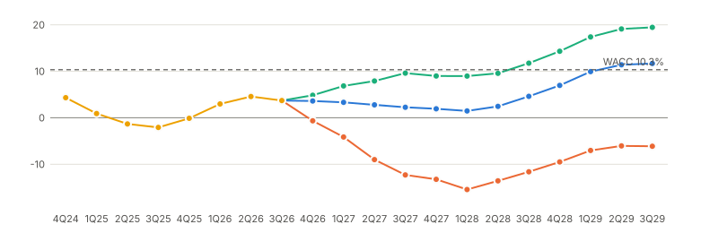

노란 선 = 실적(4Q24~3Q26). 2Q28 이후 상승은 기존 기계장치 상각 종료(분기 약 300억 감소) 효과다. 유지보수 투자(리스 장비 포함 기계장치 취득원가 × 연 4.2%, 실적 비율)를 반영했다. 상각 종료로 늘어나는 것은 회계 이익이고, 현금 이익은 거의 그대로다.

**ROE (최근 4분기, 평균 자기자본, %) — 기준선 Ke**

🟩 낙관 · 🟦 기본 · 🟧 비관 · 🟨 실적

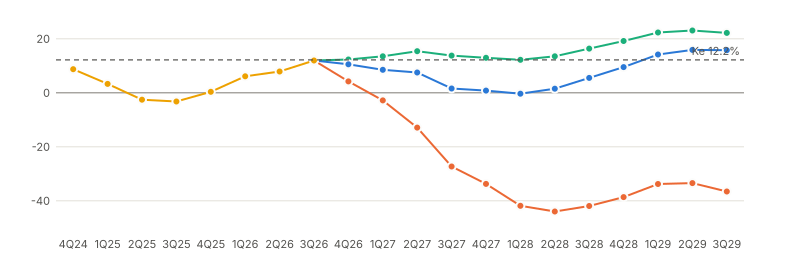

노란 선 = 실적. 2Q28 이후 급등의 이유는 ROIC와 같다.

> [!NOTE]
> **그래프 해석 — 언제 자본비용보다 많이 버나.**
>
> - **읽는 법**: ROIC(사업에 넣은 돈 = 자기자본 + 순차입금 대비 세후 영업이익)는 WACC 10.3%를, ROE(주주 돈 대비 순이익)는 Ke 12.2%를 넘어야 가치를 만든다. 실적(노란 선)은 2025년 적자로 떨어졌다가 2Q26 ROIC 4.6%까지 회복한 뒤 3Q26 3.7%로 다시 낮아졌다(ROE 11.9%는 세액공제 효과, 조정 ROE 4.7%). 아직 두 기준선 아래다.
> - **낙관 — 아이디어가 맞으면 2027년부터 가치 창출**: 새 장비가 70% 가동되면 ROE는 4Q26(12.3%)에 Ke를 넘고, ROIC는 3Q28쯤 WACC를 넘는다.
> - **기본 — 2Q28까지 자본비용 미달**: 새 장비가 지금 가동률로만 돌면 2Q28까지 ROIC 1~5%, ROE -0~11%에 머문다.
> - **비관 — 놀고 있는 장비의 상각이 그대로 손실**: ROIC는 최저 -15.5%, ROE는 최저 -44.0%까지 떨어진다. ROE가 더 깊은 것은 빚이 손실을 키우기 때문이다.
> - **2Q28 이후 상승의 정체**: 기존 기계장치 상각이 2Q28에 끝나 감가상각비가 분기 약 300억 줄어든다. 다만 장비는 상각이 끝나도 계속 돌고 유지비가 든다 — 모델은 유지보수 투자를 기계장치(리스 장비 포함) 취득원가(돌아가는 장비의 양) × 연 4.2%(2025~1H26 실적 — 3Q26은 증설 분기라 측정에서 뺌, 증설분이 섞였을 가능성 있음)로 넣고 그 상각도 넣으며, 생산능력은 지금 수준을 유지한다(1H26·3Q26 생산능력 감소는 장비 처분 없이 일어났다 — 생산능력이 장비·고객별 단가로 산정되기 때문으로 보여 추정에 넣지 않고 추적만 한다). 그래서 3Q29 기본 ROIC 11.7%·ROE 15.8%, 낙관 19.5%·22.2%다. 상각 종료로 늘어나는 것은 회계 이익이고 현금 이익(영업이익 + 감가상각)은 거의 그대로다. 유지보수 투자율은 매 분기 실적으로 갱신하므로, 교체 투자가 늘면 이 상승 폭은 줄어든다.
> - **결론**: 이 회사의 가치는 새 장비 가동률이 정한다. 확인할 시점은 4Q26(테라다인분 매출이 붙는지)과 2Q27(어드반테스트분)이다.

**순차입금 경로 (억원, 리스 포함)**

🟩 낙관 · 🟦 기본 · 🟧 비관

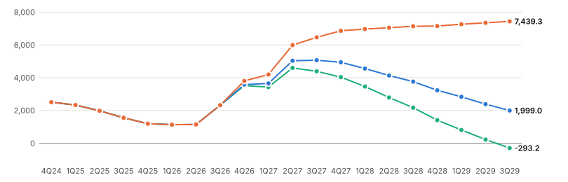

> [!WARNING]
> **조달 표시.** 순차입금 정점: 낙관 4,598억 · 기본 5,066억 · 비관 7,439억 (3Q26 2,320억, 2Q26 1,145억). **3Q26 보고서로 조달 수단이 확인됐다**: 시설자금대출 약정 8,400억 중 2,170억 실행(남은 한도 약 6,230억), 일반대출 약정 1,390억 중 950억 실행. 정점까지 더 필요한 차입(기본 약 2,746억)은 남은 한도 안이다. 비관에서는 순차입금이 계속 늘어 정점 7,439억 — 약정 한도는 남지만 적자와 함께라 재약정·담보 조건이 위험이 된다.

### 증분 ROIC와 마지막 해 상태

12분기 증분 ROIC(3Q26 → 3Q29): 낙관 137% · 기본 78% · 비관 -105%. 투하자본이 거의 늘지 않는 경로라(기존 설비 상각 ≈ 새 투자) 값이 크게 나온다 — 방향만 본다.

**마지막 해(4Q28~3Q29)**: 증설 투자는 끝났고(공장 4Q27 완료) 유지보수 투자만 남는다(분기 약 155억). 기존 기계장치 상각 종료(2Q28) 뒤라 이익이 높지만, 새 장비 상각(연 약 800억)이 2031년 무렵까지 남아 있어 안정 상태는 아니다(절대가치 평가 참고) — 2029년 이후의 이익 수준은 상대가치의 밴드 배수에 맡긴다.

### ④ 현금 경로 — 시나리오별 FCF·주주 이익·현금 전환율 (2026-11-10 프레임 개정)

④ 추정 표의 같은 칸을 현금 쪽에서 다시 묶었다. 브리핑마다 실적의 주주 이익·FCF·순차입금을 이 경로와 나란히 놓는다.

<table><thead><tr><th>시나리오 (4Q26~3Q29 합계)</th><th>영업현금흐름</th><th>유지보수 투자</th><th>증설 투자</th><th>FCF</th><th>주주 이익</th><th>세후 영업이익</th><th>현금 전환율 (12분기)</th><th>현금 세금</th><th>순차입금 정점</th></tr></thead><tbody><tr><td>낙관</td><td align="right">9,437</td><td align="right">1,816</td><td align="right">4,144</td><td align="right">3,477</td><td align="right">7,622</td><td align="right">3,484</td><td align="right">2.2배</td><td align="right">242</td><td align="right">4,598</td></tr><tr><td>기본</td><td align="right">7,270</td><td align="right">1,816</td><td align="right">4,144</td><td align="right">1,310</td><td align="right">5,454</td><td align="right">1,550</td><td align="right">3.5배</td><td align="right">0</td><td align="right">5,066</td></tr><tr><td>비관</td><td align="right">2,105</td><td align="right">1,816</td><td align="right">4,144</td><td align="right">-3,855</td><td align="right">289</td><td align="right">-2,514</td><td align="right">—</td><td align="right">0</td><td align="right">7,439</td></tr></tbody></table>

**④ 현금 경로 — 주주 이익 (최근 4분기 합계, 억원): 실적과 세 시나리오**

🟩 낙관 · 🟦 기본 · 🟧 비관 · 🟨 실적

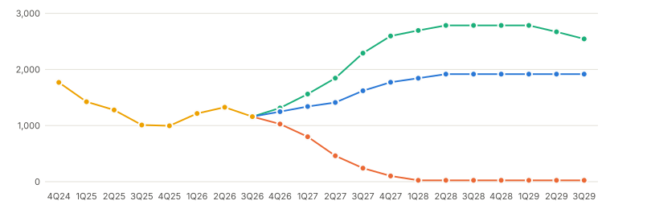

주주 이익 = 영업현금흐름 − 유지보수 투자. 증설 투자는 빼지 않으므로 증설기에도 현금 창출력이 왜곡되지 않는다. 2Q28 무렵 기존 기계장치 상각이 끝나도 이 선은 거의 움직이지 않는다 — 상각 종료는 회계 이익만 올린다.

**④ 현금 경로 — 분기 FCF (억원)**

🟩 낙관 · 🟦 기본 · 🟧 비관 · 🟨 실적

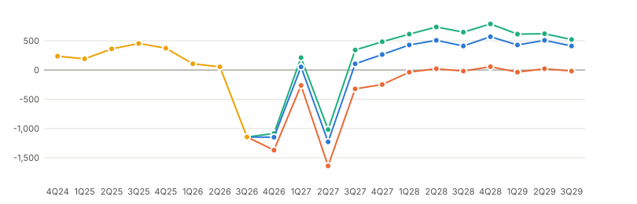

FCF = 영업이익 − 현금 세금 − (설비투자 − 감가상각 + 운전자본 증가). 4Q26·2Q27의 큰 마이너스는 테라다인·어드반테스트 장비 잔금 지급.

- **기본**: 12분기 FCF 합계 1,310억 — 증설 대금(약 4,144억)을 영업현금으로 거의 다 메운다. 순차입금 정점 5,066억.
- **낙관**: FCF 3,477억으로 증설을 메우고도 남는다. 현금 세금이 처음 생긴다(242억 — 세액공제 소진).
- **비관**: FCF -3,855억, 주주 이익도 12분기 합계 289억으로 거의 0. 순차입금 정점 7,439억 — 이 경로에서는 **회계 이익보다 현금(차입 여력)이 먼저 문제**가 된다.
- **회계 이익과 현금의 엇갈림 (모든 시나리오)**: 2Q28 무렵 기존 기계장치 상각이 끝나면 세후 영업이익은 분기 약 227억 뛰지만 주주 이익은 거의 그대로다. 그 시점의 ROE 상승은 회계 효과이므로, 브리핑에서 "이익 ↑ · 현금 그대로"가 나오면 경고가 아니라 예정된 모양으로 읽는다(정상화 도착점 ROE·N이 이 효과를 빼는 장치).

### 컨센서스 비교

<table><thead><tr><th></th><th>3Q26 매출</th><th>3Q26 영업이익</th><th>4Q26 매출</th><th>4Q26 영업이익</th><th>1Q27 매출</th><th>1Q27 영업이익</th><th>비고</th></tr></thead><tbody><tr><td><b>3Q26 실적</b></td><td align="right"><b>734</b></td><td align="right"><b>10</b></td><td align="right">—</td><td align="right">—</td><td align="right">—</td><td align="right">—</td><td align="right">2026-11-13 분기보고서</td></tr><tr><td>FnGuide 컨센서스</td><td align="right">789</td><td align="right">52</td><td align="right">1,004</td><td align="right">166</td><td align="right">1,094</td><td align="right">282</td><td align="right">사용자 제공 화면(2026-11-07)</td></tr><tr><td>메리츠증권(보도 인용)</td><td align="right">770</td><td align="right">33</td><td align="right">—</td><td align="right">—</td><td align="right">—</td><td align="right">—</td><td align="right">3Q26만</td></tr><tr><td>IBK투자증권(2026-11-02, 신규 매수·목표 143,000원)</td><td align="right">740</td><td align="right">22</td><td align="right">1,009</td><td align="right">159</td><td align="right">—</td><td align="right">—</td><td align="right">3Q26·4Q26만 (1Q27 분기 추정 없음)</td></tr><tr><td>④ 낙관</td><td align="right">1,122</td><td align="right">284</td><td align="right">1,122</td><td align="right">240</td><td align="right">1,312</td><td align="right">268</td><td align="right">새 장비 70% 가동</td></tr><tr><td>④ 기본</td><td align="right">1,005</td><td align="right">169</td><td align="right">903</td><td align="right">28</td><td align="right">1,113</td><td align="right">74</td><td align="right">작년 같은 분기 × 생산능력 비율</td></tr><tr><td>④ 비관</td><td align="right">607</td><td align="right">-223</td><td align="right">607</td><td align="right">-261</td><td align="right">607</td><td align="right">-421</td><td align="right">새 장비 놂</td></tr></tbody></table>

연간: iM증권(2026-10-06) 2026E 매출 3,335억·영업이익 338억·순이익 290억, 2027E 4,932억·1,046억·857억. FnGuide 연간 컨센서스: 2026E 3,365억·366억·313억, 2027E 4,932억·1,142억·950억, 2028E 5,544억·1,370억·1,149억. IBK투자증권(2026-11-02): 2026E 3,327억·334억·310억, 2027E 4,938억·1,061억·990억(EPS 5,120원), 2028E 5,470억·1,240억·1,190억. 컨센서스는 비교용이며 계산에는 쓰지 않는다.

**읽은 것 (3Q26 실적 뒤)**: 3Q26 실제(매출 734억·영업이익 10억)는 FnGuide(789억·52억), 메리츠(770억·33억), IBK(740억·22억) 모두보다 낮았다 — 매출은 IBK와 거의 같았고, 이익 차이는 감가상각비 증가와 영업레버리지의 역작용이다. 4Q26부터는 컨센서스(4Q26 1,004억·166억, 1Q27 1,094억·282억)가 우리 기본(1,005억·169억, 903억·28억)보다 높고 낙관(1,122억·284억, 1,122억·240억) 쪽에 있다. 즉 **시장(애널리스트)은 4Q26부터 새 장비 물량이 대부분 붙는다는 아이디어를 숫자에 넣고 있다**. 3Q26 이후 컨센서스 갱신은 아직 받지 않았다(요청 자료 1번).

**IBK투자증권 리포트(11/2)와 맞춰 본 것**: ① 일정은 공시와 같다(테라다인 1,909억 4Q26 LPU, 어드반테스트 2,053억 2Q27 CIS, 평택 2공장 2027-11). ② IBK 2027E 매출 4,938억·영업이익 1,061억 vs 우리 2027년(1Q~4Q27) 낙관 5,059억·1,059억, 기본 4,208억·227억. ③ IBK 순이익 990억 vs 우리 낙관 681억 — IBK 표는 설비투자를 2027E 360억으로 넣어 순현금이 되는 반면, 우리는 공시된 대금을 모두 넣어 차입 이자가 붙는다(3Q26에 순차입금 2,320억으로 늘어난 것이 우리 가정 쪽을 지지). ④ IBK 표의 감가상각비 2027E 약 760억은 우리 2,217억보다 훨씬 낮다 — 3Q26 실제 감가상각비 383억(분기)만으로도 연 1,500억이 넘는다. 목표주가 143,000원은 2027E EPS × P/E 27.8배라 배수 기준이 우리와 다르다. 증권사 숫자는 비교용이며 계산에 쓰지 않는다.

### 민감도

<table><thead><tr><th>바꾼 것</th><th>결과</th></tr></thead><tbody><tr><td>비관 가동률 45% → 30%</td><td>3년 뒤 BPS -1,723원 (45%일 때 8,142원)</td></tr><tr><td>기본을 이전 정의(새 장비 물량 0)로</td><td>3년 뒤 BPS 16,820원 (지금 정의 30,343원)</td></tr><tr><td>증설 고정비: 생산능력 비례(분기 약 +109억) → 0 / 2023→2024 한 구간 비례(분기 약 +198억)</td><td>오늘 적정 주가 — 0일 때 낙관 69,096 · 기본 53,338 · 비관 20,050원 / +198억일 때 55,639 · 39,825 · 6,538원 (지금 61,711 · 45,905 · 12,617원) — 가장 큰 불확실성. 4Q26 실적에서 확인</td></tr><tr><td>유지보수 투자율 4.2% → 0% (증설 없던 1Q~3Q25 수준)</td><td>오늘 적정 주가 낙관 65,150 · 기본 49,395 · 비관 16,108원 (4.2%일 때 61,711 · 45,905 · 12,617원)</td></tr><tr><td>새 장비 생산능력 비율 0.42 / 0.61 (낙관)</td><td>분기 매출 1,236억 / 1,367억</td></tr></tbody></table>

## 절대가치 평가 — 시나리오별로 쌓이는 장부가치 (2026-11-07 개정)

이 단계는 주가를 보지 않는다. ④의 드라이버가 만드는 **3년 뒤(④ 마지막 분기, 3Q29 말) BPS와 ROE**를 시나리오별로 구한다. 시나리오의 차이는 모두 여기서 나온다(연결 표의 드라이버 → 이익 → 자기자본). ω·g 같은 추가 가정은 쓰지 않는다.

**시나리오별 BPS 경로 (원) — 실적 + 12분기 추정**

🟩 낙관 · 🟦 기본 · 🟧 비관 · 🟨 실적

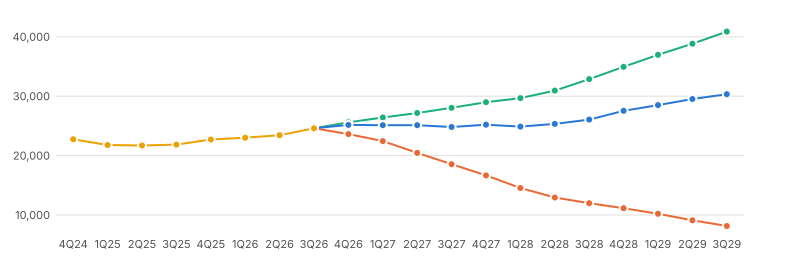

BPS = 자기자본 ÷ 19,245,628주. 비관은 새 장비가 놀며 적자가 쌓여 BPS가 줄고, 낙관·기본은 기존 기계장치 상각이 끝나는 2028년부터 빠르게 쌓인다.

<table><thead><tr><th>시나리오</th><th>3Q26 BPS</th><th>1년 뒤 BPS (3Q27)</th><th>3년 뒤 BPS (3Q29)</th><th>3년 뒤 ROE (TTM, 평균 자본)</th><th>3년 뒤 EPS (TTM)</th><th>ROE로 본 적정 PBR (점검용, 기초 자본 ROE로 계산)</th></tr></thead><tbody><tr><td>낙관</td><td align="right">24,587</td><td align="right">28,046</td><td align="right"><b>40,884</b></td><td align="right">22.2%</td><td align="right">8,171</td><td align="right">2.25배 (기초 ROE 24.9%)</td></tr><tr><td>기본</td><td align="right">24,587</td><td align="right">24,814</td><td align="right"><b>30,343</b></td><td align="right">15.8%</td><td align="right">4,445</td><td align="right">1.48배 (기초 ROE 17.1%)</td></tr><tr><td>비관</td><td align="right">24,587</td><td align="right">18,540</td><td align="right"><b>8,142</b></td><td align="right">-36.6%</td><td align="right">-3,680</td><td align="right">계산 불가 (ROE 마이너스)</td></tr></tbody></table>

`ROE로 본 적정 PBR = (3년 뒤 ROE기초 자본 − 2%) ÷ (Ke − 2%)`, Ke 12.18%. 표의 3년 뒤 ROE는 표시용(평균 자기자본)이고, 적정 PBR은 가치 계산이라 기초 자기자본 ROE로 계산한다(프레임 ROE 분모 규칙). 가격 계산에는 쓰지 않고, 상대가치에서 쓰는 밴드 배수(2.09배)가 그 시나리오의 수익성에 비해 터무니없지 않은지 확인하는 용도다. 낙관·기본은 2.25배·1.48배로 밴드 중앙값과 비슷하거나 높아 밴드 배수가 무리하지 않다. 비관은 2029년에도 놀고 있는 새 장비의 상각(연 약 800억)이 남아 ROE가 마이너스라 계산이 안 된다 — **비관의 밴드 배수는 신뢰가 낮다**(실제로는 시장이 더 낮은 배수를 줄 수 있다).

**마지막 해(4Q28~3Q29)가 안정 상태인가**: 아니다. 증설 투자는 4Q27(공장 완공)에 끝나지만, 새 장비(테라다인·어드반테스트)의 상각이 분기 약 198억 남아 있고(5년 정액, 2031년 무렵 종료), 유지보수 투자분 상각은 아직 다 쌓이지 않았다(분기 약 83억, 장기 수준 155억). 그래서 3Q29 ROE는 장기 수준을 그대로 대표하지 않는다 — 적정 PBR 점검은 그 시점 ROE로 두고, 3년 뒤 이후를 보는 N(상대가치 4번)에서만 정상화한다.

할인율(상대가치의 할인과 기준선에 씀): `Ke = 4.21% + 0.93 × 8.57% = 12.18%`. 국고채 10년 2026년 10월 평균(ECOS, 11월 값 미수신 — 대체값: ±0.5%p면 Ke ±0.5%p), MRP = 한공회 2026 가이던스 8.383% + 회사채 AA− 스프레드 변화 0.187%p(ECOS), k = 1(대체값), β 2년 조정 0.93(상관계수 0.37로 불안정). WACC 10.34%(ROIC 기준선).

## 상대가치 평가 — 장부가치에 시장의 평소 배수를 곱한 주가 (2026-11-16 종가 68,500원)

### 1. 현재 배수

<table><thead><tr><th>배수</th><th>최근 4분기(TTM)</th><th>향후 12개월 컨센서스</th><th>향후 12개월 ④ 기본</th></tr></thead><tbody><tr><td>PBR</td><td>2.79배 (BPS 24,587원, 3Q26)</td><td>확인 안 됨 (3Q26 이후 컨센서스 미수신)</td><td>2.76배</td></tr><tr><td>PER</td><td>24.7배 (조정 순이익 기준 66배 — 세액공제·처분손익 제외)</td><td>확인 안 됨</td><td>177배</td></tr><tr><td>배당수익률</td><td>0.26% (160원)</td><td>0.26% (FnGuide DPS 160원 유지)</td><td>0.26%</td></tr><tr><td>FCF 수익률</td><td>-4.6% (최근 4분기 FCF -611억 — 증설 대금)</td><td>—</td><td>-17%</td></tr></tbody></table>

### 2. 자기 과거 PBR 밴드

**두산테스나 PBR 추이와 밴드 (2021-12 ~ 2026-11-16, 주간)**

■ PBR (주간, 왼쪽 축) · ■ 밴드 중앙값 2.09배 (적정 주가에 쓰는 배수) · ■ 하위~상위 25% (1.65~2.77배) · ■ ROE (TTM, 평균 자본, 오른쪽 축)

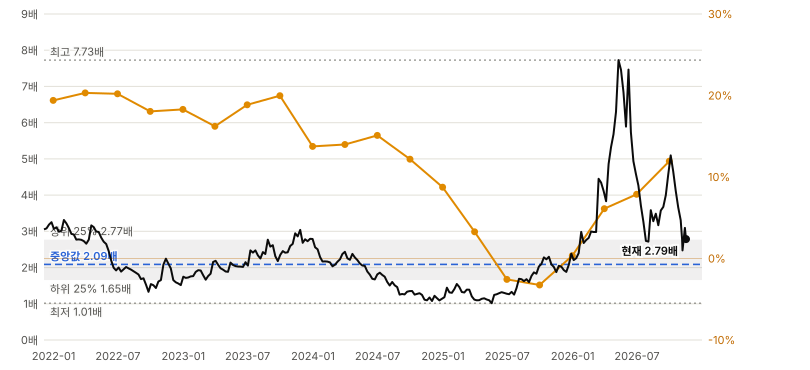

출처: 주가 Yahoo(2차 자료, PBR 계산용) · BPS·ROE 두산테스나 분기 재무제표(DART) · 2026E ROE FnGuide 컨센서스

PBR(2021-12 ~ 2026-11-16, 주간 261개 — 2026-10 이후 주는 3Q26 BPS 24,587원으로 다시 계산): 최저 1.01 · 하위 25% 1.65 · **중앙값 2.09** · 평균 2.36 · 상위 25% 2.77 · 최고 7.73배(2026-05-10 주). 현재 2.79배는 역사적 상위 24%. 2026년 2~5월 PBR 4.3~7.7배는 4월 28일 테라다인 장비 공시를 증권사들이 북미 고객 LPU 외주 테스트로 해석하며 생긴 기대 구간이다(당시 교보증권 목표주가 190,000원 = 2027년 EPS 4,739원 × 글로벌 OSAT P/E 상단 40배 — 사용자 제공 리포트). 그 뒤 주가는 고점 대비 크게 내렸다(현재 68,500원).

### 3. 시나리오별 적정 주가

`오늘 적정 주가 = 3Q29 BPS × 밴드 중앙값 2.09배 ÷ (1 + Ke)2.874 + 배당 160원 × 3회의 현재가치(409원)`   `연 기대수익률 = ((3Q29 BPS × 2.09배 + 배당 480원) ÷ 현재가)1/2.874 − 1`

<table><thead><tr><th>시나리오</th><th>3년 뒤 BPS</th><th>오늘 적정 주가</th><th>현재가 대비</th><th>연 기대수익률 (Ke 12.2%와 비교)</th><th>현재가가 정당하려면 3년 뒤 PBR</th></tr></thead><tbody><tr><td>낙관</td><td align="right">40,884</td><td align="right"><b>61,711</b></td><td align="right">-10%</td><td align="right"><b>+8.1%</b></td><td align="right">2.32배</td></tr><tr><td>기본</td><td align="right">30,343</td><td align="right"><b>45,905</b></td><td align="right">-33%</td><td align="right"><b>-2.5%</b></td><td align="right">3.12배</td></tr><tr><td>비관</td><td align="right">8,142</td><td align="right"><b>12,617</b></td><td align="right">-82%</td><td align="right"><b>-37.8%</b></td><td align="right">11.64배</td></tr></tbody></table>

**시나리오별 오늘 적정 주가와 배수 범위 (원)**

■ 상자 = 밴드 하위~상위 25% 배수 · ■ 굵은 선 = 중앙값 배수 (오늘 적정 주가) · ■ 수염 = 하위~상위 10% 배수

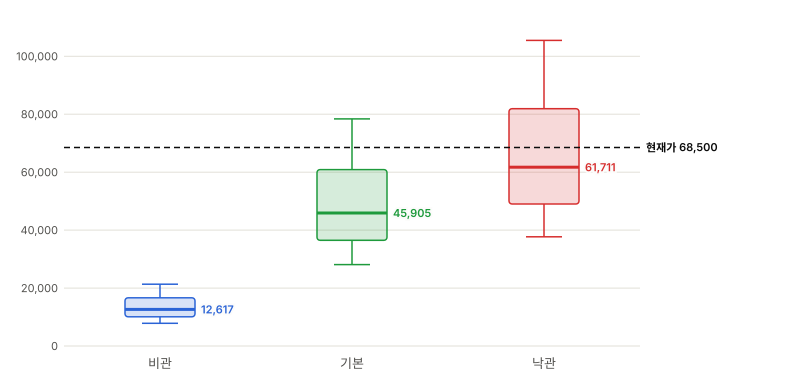

3년 뒤(3Q29) BPS × PBR 배수 ÷ (1 + Ke)^2.87 + 배당 현재가치. 배수는 자기 PBR 밴드(주간)의 하위 10%·25%·중앙값·상위 25%·10%. 적정 주가는 중앙값 하나만 쓰고, 상자·수염은 "같은 BPS에 시장이 다른 배수를 주면"의 범위다.

#### 손익비와 해석

<table><thead><tr><th></th><th></th></tr></thead><tbody><tr><td>오를 여지 (낙관 오늘 적정가 − 현재가)</td><td align="right">없음 — 낙관 오늘 적정가가 현재가보다 6,789원(−10%) 아래</td></tr><tr><td>내릴 여지 (현재가 − 비관 오늘 적정가)</td><td align="right">55,883원 (−82%)</td></tr><tr><td><b>손익비</b> (바닥 = 비관)</td><td align="right"><b>해당 없음</b> (낙관도 현재가 아래 — 오를 여지 없음)</td></tr><tr><td>기본 대비</td><td align="right">현재가가 기본 오늘 적정가(45,905원)보다 49% 위</td></tr><tr><td>손익비 2:1이 되는 가격</td><td align="right"><b>28,982원</b></td></tr><tr><td>손익비 3:1이 되는 가격</td><td align="right"><b>24,891원</b></td></tr></tbody></table>

> [!NOTE]
> **정리.** 현재가 68,500원은 기본(오늘 적정가 45,905원)보다 49% 위, 낙관(61,711원)보다도 10% 위다. 아이디어가 맞으면 연 8%(Ke 12% 미달), 지금 가동률에 머물면 연 -2%(Ke 12% 미달), 새 장비가 놀면 연 -38%다. 낙관이 실현돼도 오늘 기준으로는 현재가에 못 미쳐 손익비를 계산할 수 없고(내릴 여지 −82%), 2:1이 되는 가격은 28,982원이다. 첫 확인은 3Q26(2026-11-16 기한), 결정적인 확인은 4Q26(테라다인분 매출이 붙는지)이다. 매수·매도 결정은 사용자가 한다.

참고 — 증권사식 12개월 목표주가(1년 뒤 BPS × 중앙값, 할인 안 함): 낙관 58,512 · 기본 51,769 · 비관 38,681원. 1년 뒤(3Q27)는 증설 상각이 막 붙은 바닥 시점이라 3년 뒤 기준보다 낮다.

### 4. 현재 주가에 담긴 시장 기대

"현재가가 정당하려면 3년 뒤 PBR" 열이 시장 기대를 보여준다(밴드 중앙값 2.09배). 68,500원은 **낙관이 실현되면 3년 뒤 PBR 2.32배**(밴드 중앙값~상위 25% 사이), **기본이면 3.12배**(밴드 상위 25%~10% 사이), 비관이면 11.64배(역대 최고보다 높음)를 받아야 정당하다. 즉 현재가는 **낙관을 거의 다 반영한 가격** — 낙관이 실현돼도 밴드 중앙값보다 약간 높은 배수를 받아야 한다.

증권사와의 차이: 교보증권(5/20)의 2027년 추정(매출 5,046억, EPS 4,739원)은 우리 2027년 낙관(매출 5,059억, EPS 약 3,536원)과 비교된다. 목표주가 190,000원의 차이는 이익보다 배수(P/E 40배 ≈ 밴드 최고치)와 시점(할인하지 않은 1년 뒤 가격)에서 나온다. 메리츠(10/13) 목표주가 169,000원, IBK(11/2) 143,000원도 같은 구조다(2차 자료).

> [!NOTE]
> **성장 기대 추적 — 2026-11-08 추가**
>
> **① 현재가가 요구하는 초과수익 지속 기간 N**: **정상화 도착점 ROE**(12분기 마지막 해 ROE에서 기계장치 감가상각을 유지보수 투자 수준으로 바꾼 값 — 생산능력이 일정한 장기 상태에서는 기계장치 투자 = 기계장치 상각이므로, 기존 장비 상각 종료와 새 장비의 증설 직후 상각을 함께 걷어낸다)가 3Q29 이후 몇 년 더 Ke(12.2%)를 넘어야 지금 가격이 정당한지 역산한 값. 남긴 이익은 다시 쌓이고(배당성향 약 2%), N년 뒤 ROE는 Ke로 내려온다고 본다. 정할 숫자가 없는 역산이다.
>
> <table><thead><tr><th>시나리오</th><th>3Q29 ROE (기초 자본)</th><th>정상화 도착점 ROE (기초 자본)</th><th>3년 뒤 BPS</th><th>현재가가 요구하는 N</th><th>(참고) 정상화 안 하면 N</th></tr></thead><tbody><tr><td>낙관</td><td align="right">24.9%</td><td align="right">30.6%</td><td align="right">40,884원</td><td align="right">약 6년 (2035년 무렵까지)</td><td align="right">약 8년</td></tr><tr><td>기본</td><td align="right">17.1%</td><td align="right">24.3%</td><td align="right">30,343원</td><td align="right">약 12년 (2041년 무렵까지)</td><td align="right">약 28년</td></tr><tr><td>비관</td><td align="right">-30.7%</td><td align="right">-15.0%</td><td align="right">8,142원</td><td align="right">초과이익 없음 — 설명 불가</td><td align="right">—</td></tr></tbody></table>
>
> 읽는 법: 68,500원은 낙관이면 ROE 31%가 3Q29 이후 약 6년, 기본이면 ROE 24%가 약 12년 이어진다는 기대다. N은 절대 기준이 아니라 이 회사 자신의 평소 수준과 비교해 읽는다 — 밴드 중앙값 가격(낙관 기준)이 현재가와 거의 같으므로 지금은 "평소 수준의 기대"다. Ke가 낮을수록 N은 짧아진다. 회차마다 N을 쌓아, 실적이 좋아지는데 N이 줄면 실적이 기대를 따라잡는 중, N이 늘면 기대가 앞서가는 중으로 읽는다. 주의: 정상화 ROE는 유지보수 투자율(취득원가의 연 4.2%)에 크게 기댄다. 이 비율은 두 방향으로 틀릴 수 있다 — 6분기 투자의 거의 전부가 어드반테스트 사업 시작 뒤라 증설분이 섞였다면 실제 유지보수는 더 적고(증설 없던 1Q~3Q25는 약 6.5억), 가동률 바닥기(45%)에 놀던 장비가 많았던 점을 생각하면 정상 가동에서는 더 많을 수 있다(4.2%면 장비를 약 24년마다 바꾸는 셈). 매 분기 실적으로 갱신하며, 비율이 오르면 정상화 ROE가 낮아지고 N은 길어진다. 그래서 정상화하지 않은 N을 옆에 함께 둔다.
>
> **② 시나리오 실현도**: 실현도 = (실적 − 비관 경로) ÷ (낙관 경로 − 비관 경로). 0% = 비관, 100% = 낙관. 비교 기준은 그 분기에 대한 직전 투자프레임의 경로다.
>
> <table><thead><tr><th>분기</th><th>실적</th><th>직전 경로 비관 / 기본 / 낙관</th><th>실현도</th><th>읽는 법</th></tr></thead><tbody><tr><td>3Q26 ROIC (최근 4분기)</td><td align="right">3.71%</td><td align="right">2.49% / 5.27% / 6.80%</td><td align="right"><b>28%</b></td><td align="right">기본(실현도 65%)보다 아래 — 사업 숫자의 기준</td></tr><tr><td>3Q26 ROE (최근 4분기)</td><td align="right">11.94%</td><td align="right">5.01% / 8.58% / 10.52%</td><td align="right">126%</td><td align="right">100% 초과는 세액공제(법인세 수익 212억) 때문 — 드라이버와 무관, 변경 제안 사유 아님</td></tr><tr><td>3Q26 매출</td><td align="right">734억</td><td align="right">607 / 824 / 944억</td><td align="right">38%</td><td align="right">참고</td></tr></tbody></table>
>
> 다음 비교 기준(이번 파일의 경로): 4Q26E ROIC 비관 -0.7% / 기본 3.6% / 낙관 4.8%, ROE 4.2% / 10.5% / 12.3%. 1Q27E ROIC -4.1% / 3.3% / 6.8%.

참고: FnGuide 3Q26E 순이익(38억)으로 계산한 ROE 8.0%는 실현도 약 54%(기본 바로 아래)에 해당한다.

## 요청 자료 (우선순위 순)

1. **분기별 매입채무·계약부채(선수금)·재고와 '법인세 납부(환급)' 현금, 1Q23~3Q26** — 현금 추적의 CCC와 실제 납부 세금(지금은 매출채권 일수만, 세금 확인 안 됨). DART 각 분기·반기·사업보고서의 재무상태표(매입채무, 계약부채, 재고자산)와 현금흐름표(법인세의 납부·환급). OpenDART 키가 있으면 앞서 쓴 Colab 코드에서 계정명만 바꿔 받을 수 있다. CSV 첨부.
2. **3Q26 실적 뒤 FnGuide 컨센서스(4Q26~2027 분기·연간)와 증권사 리포트** — ④ 컨센서스 비교 갱신. comp.fnguide.com → 두산테스나(131970) → Consensus 화면 캡처. 지금 표는 3Q26 실적 전 값이다.
3. **증설 3건의 사업별 집행액·남은 대금 지급 조건** — 순차입금 정점 시기. 3Q26 보고서에는 총액·기간만 있다(조달은 시설자금대출 약정 8,400억으로 확인). 회사 IR 문의 또는 사업보고서(3월).
4. **ECOS 2026년 11월 국고채 10년·회사채 AA− 3년·국고채 3년, 그리고 월별 2021.11~2025.09** — Ke의 k 회귀(지금 k = 1 대체값, KOSPI PER·PBR 5년치는 받음). 2025.10~2026.10 13개월은 받아서 현재 Ke 입력값(국고채 10년 4.21%, 스프레드)과 맞는 것을 확인했다. ecos.bok.or.kr → '시장금리(월,분기,년)'에서 기간을 2021/11~2026/10으로 지정해 CSV.
5. **4Q26·1Q27 실적의 인건비·기타 고정비** (3Q26은 새 장비 가동 전이라 측정 못 함) — 테라다인 장비 가동(4Q26)과 어드반테스트 장비 가동(2Q27) 뒤 고정비(감가상각 제외)가 작년 같은 분기보다 얼마나 늘었는지. 지금 넣은 추정(5년 평균 고정비 ÷ 생산능력 20.8%, 새 장비 전부 가동 시 분기 약 +109억)과 비교해 실측값으로 바로 바꾼다. 사업보고서(2027년 3월)의 직원 현황(직원 수·급여 총액)도 함께 본다.
6. **2021~2022년 매출액·직원 수 원문 확인** — 고정비 ÷ 생산능력 5년 평균에 쓴 2021년(2,076억)·2022년(2,777억) 매출은 언론 보도 숫자(2차 자료)이고, 2022년 직원 수 표기(570+100)도 모호하다. DART 2021·2022 사업보고서의 손익계산서와 직원 현황으로 확인한다(제가 먼저 열어 보고, 열리지 않으면 요청드린다). 달라지면 비율과 증설 고정비 민감도를 다시 계산한다.
7. **4Q25~1Q26 기계장치 투자(약 590억)가 어드반테스트 증설분인지 유지보수인지 — 회사 IR 확인** (3Q26 보고서에도 사업별 집행액 없음). 증설분이면 유지보수 투자율이 낮아지고, 남은 어드반테스트 투자(2,053억)와 새 장비 생산능력이 이중으로 잡혀 있는 것이므로 함께 고친다.
8. **건물(공장) 내용연수, 기계장치 취득 연도별 장부금액** — 감가상각 일정. 사업보고서 '유형자산' 주석.

## 숫자 블록 (JSON — 다음 브리핑·투자프레임이 이어 씀)

화면에 보이지 않는 JSON 블록(id="data-block")에 핵심 숫자와 항목 설명(이름·단위·뜻)을 넣었다. 형식 기준은 첫 투자프레임(2026-11-07)이며, 이 파일은 현금 항목을 뒤에 추가해 schema\_version 2로 올렸다.

---

숫자 블록: [data/doosan-tesna-framework-20261116.json](data/doosan-tesna-framework-20261116.json) · 원본은 같은 이름의 HTML(로컬 보관)
