# 삼양식품(003230) — 투자프레임 2026-11-22

작성 2026-11-22 · 분석 기준 **3Q26 분기보고서(2026-11-16 제출)** · 평가 기준일 **2026-11-20 종가 1,233,000원** · 추정 구간 4Q26~3Q29(12분기) · **다음 브리핑 예정일: 2027-02-10**(4Q26 잠정실적 발표 예상일, 회사 일정 미확정 — 발표일이 공시되면 바꿈)  
금액 단위 억원(별도 표시 제외). 가치 계산은 이 회사 과거 PBR 밴드와 자기자본비용(Ke) 기준이며, **매수·매도 결정은 사용자가 합니다.**

> [!NOTE]
> **결론 한눈에**
>
> - **아이디어**: ① Q 사이클 — 중국 자싱공장(2027.01, 11.3억식)이 중국 물량을 맡고 국내 공장 물량을 미국·유럽으로 돌려 같은 생산량으로 매출이 커짐 ② 코스트 다운 — 해외 생산으로 운반비 절감 ③ P 사이클 — 가격 전가로 이익률 확대. 리스크: 환율, 농심.
> - **③ 드라이버 판정(오늘)**: Q 사이클 **지속**(미국 +37%, 유럽 +66% 성장, 중국은 +13%로 둔화 — 중국은 관찰 필요) · 코스트 다운 **관찰 필요**(자싱 가동 전, 숫자는 1Q27 실적에서) · P 사이클 **관찰 필요**(회사가 가격 인상 '검토 중', 일회성 제외 매출총이익률은 2Q 48.1% → 3Q 44.1%로 하락. 판단 시점: 1Q27 원재료 계약 후 2027 상반기).
> - **④ 2027 영업이익**: 비관 7,159억(20.4%) · 기본 8,798억(22.9%) · 낙관 10,294억(25.2%). 증권사 컨센서스(8,724~9,210억)는 **기본 근처** — 시장은 물량(자싱)은 넣었지만 가격 인상에 따른 이익률 확대(아이디어의 P 사이클)는 넣지 않았습니다.
> - **절대가치(3년 뒤, 3Q29 BPS)**: 비관 421,804원 · 기본 467,302원 · 낙관 508,640원 (지금 208,196원). 3년 뒤 ROE 22.5% / 25.7% / 27.5% — 배당성향 10% 정책으로 순현금이 쌓여 ROE가 조금씩 내려가는 경로입니다.
> - **상대가치(2022Q2~ PBR 밴드 중앙값 5.60배 기준)**: 오늘 적정 주가 비관 1,963,319원 · 기본 2,176,741원 · 낙관 2,370,766원. 현재가 1,233,000원는 **비관보다도 37.2% 낮습니다**. 연 기대수익률 +25.9% / +30.5% / +34.5%(Ke 7.07%). 내릴 여지(현재가 − 비관)가 없어 **손익비는 계산되지 않습니다**. **참고: 10년 밴드(중앙값 2.51배)로 보면** 적정 주가 892,661원 / 990,597원 / 1,079,694원, 기대수익률 -4.4% / -0.9% / +2.1%로 모두 현재가 아래입니다. 두 결과는 정반대입니다.
> - **주의 — 이 결론은 "2023년 8월 이후의 높은 배수가 유지된다"는 가정에 기댑니다**: 2022Q2~ 밴드 244주 중 저배수(1.7~2배대) 구간은 2022Q2~2023년 7월 약 70주뿐이고 나머지는 모두 고배수입니다. ROE로 본 적정 PBR(점검용) 기본 5.34배는 이 밴드 중앙값과 같은 범위라 점검은 통과합니다. 그러나 10년 중앙값 2.51배는 그 점검을 통과하지 못합니다(2배 이상 차이). **재검토 조건: 영업이익률이 20% 아래로 내려가면 이 가정을 다시 봅니다.** 판단의 핵심 쟁점은 여전히 "어느 기간의 배수를 믿을지"입니다.
> - **시장 기대**: 지금 가격이 정당하려면 3년 뒤 PBR이 기본 3.14배(2022Q2~ 밴드 하위 43% 위치, 10년 밴드로는 하위 67%), 또는 정상화 ROE 30.6%가 3Q29 이후 **6.0년 더** 이어져야 합니다.

## 이전 버전 대비 변경 사항

**첫 투자프레임 파일입니다 — 이전 버전 없음.** A(정해진 갱신): 해당 없음.

<table><tr><th>B. 판단 변경</th><th>이전</th><th>변경</th><th>이유</th><th>날짜</th></tr> <tr><td>상대가치 PBR 밴드 기간</td><td>최근 10년(2016-11~, 523주, 중앙값 2.51배)</td><td>2022Q2~(2022-04-01~, 244주, 중앙값 5.60배). 10년 결과는 참고 행으로 병기</td><td>① 2022년 증설 투자 시기부터는 2027년 자싱 가동을 앞둔 지금과 같은 증설 국면 ② ROE로 본 적정 PBR(4.5~6.2배)이 이 밴드 중앙값과 같은 범위라 교차 점검 통과(10년 중앙값은 점검 실패) ③ 시작일을 2022년 안에서 옮겨도 중앙값 안정. <b>한계</b>: 기간이 약 4.7년으로 프레임 10년 규칙 이탈, 결과를 본 뒤 정한 기준이라 사후 합리화 가능성(결과: 10년 −4~+2% → 이 밴드 +26~+35%), 고배수 체제 유지 가정에 기댐</td><td>2026-11-22 (같은 날짜 파일 재생성)</td></tr> <tr><td>낙관 시나리오 해외 가격 인상</td><td>+10%</td><td>+7% (기본 +3% 유지, 비관 0%)</td><td>① 2025.10 미국 공급가 약 9~10% 인상이 기준 매출에 이미 들어 있어 +10%는 같은 규모의 두 번째 인상 ② 원재료 +5%를 상쇄하는 원가 중립선은 +2.3% ③ 2025년 평균 단가 상승률 +7.5%(환율·믹스 포함) 수준. 낙관 2027 영업이익 11,046억 → 10,294억(FnGuide 연간 컨센서스 8,868억 대비 +25% → +16%)</td><td>2026-11-22</td></tr> <tr><td>낙관 시나리오 자싱 가동률</td><td>2029년 105%, 1Q28 85%(3교대 전)</td><td>2029년 100%, 1Q28 73%(2교대 한도)</td><td>기존 공장 분기 최고 가동률이 101.4%(2Q26)라 105% 유지는 과도. 1Q28 85%는 3교대 시작(2Q28) 전 2교대 한도 73%를 넘는 내부 불일치(<b>오류 정정</b>). 두 수정 모두 낙관 3년 뒤 BPS를 535,922원 → 508,640원으로 낮춤(가격 수정 포함 합계)</td><td>2026-11-22</td></tr></table>

**1단계(①②) 요약 — 2026-11-22 진행중 파일에서 옮김**

①

**"불닭" 하나로 3년 만에(최근 4분기 합계 기준) 매출 2.6배, 영업이익 5.3배.**

최근 4분기 매출 2조 9,142억, 영업이익 6,887억(이익률 23.6%), 지배순이익 4,672억. 3Q26 단일 분기는 매출 7,918억(+25%), 영업이익 1,962억(+50%)으로 사상 최대였지만, 원화 강세에 따른 외화 손실(기타비용 776억)로 순이익은 892억(−19%)에 그쳤습니다.

②

**ROIC 16% → 37%, ROE 20% → 35%(3년).**

자본비용(Ke 7.1%, WACC 6.8%)의 5배 수준입니다. 다만

**2024년 4분기 이후 ROIC는 33~37%에서 옆으로 가고 있습니다**

— 개선의 '속도'가 멈췄다는 것이 이 회사의 과거 대비 가장 중요한 변화입니다.

③

**이익이 오른 원천은 '단가(믹스)'와 '물량'이 함께.**

변동비율이 61% → 51%(최근 4분기 합계, 3Q26 단일 분기 48%)로 10%p 떨어졌고(해외 고가 판매·가격 인상·직판 마진 흡수), 같은 기간 고정비는 연 2,900억 → 6,600억으로 2.3배 늘었습니다(인건비·광고). 즉 매출이 고정비를 넘어서 얻는 레버리지보다

**"같은 1봉을 더 비싸게 판 효과"**

가 마진을 끌어올렸습니다. 안전여유율은 48%로 1년 넘게 그대로입니다.

④

**현금: 밀양2공장 투자기(2025년)에 FCF가 −1,500억대까지 갔다가, 투자가 끝나자 최근 4분기 +3,567억으로 회복.**

순차입 2,494억(2Q25) → 순현금 1,223억(3Q26). 12분기 증분 ROIC 52%, 재투자율 92% — 번 돈을 거의 다 다시 공장에 넣었고, 그 투자가 높은 수익을 냈습니다.

⑤

**공급이 수요를 못 따라가는 회사입니다.**

국내 3개 공장 가동률 96~101%(2026), 생산능력 연 28억식. 다음 물량 계단은

**중국 자싱공장(2027년 1월, 2,072억, 8라인)**

과

**베트남 공장(2029년 1월, 2,186억)**

입니다.

⑥

**주주환원은 "배당성향 9~11%, 투자 우선"**

이 공시된 정책입니다. 2025년 11월에는 자기주식 74,887주(약 1,000억)를 오히려 팔아 투자 재원으로 썼습니다. 이익에 맞춰 돌려주는 비율 자체는 낮습니다.

⑦ 주주 성과: TSR 3년 +479%(연 80%), 5년 +1,450%. 그러나

**최근 1년 −10%(같은 기간 KOSPI +26%)**

— 사업 성과(ROIC 37% 유지)와 주주 성과가 벌어지고 있습니다.

## 0. 밸류체인 지도 — 돈이 어디서 들어와 어디로 흐르나

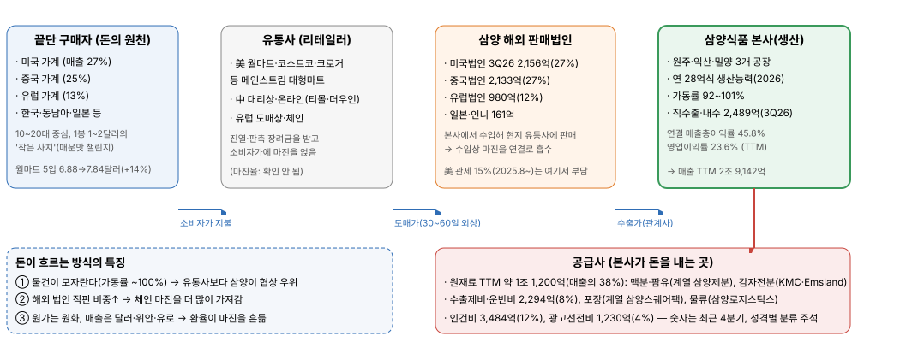

**그림 읽는 법.** 삼양식품의 돈은 결국 **전 세계 10~20대 소비자가 매운 라면 한 봉지에 1~2달러를 쓰는 데서** 나옵니다. 그 돈이 월마트·코스트코 같은 유통사 → 삼양의 해외 판매법인 → 한국 본사(공장)로 거슬러 올라옵니다. 판매 법인 소재지 기준으로 3Q26 매출 7,918억 중 미국법인 2,156억(27%), 중국법인 2,133억(27%), 유럽법인 980억(12%), 한국(본사의 국내 판매 + 본사가 직접 수출하는 물량) 2,489억(31%)입니다(영업부문 주석).

**체인 안에서 삼양의 위치가 강한 이유**는 세 가지입니다.

- **물건이 모자랍니다.** 공장 가동률이 2026년 내내 92~101%입니다. 유통사 입장에서는 '팔면 나가는' 상품을 받아야 하므로, 가격·결제 조건 협상에서 삼양이 유리합니다. 2025년 10월 미국 관세(15%)를 공급가 9~10% 인상으로 넘겼고, 월마트는 소비자가를 14% 올렸는데도(6.88→7.84달러, 5입) 판매가 이어졌습니다(언론 보도, 2차 자료).
- **해외 판매법인을 직접 운영합니다.** 판매법인이 수입·유통을 직접 하면 중간 수입상이 가져가던 마진이 연결 매출·이익으로 들어옵니다. 해외 판매법인 매출은 3Q23 1,378억 → 3Q26 5,430억(분기)으로 3.9배가 되었고, 본사(한국) 매출은 1,974억 → 2,489억으로 1.3배에 그쳤습니다. 회사 이익률이 오른 이유 중 하나입니다.
- **원가는 원화, 매출은 외화입니다.** 원재료(밀가루·팜유·감자전분)와 공장·인력은 한국에 있고, 매출의 83%는 달러·위안·유로로 들어옵니다. 원화가 약하면 마진이 커지고 강하면 줄어듭니다(아래 0-1 참고).

**본사가 돈을 내는 곳(공급사)**: 최근 4분기 기준 원재료·상품 사용 약 1조 1,200억(매출의 38%), 수출제비·운반비 2,294억(8%), 인건비 3,484억(12%), 광고선전비 1,230억(4%)입니다(비용의 성격별 분류 주석). 맥분·팜유는 계열사 삼양제분에서, 포장재는 삼양스퀘어팩, 물류는 삼양로지스틱스에서 사므로 체인의 일부가 그룹 안에 있습니다. 원재료 단가는 맥분 782 → 742 → 677원/kg(2024 → 2025 → 3Q26)으로 내려왔고, 팜유는 1,543 → 1,776 → 1,886원/kg으로 올랐습니다(사업의 내용 '원재료').

유통사의 마진율과 결제 조건(외상 기간)은 공시되지 않아 '확인 안 됨'입니다. 매출채권 회전일수(23~30일)로 보면 평균 한 달 안에 대금을 받습니다.

## 0-1. 유동성 점검 — 끝단 구매자의 지갑

삼양의 끝단 구매자는 기업이 아니라 **가계(소비자)**입니다. 그래서 '하이퍼스케일러의 CapEx' 대신 **미국·중국·유럽 소비자의 지출 여력**, 그리고 그 지출이 원화로 바뀔 때의 **환율**을 봅니다. 라면은 한 봉지 1~2달러의 필수 소비재에 가깝고, 불닭은 그중 '작은 사치' 성격이 강해 소득 충격에 상대적으로 덜 민감한 편입니다(다만 이것은 아직 불황기 데이터로 검증된 적이 없는 가설입니다).

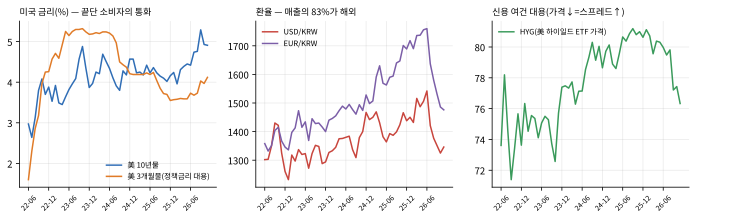

<table><tr><th>항목</th><th>지금 상태 (2026-11)</th><th>의미</th></tr> <tr><td>미국 금리 (미국 소비자의 통화)</td><td>10년물 4.91%(11월), 2월 3.96%에서 1%p 가까이 상승, 11/10 장중 5% 돌파. 3개월물 4.12%(6월 3.73%) — 연준은 10월 동결</td><td>미국 가계의 카드·자동차·주택 금리 부담이 커지는 방향. 저소득층부터 압박</td></tr> <tr><td>미국 소비</td><td>10월 소매판매 +0.2%(9월 +0.8%), 월마트 3Q(FY27) 매출 +5.2%, 연간 전망 3번째 상향 — "가치 추구 소비, 저소득층 압박"</td><td>아직 꺾이지 않음. 월마트는 삼양의 핵심 채널이라 같은 방향</td></tr> <tr><td>중국 소비</td><td>10월 소매판매 +0.4%(예상 0.8%), 1~10월 +1.0%. 단 편의점 +5.1%, 슈퍼 +3.5%(1~10월)</td><td>전체 소비는 약하지만 삼양의 채널(편의점·온라인)은 상대적으로 양호</td></tr> <tr><td>신용 여건</td><td>미국 하이일드 ETF(HYG) 가격 81.1(1월) → 76.3(11월) — 스프레드가 넓어지는 쪽</td><td>위험 회피가 조금씩 커지는 신호. 소비 둔화의 선행 신호로 계속 확인</td></tr> <tr><td>환율 (매출 83%가 외화)</td><td>USD/KRW 1,542(6월 고점) → 1,346(11월, −13%), EUR/KRW 1,760 → 1,476(−16%)</td><td><b>2024~26년 상반기 원화 약세가 마진을 밀어 올렸는데, 하반기부터 반대로 작동.</b> 3Q26 외화 관련 손실 약 681억(그중 평가손실 약 400억, 언론 보도)</td></tr> <tr><td>한국 금리·삼양의 조달 (삼양의 통화)</td><td>기준금리 3.00%(2026년 7·8월 각 +0.25%p 인상 후 10월 동결), 국고채 10년 4.21%(10월 평균). 삼양 신용등급 A0 → AA−, 2026년 4월 회사채 2,000억 발행(3.888%)</td><td>순현금 상태라 금리 상승은 오히려 이자수익을 늘림. 조달 부담 낮음</td></tr> </table>

**유동성 결론.**

끝단 소비는 '둔화 조짐은 있으나 꺾이지 않음'입니다. 이 회사에 더 직접적인 변수는

**환율**

입니다. 원화가 강해지는 지금은 같은 물량을 팔아도 원화 매출·마진이 줄어드는 국면이므로, 3Q26의 영업이익률 24.8%에는 관세 환급 약 200억(언론 보도, 제외 시 22.3%)이 들어 있다는 점과 함께 2단계에서 꼭 따져봐야 합니다. 한국 CDS·회사채 스프레드의 11월 값은 확인하지 못했습니다(요청 자료).

## ① 지금까지 만들어온 가치 — 숫자

### 손익

<table><tr><th>분기</th><th>23.1Q</th><th>23.2Q</th><th>23.3Q</th><th>23.4Q</th><th>24.1Q</th><th>24.2Q</th><th>24.3Q</th><th>24.4Q</th><th>25.1Q</th><th>25.2Q</th><th>25.3Q</th><th>25.4Q</th><th>26.1Q</th><th>26.2Q</th><th>26.3Q</th></tr><tr><td>매출</td><td align="right">2,456</td><td align="right">2,854</td><td align="right">3,352</td><td align="right">3,267</td><td align="right">3,858</td><td align="right">4,244</td><td align="right">4,390</td><td align="right">4,789</td><td align="right">5,290</td><td align="right">5,531</td><td align="right">6,320</td><td align="right">6,377</td><td align="right">7,144</td><td align="right">7,703</td><td align="right">7,918</td></tr><tr><td>영업이익</td><td align="right">239</td><td align="right">440</td><td align="right">434</td><td align="right">362</td><td align="right">801</td><td align="right">895</td><td align="right">873</td><td align="right">877</td><td align="right">1,340</td><td align="right">1,201</td><td align="right">1,309</td><td align="right">1,392</td><td align="right">1,771</td><td align="right">1,762</td><td align="right">1,962</td></tr><tr><td>영업이익률</td><td align="right">9.7%</td><td align="right">15.4%</td><td align="right">13.0%</td><td align="right">11.1%</td><td align="right">20.8%</td><td align="right">21.1%</td><td align="right">19.9%</td><td align="right">18.3%</td><td align="right">25.3%</td><td align="right">21.7%</td><td align="right">20.7%</td><td align="right">21.8%</td><td align="right">24.8%</td><td align="right">22.9%</td><td align="right">24.8%</td></tr><tr><td>기타수익−기타비용(주로 외환)</td><td align="right">35</td><td align="right">-8</td><td align="right">40</td><td align="right">30</td><td align="right">60</td><td align="right">60</td><td align="right">-103</td><td align="right">237</td><td align="right">10</td><td align="right">-209</td><td align="right">102</td><td align="right">54</td><td align="right">251</td><td align="right">83</td><td align="right">-694</td></tr><tr><td>금융수익−금융원가</td><td align="right">-15</td><td align="right">-16</td><td align="right">-18</td><td align="right">-16</td><td align="right">-20</td><td align="right">-33</td><td align="right">25</td><td align="right">-157</td><td align="right">-0</td><td align="right">30</td><td align="right">-32</td><td align="right">-56</td><td align="right">-12</td><td align="right">-23</td><td align="right">5</td></tr><tr><td>지배순이익</td><td align="right">223</td><td align="right">348</td><td align="right">378</td><td align="right">313</td><td align="right">665</td><td align="right">705</td><td align="right">589</td><td align="right">761</td><td align="right">991</td><td align="right">845</td><td align="right">1,102</td><td align="right">956</td><td align="right">1,446</td><td align="right">1,372</td><td align="right">898</td></tr><tr><td>유효세율</td><td align="right">13.5%</td><td align="right">18.1%</td><td align="right">17.4%</td><td align="right">25.2%</td><td align="right">21.0%</td><td align="right">23.8%</td><td align="right">26.1%</td><td align="right">20.9%</td><td align="right">26.7%</td><td align="right">19.8%</td><td align="right">20.3%</td><td align="right">31.2%</td><td align="right">28.2%</td><td align="right">24.6%</td><td align="right">29.9%</td></tr></table>

**무슨 일이 있었나.** 2023년 1분기까지 분기 매출 2,000억대, 영업이익률 10% 안팎의 평범한 라면 회사였습니다. 2023년 하반기부터 불닭이 미국·중국에서 퍼지기 시작했고, 2024년 2분기 미국 SNS 바이럴과 함께 매출이 분기 4,000억대로 뛰었습니다. 2025년 6월 밀양2공장이 가동되자 다시 한 계단(분기 6,000억대) 올라갔고, 2026년 3분기 7,918억입니다. 영업이익률은 12% → 20%(2024Q4) → 23~25%로 올라왔습니다.

**3Q26에서 볼 점 세 가지**: (1) 영업이익 1,962억에는 미국 관세 환급 약 200억이 들어 있습니다(언론 보도, 회사 IR 기준). 이것을 빼면 이익률 22.3%로 2Q26(22.9%)과 비슷합니다. (2) 기타비용 776억 — 원화 강세로 외화 자산을 원화로 바꿀 때 생긴 손실입니다(외화 관련 손실 약 681억, 그중 평가손실 약 400억, 언론 보도). (3) 종업원급여가 1,015억으로 1년 전(669억)보다 52% 늘었습니다(성과급·인력 증가 추정 — 원인 확인 안 됨).

### 현금흐름 — 이익은 계속 늘었는데, 현금은 '투자 → 회수'의 파도를 탔습니다

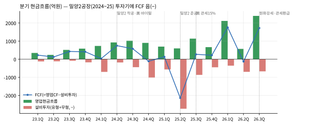

<table><tr><th>분기</th><th>23.1Q</th><th>23.2Q</th><th>23.3Q</th><th>23.4Q</th><th>24.1Q</th><th>24.2Q</th><th>24.3Q</th><th>24.4Q</th><th>25.1Q</th><th>25.2Q</th><th>25.3Q</th><th>25.4Q</th><th>26.1Q</th><th>26.2Q</th><th>26.3Q</th></tr><tr><td>영업현금흐름</td><td align="right">345</td><td align="right">239</td><td align="right">514</td><td align="right">583</td><td align="right">732</td><td align="right">927</td><td align="right">1,018</td><td align="right">901</td><td align="right">696</td><td align="right">596</td><td align="right">1,135</td><td align="right">666</td><td align="right">2,113</td><td align="right">569</td><td align="right">2,392</td></tr><tr><td>  법인세 납부</td><td align="right">-170</td><td align="right">-0</td><td align="right">-103</td><td align="right">-7</td><td align="right">-228</td><td align="right">-21</td><td align="right">-190</td><td align="right">-13</td><td align="right">-312</td><td align="right">-385</td><td align="right">-390</td><td align="right">-36</td><td align="right">-380</td><td align="right">-694</td><td align="right">-582</td></tr><tr><td>설비투자(유형)</td><td align="right">-111</td><td align="right">-117</td><td align="right">-79</td><td align="right">-142</td><td align="right">-699</td><td align="right">-171</td><td align="right">-429</td><td align="right">-986</td><td align="right">-516</td><td align="right">-2,733</td><td align="right">-827</td><td align="right">-414</td><td align="right">-344</td><td align="right">-689</td><td align="right">-656</td></tr><tr><td>무형자산 취득</td><td align="right">-10</td><td align="right">2</td><td align="right">-7</td><td align="right">-30</td><td align="right">-2</td><td align="right">-8</td><td align="right">-12</td><td align="right">-27</td><td align="right">-49</td><td align="right">-3</td><td align="right">-40</td><td align="right">-33</td><td align="right">-13</td><td align="right">-8</td><td align="right">-15</td></tr><tr><td>FCF(영업CF−유형−무형)</td><td align="right">224</td><td align="right">124</td><td align="right">428</td><td align="right">411</td><td align="right">31</td><td align="right">748</td><td align="right">577</td><td align="right">-112</td><td align="right">131</td><td align="right">-2,140</td><td align="right">269</td><td align="right">219</td><td align="right">1,756</td><td align="right">-128</td><td align="right">1,720</td></tr><tr><td>리스부채 상환</td><td align="right">-9</td><td align="right">-9</td><td align="right">-9</td><td align="right">-18</td><td align="right">-17</td><td align="right">-23</td><td align="right">-34</td><td align="right">-2</td><td align="right">-42</td><td align="right">-44</td><td align="right">-47</td><td align="right">-52</td><td align="right">-64</td><td align="right">-69</td><td align="right">-66</td></tr><tr><td>배당 지급</td><td align="right">0</td><td align="right">-45</td><td align="right">-75</td><td align="right">0</td><td align="right">0</td><td align="right">-82</td><td align="right">-112</td><td align="right">0</td><td align="right">0</td><td align="right">-134</td><td align="right">-164</td><td align="right">0</td><td align="right">0</td><td align="right">-196</td><td align="right">-241</td></tr><tr><td>자기주식(취득−/처분+)</td><td align="right">0</td><td align="right">0</td><td align="right">-68</td><td align="right">0</td><td align="right">0</td><td align="right">0</td><td align="right">0</td><td align="right">0</td><td align="right">0</td><td align="right">0</td><td align="right">0</td><td align="right">991</td><td align="right">0</td><td align="right">0</td><td align="right">0</td></tr></table>

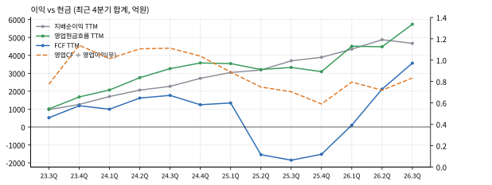

<table><tr><th>TTM</th><th>23.3Q</th><th>23.4Q</th><th>24.1Q</th><th>24.2Q</th><th>24.3Q</th><th>24.4Q</th><th>25.1Q</th><th>25.2Q</th><th>25.3Q</th><th>25.4Q</th><th>26.1Q</th><th>26.2Q</th><th>26.3Q</th></tr><tr><td>매출</td><td align="right">11,062</td><td align="right">11,929</td><td align="right">13,331</td><td align="right">14,722</td><td align="right">15,759</td><td align="right">17,280</td><td align="right">18,713</td><td align="right">19,999</td><td align="right">21,930</td><td align="right">23,518</td><td align="right">25,372</td><td align="right">27,544</td><td align="right">29,142</td></tr><tr><td>영업이익</td><td align="right">1,306</td><td align="right">1,475</td><td align="right">2,038</td><td align="right">2,492</td><td align="right">2,931</td><td align="right">3,446</td><td align="right">3,984</td><td align="right">4,291</td><td align="right">4,726</td><td align="right">5,242</td><td align="right">5,673</td><td align="right">6,234</td><td align="right">6,887</td></tr><tr><td>지배순이익</td><td align="right">972</td><td align="right">1,263</td><td align="right">1,704</td><td align="right">2,061</td><td align="right">2,272</td><td align="right">2,720</td><td align="right">3,046</td><td align="right">3,186</td><td align="right">3,699</td><td align="right">3,894</td><td align="right">4,349</td><td align="right">4,876</td><td align="right">4,672</td></tr><tr><td>영업현금흐름</td><td align="right">1,011</td><td align="right">1,681</td><td align="right">2,068</td><td align="right">2,756</td><td align="right">3,261</td><td align="right">3,579</td><td align="right">3,542</td><td align="right">3,212</td><td align="right">3,329</td><td align="right">3,093</td><td align="right">4,511</td><td align="right">4,484</td><td align="right">5,740</td></tr><tr><td>설비투자(유형+무형)</td><td align="right">492</td><td align="right">494</td><td align="right">1,074</td><td align="right">1,137</td><td align="right">1,493</td><td align="right">2,334</td><td align="right">2,198</td><td align="right">4,755</td><td align="right">5,180</td><td align="right">4,614</td><td align="right">4,406</td><td align="right">2,368</td><td align="right">2,172</td></tr><tr><td>FCF</td><td align="right">519</td><td align="right">1,187</td><td align="right">994</td><td align="right">1,618</td><td align="right">1,768</td><td align="right">1,245</td><td align="right">1,344</td><td align="right">-1,543</td><td align="right">-1,851</td><td align="right">-1,521</td><td align="right">105</td><td align="right">2,116</td><td align="right">3,567</td></tr><tr><td>FCF ÷ 지배순이익</td><td align="right">0.53</td><td align="right">0.94</td><td align="right">0.58</td><td align="right">0.79</td><td align="right">0.78</td><td align="right">0.46</td><td align="right">0.44</td><td align="right">-0.48</td><td align="right">-0.50</td><td align="right">-0.39</td><td align="right">0.02</td><td align="right">0.43</td><td align="right">0.76</td></tr><tr><td>영업CF ÷ 영업이익</td><td align="right">0.77</td><td align="right">1.14</td><td align="right">1.01</td><td align="right">1.11</td><td align="right">1.11</td><td align="right">1.04</td><td align="right">0.89</td><td align="right">0.75</td><td align="right">0.70</td><td align="right">0.59</td><td align="right">0.80</td><td align="right">0.72</td><td align="right">0.83</td></tr></table>

**읽는 법.** 2024년까지는 이익과 현금이 같이 움직였습니다(영업CF가 영업이익보다 많음). 2025년에는 **밀양2공장(1,838억)과 토지·건물 취득으로 설비투자가 연 4,600억까지** 늘어 FCF가 −1,500억대로 떨어졌고, 법인세 납부가 1,123억으로 늘고(2024년 452억) 재고가 쌓이면서 영업CF ÷ 영업이익도 0.59까지 내려갔습니다. 2026년에는 설비투자가 분기 350~690억으로 줄어 **최근 4분기 FCF 3,567억, 지배순이익의 0.76배**로 회복했습니다.

**현금이 어디에 쓰였나 (12분기 합계, 4Q23~3Q26)**: 영업CF 1조 2,329억을 벌어 설비투자 8,846억(유형+무형), 리스 상환 478억, 배당 929억을 썼습니다. 여기에 차입금·사채 순증 약 3,200억(3,094억 → 6,300억)과 자기주식 매각 991억이 더해져, 현금+단기금융이 2,052억 → 8,230억으로 늘었습니다(중국·베트남 투자 대금으로 보임).

FCF는 '영업CF − 유형자산 취득 − 무형자산 취득'입니다. 리스 상환(최근 4분기 250억)까지 빼면 3,317억입니다. 영업CF는 이자·배당 수취를 포함하지 않는 회사 표시 기준입니다.

### 운전자본

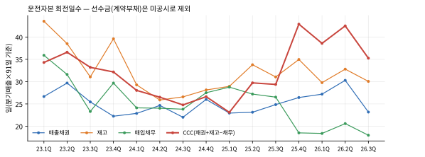

<table><tr><th>분기</th><th>23.1Q</th><th>23.2Q</th><th>23.3Q</th><th>23.4Q</th><th>24.1Q</th><th>24.2Q</th><th>24.3Q</th><th>24.4Q</th><th>25.1Q</th><th>25.2Q</th><th>25.3Q</th><th>25.4Q</th><th>26.1Q</th><th>26.2Q</th><th>26.3Q</th></tr><tr><td>매출채권(억원)</td><td align="right">719</td><td align="right">931</td><td align="right">937</td><td align="right">798</td><td align="right">970</td><td align="right">1,150</td><td align="right">1,062</td><td align="right">1,368</td><td align="right">1,334</td><td align="right">1,406</td><td align="right">1,725</td><td align="right">1,852</td><td align="right">2,134</td><td align="right">2,564</td><td align="right">2,016</td></tr><tr><td>재고자산</td><td align="right">1,175</td><td align="right">1,208</td><td align="right">1,144</td><td align="right">1,422</td><td align="right">1,241</td><td align="right">1,207</td><td align="right">1,282</td><td align="right">1,480</td><td align="right">1,682</td><td align="right">2,053</td><td align="right">2,156</td><td align="right">2,450</td><td align="right">2,337</td><td align="right">2,776</td><td align="right">2,615</td></tr><tr><td>매입채무</td><td align="right">969</td><td align="right">991</td><td align="right">858</td><td align="right">1,065</td><td align="right">1,022</td><td align="right">1,121</td><td align="right">1,149</td><td align="right">1,448</td><td align="right">1,672</td><td align="right">1,653</td><td align="right">1,842</td><td align="right">1,296</td><td align="right">1,442</td><td align="right">1,742</td><td align="right">1,563</td></tr><tr><td>채권일수</td><td align="right">27</td><td align="right">30</td><td align="right">25</td><td align="right">22</td><td align="right">23</td><td align="right">25</td><td align="right">22</td><td align="right">26</td><td align="right">23</td><td align="right">23</td><td align="right">25</td><td align="right">26</td><td align="right">27</td><td align="right">30</td><td align="right">23</td></tr><tr><td>재고일수</td><td align="right">44</td><td align="right">39</td><td align="right">31</td><td align="right">40</td><td align="right">29</td><td align="right">26</td><td align="right">27</td><td align="right">28</td><td align="right">29</td><td align="right">34</td><td align="right">31</td><td align="right">35</td><td align="right">30</td><td align="right">33</td><td align="right">30</td></tr><tr><td>채무일수</td><td align="right">36</td><td align="right">32</td><td align="right">23</td><td align="right">30</td><td align="right">24</td><td align="right">24</td><td align="right">24</td><td align="right">28</td><td align="right">29</td><td align="right">27</td><td align="right">27</td><td align="right">19</td><td align="right">18</td><td align="right">21</td><td align="right">18</td></tr><tr><td>CCC(일)</td><td align="right">34</td><td align="right">37</td><td align="right">33</td><td align="right">32</td><td align="right">28</td><td align="right">27</td><td align="right">25</td><td align="right">27</td><td align="right">23</td><td align="right">30</td><td align="right">29</td><td align="right">43</td><td align="right">39</td><td align="right">43</td><td align="right">35</td></tr></table>

매출채권은 늘 22~30일치로 안정적입니다 — 유통사가 대금을 제때 줍니다. 재고는 26~44일치. 눈에 띄는 변화는 **매입채무 일수가 27일(3Q25) → 18일(3Q26)로 줄어든 것**입니다. 공급사에 더 빨리 돈을 주고 있다는 뜻이고(원인 확인 안 됨: 계열사 거래 조건 변경 또는 원재료 선매입 가능성), 그래서 CCC가 29일 → 35일로 늘었습니다. 계약부채(선수금)는 별도 주석이 없어 제외했습니다.

### 비용 구조 — 고정비·변동비·감가상각비

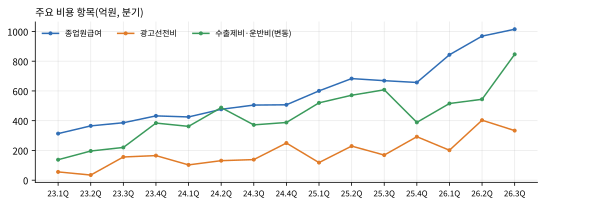

<table><tr><th>분기</th><th>23.1Q</th><th>23.2Q</th><th>23.3Q</th><th>23.4Q</th><th>24.1Q</th><th>24.2Q</th><th>24.3Q</th><th>24.4Q</th><th>25.1Q</th><th>25.2Q</th><th>25.3Q</th><th>25.4Q</th><th>26.1Q</th><th>26.2Q</th><th>26.3Q</th></tr><tr><td>매출</td><td align="right">2,456</td><td align="right">2,854</td><td align="right">3,352</td><td align="right">3,267</td><td align="right">3,858</td><td align="right">4,244</td><td align="right">4,390</td><td align="right">4,789</td><td align="right">5,290</td><td align="right">5,531</td><td align="right">6,320</td><td align="right">6,377</td><td align="right">7,144</td><td align="right">7,703</td><td align="right">7,918</td></tr><tr><td>변동비</td><td align="right">1,610</td><td align="right">1,723</td><td align="right">2,070</td><td align="right">1,848</td><td align="right">2,163</td><td align="right">2,445</td><td align="right">2,475</td><td align="right">2,739</td><td align="right">2,808</td><td align="right">2,908</td><td align="right">3,553</td><td align="right">3,398</td><td align="right">3,714</td><td align="right">3,865</td><td align="right">3,818</td></tr><tr><td>  변동비율</td><td align="right">65.6%</td><td align="right">60.4%</td><td align="right">61.7%</td><td align="right">56.6%</td><td align="right">56.1%</td><td align="right">57.6%</td><td align="right">56.4%</td><td align="right">57.2%</td><td align="right">53.1%</td><td align="right">52.6%</td><td align="right">56.2%</td><td align="right">53.3%</td><td align="right">52.0%</td><td align="right">50.2%</td><td align="right">48.2%</td></tr><tr><td>고정비(감가 제외)</td><td align="right">528</td><td align="right">610</td><td align="right">766</td><td align="right">979</td><td align="right">790</td><td align="right">797</td><td align="right">921</td><td align="right">1,045</td><td align="right">1,005</td><td align="right">1,283</td><td align="right">1,287</td><td align="right">1,397</td><td align="right">1,456</td><td align="right">1,871</td><td align="right">1,922</td></tr><tr><td>  종업원급여</td><td align="right">313</td><td align="right">365</td><td align="right">386</td><td align="right">432</td><td align="right">425</td><td align="right">477</td><td align="right">505</td><td align="right">507</td><td align="right">600</td><td align="right">683</td><td align="right">669</td><td align="right">657</td><td align="right">843</td><td align="right">969</td><td align="right">1,015</td></tr><tr><td>  광고선전비</td><td align="right">56</td><td align="right">34</td><td align="right">156</td><td align="right">165</td><td align="right">103</td><td align="right">131</td><td align="right">138</td><td align="right">250</td><td align="right">118</td><td align="right">229</td><td align="right">169</td><td align="right">292</td><td align="right">201</td><td align="right">403</td><td align="right">333</td></tr><tr><td>감가상각(사용권·무형 포함)</td><td align="right">79</td><td align="right">80</td><td align="right">83</td><td align="right">79</td><td align="right">103</td><td align="right">108</td><td align="right">121</td><td align="right">128</td><td align="right">138</td><td align="right">139</td><td align="right">172</td><td align="right">189</td><td align="right">202</td><td align="right">206</td><td align="right">217</td></tr><tr><td>합계(=매출원가+판관비)</td><td align="right">2,217</td><td align="right">2,413</td><td align="right">2,918</td><td align="right">2,906</td><td align="right">3,056</td><td align="right">3,350</td><td align="right">3,517</td><td align="right">3,912</td><td align="right">3,950</td><td align="right">4,330</td><td align="right">5,011</td><td align="right">4,985</td><td align="right">5,373</td><td align="right">5,941</td><td align="right">5,957</td></tr></table>

**나눈 방법**: '비용의 성격별 분류' 주석(분기 3개월 값; 4분기 = 연간 − 3분기 누적)을 항목별로 나눴습니다. 합계가 손익계산서의 매출원가+판관비와 모든 분기에서 맞습니다(차이 0.1억 이내).

- **감가상각**: 유형·투자부동산·사용권·생물자산 상각 + 무형자산 상각(주석 표시 그대로).
- **고정비**: 종업원급여, 복리후생비, 지급임차료, 광고선전비, 여비교통비, 차량유지비, 수선비, 지급수수료, 세금과공과, 기타비용, 대손상각비. 애매한 항목: 광고선전비(경영 판단으로 정하는 비용이라 고정비로), 지급수수료(판매 수수료가 섞여 있을 수 있음 — 고정비로 넣음), 성과급(종업원급여에 포함, 고정비).
- **변동비**: 나머지 = 원재료·상품 사용(+재고 변동), 수출제비·운반비, 전력비, 연료비, 수도비, 도급비, 소모품비, 위탁용역비.
- 2023년 분기는 소모품비·위탁용역비·세금과공과가 '기타비용'에 묶여 공시되어 고정비가 조금 크게, 변동비가 조금 작게 잡혔습니다. 2024년 이후는 2025년 재분류 기준의 비교 표시값을 썼습니다(2024 연간 원래 공시는 원재료 5,990억/수출제비 3,049억이었으나 재분류 후 7,412억/1,610억 — 합계는 같음).

**회귀 확인**: 15개 분기 (총비용 − 감가)를 매출에 회귀하면 기울기 0.668(t=40.8)로, 분류로 구한 변동비율(48~66%)보다 큽니다. 이유는 **이 기간 내내 증설·인력 확대가 진행되어 고정비가 매출과 같이 늘었기 때문**입니다(밀양2공장 2023.08 공시 → 2025.06 준공, 이어 중국·원주 투자). 프레임 규칙상 증설이 없던 분기만 써야 하는데 그런 분기가 없으므로 회귀는 참고로만 보고, **공시 분류를 씁니다.**

**핵심 관찰**: 변동비율이 **61%(2023Q4 TTM) → 51%(2026Q3 TTM)**로 내려왔습니다. 같은 1봉을 만드는 데 드는 재료·물류비 비중이 줄었다는 것 — 즉 **판매 단가가 원가보다 빨리 올랐다**는 뜻입니다(해외 비중 확대, 직판 법인 마진 흡수, 2025년 10월 미국 가격 인상, 원화 약세, 맥분 단가 하락). 반대로 고정비(감가 제외)는 TTM 2,883억 → 6,646억으로 2.3배가 되었습니다(인건비 1,495 → 3,484억, 광고 411 → 1,230억).

### 손익분기점과 영업레버리지

<table><tr><th>TTM</th><th>23.4Q</th><th>24.1Q</th><th>24.2Q</th><th>24.3Q</th><th>24.4Q</th><th>25.1Q</th><th>25.2Q</th><th>25.3Q</th><th>25.4Q</th><th>26.1Q</th><th>26.2Q</th><th>26.3Q</th></tr><tr><td>매출</td><td align="right">11,929</td><td align="right">13,331</td><td align="right">14,722</td><td align="right">15,759</td><td align="right">17,280</td><td align="right">18,713</td><td align="right">19,999</td><td align="right">21,930</td><td align="right">23,518</td><td align="right">25,372</td><td align="right">27,544</td><td align="right">29,142</td></tr><tr><td>변동비율</td><td align="right">60.8%</td><td align="right">58.5%</td><td align="right">57.9%</td><td align="right">56.7%</td><td align="right">56.8%</td><td align="right">55.9%</td><td align="right">54.6%</td><td align="right">54.8%</td><td align="right">53.9%</td><td align="right">53.5%</td><td align="right">52.8%</td><td align="right">50.8%</td></tr><tr><td>고정비+감가</td><td align="right">3,204</td><td align="right">3,490</td><td align="right">3,704</td><td align="right">3,897</td><td align="right">4,013</td><td align="right">4,262</td><td align="right">4,779</td><td align="right">5,196</td><td align="right">5,609</td><td align="right">6,125</td><td align="right">6,780</td><td align="right">7,460</td></tr><tr><td>손익분기 매출</td><td align="right">8,168</td><td align="right">8,417</td><td align="right">8,801</td><td align="right">8,995</td><td align="right">9,297</td><td align="right">9,672</td><td align="right">10,538</td><td align="right">11,484</td><td align="right">12,157</td><td align="right">13,171</td><td align="right">14,350</td><td align="right">15,153</td></tr><tr><td>안전여유율</td><td align="right">31.5%</td><td align="right">36.9%</td><td align="right">40.2%</td><td align="right">42.9%</td><td align="right">46.2%</td><td align="right">48.3%</td><td align="right">47.3%</td><td align="right">47.6%</td><td align="right">48.3%</td><td align="right">48.1%</td><td align="right">47.9%</td><td align="right">48.0%</td></tr><tr><td>영업레버리지 배수</td><td align="right">3.17</td><td align="right">2.71</td><td align="right">2.49</td><td align="right">2.33</td><td align="right">2.16</td><td align="right">2.07</td><td align="right">2.11</td><td align="right">2.10</td><td align="right">2.07</td><td align="right">2.08</td><td align="right">2.09</td><td align="right">2.08</td></tr></table>

손익분기 매출 = (고정비 + 감가상각비) ÷ (1 − 변동비율) = (6,646 + 814) ÷ (1 − 0.508) = 1조 5,153억

안전여유율 = (매출 − 손익분기 매출) ÷ 매출 = 48.0% · 영업레버리지 배수 = (매출 − 변동비) ÷ 영업이익 = 2.08

**그래서 무슨 뜻인가.** 매출이 손익분기를 크게 넘어선 지 오래라(안전여유율 48%), 매출 1%가 늘면 영업이익은 약 2.1% 늘어나는 정도입니다. 안전여유율이 2025년 1분기 이후 48% 근처에서 **더 오르지 않는 것**은, 매출이 늘어나는 만큼 고정비(인력·광고·새 공장 감가)도 함께 늘리고 있기 때문입니다. 지금 이 회사의 이익 증가는 "고정비를 넘어선 효과"보다 "물량 × 단가" 자체에서 옵니다.

### 설비투자와 기존 자산의 상각 현황 · 주력 영업 자산

<table><tr><th>유형자산 (2025년 말, 억원)</th><th>취득원가</th><th>감가상각누계</th><th>국고보조금</th><th>장부금액</th><th>2025 상각비</th><th>2025 취득</th></tr> <tr><td>토지</td><td align="right">1,729</td><td align="right">–</td><td align="right">–</td><td align="right">1,729</td><td align="right">–</td><td align="right">4</td></tr> <tr><td>건물</td><td align="right">2,673</td><td align="right">−432</td><td align="right">−62</td><td align="right">2,180</td><td align="right">46</td><td align="right">486</td></tr> <tr><td>구축물</td><td align="right">608</td><td align="right">−186</td><td align="right">−7</td><td align="right">415</td><td align="right">21</td><td align="right">57</td></tr> <tr><td><b>기계장치</b></td><td align="right"><b>4,699</b></td><td align="right">−1,386</td><td align="right">−123</td><td align="right"><b>3,183</b></td><td align="right"><b>295</b></td><td align="right">680(+대체 862)</td></tr> <tr><td>건설중인자산</td><td align="right">3,065</td><td align="right">−5</td><td align="right">–</td><td align="right">3,061</td><td align="right">–</td><td align="right">3,113</td></tr> <tr><td>기타(임차시설·차량·비품)</td><td align="right">358</td><td align="right">−199</td><td align="right">–</td><td align="right">159</td><td align="right">36</td><td align="right">43</td></tr> <tr><td><b>합계</b></td><td align="right"><b>13,133</b></td><td align="right">−2,203</td><td align="right">−196</td><td align="right"><b>10,726</b></td><td align="right">397</td><td align="right">4,382</td></tr></table>

출처: 2025 사업보고서 연결 주석 '유형자산'. 2024년 말 기계장치 원가 3,165억·건물 1,791억. 3Q26 말 클래스별 장부금액(사업의 내용): 토지 3,255억(9개월 +1,525억, 토지 취득 — 용도 확인 안 됨), 건물 3,074억, 기계 3,571억, 건설중 1,450억. 사용권자산 655억, 무형자산 664억.

**주력 영업 자산 후보**: 면 생산 **기계장치**(+ 공장 건물). 기계장치의 연 상각률은 약 7.5%(295억 ÷ 평균 원가 3,932억, 약 13년)로, 누계액이 원가의 29%에 불과합니다 — **대부분이 최근 3년 안에 산 새 설비**라 12분기 안에 상각이 끝나는 큰 덩어리는 없습니다. 건설중인자산(3Q26 1,450억)은 중국 자싱공장과 원주 액상스프 공장(780억, 2027.01)이며, 가동 시 기계·건물로 대체되면서 상각이 시작됩니다.

**유지보수 투자율**을 잴 '증설 없는 6개 분기'가 2023년 이후 없습니다(밀양2 → 중국 → 원주 → 베트남이 이어짐). 3Q26 기준 진행 중인 '설비 보완' 투자 5건(총 1,554억, 집행 807억, 2025.04~2027.01)도 성격이 유지보수인지 증설인지 섞여 있습니다. 2단계에서 측정 방법을 정해야 합니다.

### 이자·차입 구조, 세율, 주식 수

<table><tr><th>분기말</th><th>22.4Q</th><th>23.1Q</th><th>23.2Q</th><th>23.3Q</th><th>23.4Q</th><th>24.1Q</th><th>24.2Q</th><th>24.3Q</th><th>24.4Q</th><th>25.1Q</th><th>25.2Q</th><th>25.3Q</th><th>25.4Q</th><th>26.1Q</th><th>26.2Q</th><th>26.3Q</th></tr><tr><td>현금+단기금융</td><td align="right">1,335</td><td align="right">1,549</td><td align="right">1,746</td><td align="right">2,052</td><td align="right">2,410</td><td align="right">2,415</td><td align="right">3,866</td><td align="right">4,235</td><td align="right">3,495</td><td align="right">3,463</td><td align="right">3,110</td><td align="right">3,226</td><td align="right">3,781</td><td align="right">5,472</td><td align="right">7,493</td><td align="right">8,230</td></tr><tr><td>차입금+사채</td><td align="right">2,730</td><td align="right">2,721</td><td align="right">3,114</td><td align="right">3,094</td><td align="right">3,075</td><td align="right">3,074</td><td align="right">3,887</td><td align="right">3,853</td><td align="right">3,128</td><td align="right">2,975</td><td align="right">5,090</td><td align="right">5,073</td><td align="right">4,393</td><td align="right">4,309</td><td align="right">6,018</td><td align="right">6,300</td></tr><tr><td>리스부채</td><td align="right">77</td><td align="right">84</td><td align="right">81</td><td align="right">81</td><td align="right">340</td><td align="right">349</td><td align="right">334</td><td align="right">514</td><td align="right">601</td><td align="right">571</td><td align="right">515</td><td align="right">598</td><td align="right">634</td><td align="right">769</td><td align="right">712</td><td align="right">707</td></tr><tr><td>순차입금</td><td align="right">1,472</td><td align="right">1,257</td><td align="right">1,450</td><td align="right">1,123</td><td align="right">1,005</td><td align="right">1,009</td><td align="right">354</td><td align="right">132</td><td align="right">234</td><td align="right">83</td><td align="right">2,494</td><td align="right">2,445</td><td align="right">1,246</td><td align="right">-394</td><td align="right">-763</td><td align="right">-1,223</td></tr><tr><td>유형자산</td><td align="right">4,753</td><td align="right">4,768</td><td align="right">5,080</td><td align="right">5,097</td><td align="right">5,430</td><td align="right">6,041</td><td align="right">6,276</td><td align="right">6,650</td><td align="right">7,480</td><td align="right">8,072</td><td align="right">10,492</td><td align="right">10,420</td><td align="right">10,726</td><td align="right">11,067</td><td align="right">11,577</td><td align="right">11,949</td></tr><tr><td>지배주주 자본</td><td align="right">4,530</td><td align="right">4,718</td><td align="right">5,060</td><td align="right">5,367</td><td align="right">5,648</td><td align="right">6,238</td><td align="right">6,951</td><td align="right">7,429</td><td align="right">8,168</td><td align="right">9,031</td><td align="right">9,843</td><td align="right">10,809</td><td align="right">12,554</td><td align="right">13,886</td><td align="right">15,308</td><td align="right">15,683</td></tr><tr><td>자산총계</td><td align="right">9,249</td><td align="right">9,478</td><td align="right">10,278</td><td align="right">10,603</td><td align="right">11,703</td><td align="right">12,281</td><td align="right">14,192</td><td align="right">15,166</td><td align="right">15,948</td><td align="right">16,856</td><td align="right">19,330</td><td align="right">20,810</td><td align="right">21,965</td><td align="right">23,871</td><td align="right">27,487</td><td align="right">27,887</td></tr></table>

- **차입**(3Q26): 단기 364억, 유동성 장기 2,153억(산업은행 시설자금 등 1,654억 + 회사채 500억), 장기 3,783억(사채 2,000억 포함), 리스 707억. 회사채 3-1회 900억(3.888%, 2028.04), 3-2회 1,100억(2029.04), 2-2회 500억(4.063%, 2027.04). 차입금 만기(이자 포함, 비할인): 1년 내 2,714억, 1~2년 1,724억, 2년 초과 2,327억. 담보: 밀양공장 토지·건물·기계 등(산업은행 시설자금).
- **실효 차입 금리**: 최근 4분기 금융원가 256억 ÷ 평균 차입(리스 포함) 약 6,340억 = 약 4.0%(금융원가에 외환 관련 일부가 섞여 2024Q4~2025Q1은 8%대로 튀었음 — 그 분기는 해석에 쓰지 않음). 실효 예금 금리: 금융수익 최근 4분기 170억 ÷ 평균 현금·단기금융 약 5,730억 ≈ 3.0%.
- **세율**: 2025 법인세 주석의 '적용세율에 의한 법인세' 1,294억 ÷ 세전이익 5,169억 = **25.0%**(2024년 23.9%). 2026년 법인세율 인상으로 이연법인세 조정 19억이 있었고, 2026년 1~3분기 유효세율은 27.3%입니다. 세액공제는 연 35~55억 수준으로 작고, 큰 이월결손금·미사용 공제는 없습니다 → **수익성은 25.0%**, 현금 세금도 거의 같다고 봅니다(2026년 유효세율이 더 높은 원인 — 해외 법인 세율·세율 인상 — 은 2단계에서 확인).
- **주식 수**: 발행 7,533,015주. 자기주식 74,887주(0.99%)를 2025년 11월 시간외대량매매로 매각(목적: 투자재원 확보·재무건전성), 2026년 11월 구주권 교체분 2주 소각 → 유통 주식 7,533,013주. 전환사채·신주인수권 등 희석 증권 **없음**.

### 확정된 미래 숫자와 장부 리스크

<table><tr><th>항목</th><th>내용</th><th>근거</th></tr> <tr><td>중국 자싱공장</td><td>8라인, 2,072억, <b>2027년 1월 준공 목표</b>. 연 최대 약 11.3억식(현재 국내 28억식의 40%) — 생산량 숫자는 언론·증권사 추정. 전량 중국 내수용, 액상스프는 원주에서 공급</td><td>2024.12 장래사업계획, 2025.11 정정(6→8라인), 사업보고서 투자현황</td></tr> <tr><td>원주 액상스프 공장</td><td>780억, 2027년 1월 준공(설비 보완 투자표의 '2025.09~2027.01, 780.8억')</td><td>3Q26 분기보고서 투자계획</td></tr> <tr><td>베트남 공장</td><td>투언타잉, 8라인 수용 건물 + 건면 1라인 설비 포함 <b>2,186억</b>, 2029년 1월 준공. 법인 출자 1,311억(9,762만 달러). 추가 라인은 '추후 확정'</td><td>2026.11.11 장래사업계획·타법인출자 공시</td></tr> <tr><td>설비 보완 투자</td><td>5건 총 1,554억 중 807억 집행(2025.04~2027.01)</td><td>3Q26 분기보고서</td></tr> <tr><td>수주잔고·장기계약</td><td>없음(소비재). 선수금 별도 공시 없음</td><td>–</td></tr> <tr><td>장부 리스크</td><td>밀양공장 등 담보 제공, 종속회사 차입 지급보증(2025.02·09 채무보증 결정 공시). 큰 소송·충당부채 없음(충당부채 3Q26 173억 — 내역 확인 안 됨)</td><td>우발채무 주석·공시</td></tr></table>

### ROA · ROIC · ROE · TSR

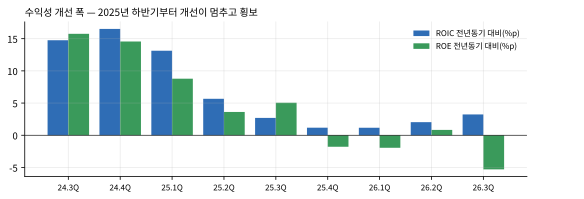

<table><tr><th>TTM</th><th>23.3Q</th><th>23.4Q</th><th>24.1Q</th><th>24.2Q</th><th>24.3Q</th><th>24.4Q</th><th>25.1Q</th><th>25.2Q</th><th>25.3Q</th><th>25.4Q</th><th>26.1Q</th><th>26.2Q</th><th>26.3Q</th></tr><tr><td>ROA</td><td align="right">10.1%</td><td align="right">12.1%</td><td align="right">15.7%</td><td align="right">16.8%</td><td align="right">17.6%</td><td align="right">19.6%</td><td align="right">20.9%</td><td align="right">18.9%</td><td align="right">20.5%</td><td align="right">20.5%</td><td align="right">21.3%</td><td align="right">20.8%</td><td align="right">19.2%</td></tr><tr><td>ROIC</td><td align="right">16.2%</td><td align="right">17.3%</td><td align="right">22.9%</td><td align="right">26.7%</td><td align="right">30.9%</td><td align="right">33.8%</td><td align="right">36.0%</td><td align="right">32.4%</td><td align="right">33.6%</td><td align="right">35.0%</td><td align="right">37.2%</td><td align="right">34.4%</td><td align="right">36.9%</td></tr><tr><td>ROE(평균 지배자본)</td><td align="right">19.8%</td><td align="right">24.8%</td><td align="right">31.1%</td><td align="right">34.3%</td><td align="right">35.5%</td><td align="right">39.4%</td><td align="right">39.9%</td><td align="right">37.9%</td><td align="right">40.6%</td><td align="right">37.6%</td><td align="right">38.0%</td><td align="right">38.8%</td><td align="right">35.3%</td></tr><tr><td>조정 ROE(기초 지배자본)</td><td align="right">23.9%</td><td align="right">26.3%</td><td align="right">34.2%</td><td align="right">37.9%</td><td align="right">41.7%</td><td align="right">44.8%</td><td align="right">46.4%</td><td align="right">46.5%</td><td align="right">48.4%</td><td align="right">48.1%</td><td align="right">46.5%</td><td align="right">45.8%</td><td align="right">45.3%</td></tr><tr><td>TSR 1년</td><td align="right">93.3%</td><td align="right">72.5%</td><td align="right">79.2%</td><td align="right">528.4%</td><td align="right">157.0%</td><td align="right">244.1%</td><td align="right">282.0%</td><td align="right">90.6%</td><td align="right">194.8%</td><td align="right">72.8%</td><td align="right">55.6%</td><td align="right">-12.1%</td><td align="right">-19.6%</td></tr><tr><td>KOSPI 1년</td><td align="right">14.4%</td><td align="right">18.7%</td><td align="right">10.9%</td><td align="right">9.1%</td><td align="right">4.3%</td><td align="right">-8.0%</td><td align="right">-10.3%</td><td align="right">9.1%</td><td align="right">38.1%</td><td align="right">76.5%</td><td align="right">118.1%</td><td align="right">164.8%</td><td align="right">97.4%</td></tr><tr><td>세후 영업이익률</td><td align="right">8.9%</td><td align="right">9.3%</td><td align="right">11.5%</td><td align="right">12.7%</td><td align="right">13.9%</td><td align="right">15.0%</td><td align="right">16.0%</td><td align="right">16.1%</td><td align="right">16.2%</td><td align="right">16.7%</td><td align="right">16.8%</td><td align="right">17.0%</td><td align="right">17.7%</td></tr><tr><td>투하자본 회전율(배)</td><td align="right">1.83</td><td align="right">1.87</td><td align="right">2.00</td><td align="right">2.10</td><td align="right">2.22</td><td align="right">2.26</td><td align="right">2.25</td><td align="right">2.01</td><td align="right">2.08</td><td align="right">2.09</td><td align="right">2.22</td><td align="right">2.03</td><td align="right">2.08</td></tr><tr><td>투하자본(억원)</td><td align="right">6,539</td><td align="right">6,773</td><td align="right">7,366</td><td align="right">7,424</td><td align="right">7,677</td><td align="right">8,515</td><td align="right">9,235</td><td align="right">12,450</td><td align="right">13,412</td><td align="right">13,961</td><td align="right">13,661</td><td align="right">14,720</td><td align="right">14,621</td></tr><tr><td>순차입금(−는 순현금)</td><td align="right">1,123</td><td align="right">1,005</td><td align="right">1,009</td><td align="right">354</td><td align="right">132</td><td align="right">234</td><td align="right">83</td><td align="right">2,494</td><td align="right">2,445</td><td align="right">1,246</td><td align="right">-394</td><td align="right">-763</td><td align="right">-1,223</td></tr><tr><td>ROE−ROIC</td><td align="right">+3.6%p</td><td align="right">+7.5%p</td><td align="right">+8.2%p</td><td align="right">+7.6%p</td><td align="right">+4.6%p</td><td align="right">+5.6%p</td><td align="right">+3.9%p</td><td align="right">+5.6%p</td><td align="right">+6.9%p</td><td align="right">+2.6%p</td><td align="right">+0.8%p</td><td align="right">+4.4%p</td><td align="right">-1.6%p</td></tr><tr><td>  레버리지 효과</td><td align="right">+3.0%p</td><td align="right">+3.4%p</td><td align="right">+4.0%p</td><td align="right">+3.5%p</td><td align="right">+2.7%p</td><td align="right">+2.4%p</td><td align="right">+2.1%p</td><td align="right">+4.8%p</td><td align="right">+4.1%p</td><td align="right">+2.2%p</td><td align="right">-0.5%p</td><td align="right">+2.1%p</td><td align="right">+1.5%p</td></tr><tr><td>  나머지</td><td align="right">+0.6%p</td><td align="right">+4.1%p</td><td align="right">+4.3%p</td><td align="right">+4.1%p</td><td align="right">+1.9%p</td><td align="right">+3.1%p</td><td align="right">+1.8%p</td><td align="right">+0.8%p</td><td align="right">+2.9%p</td><td align="right">+0.4%p</td><td align="right">+1.2%p</td><td align="right">+2.2%p</td><td align="right">-3.1%p</td></tr></table>

**정의**: ROA = 순이익 TTM ÷ 평균 총자산. ROIC = 영업이익 TTM × (1 − 25.0%) ÷ 평균 투하자본(자본총계 + 차입금 + 사채 + 리스 − 현금 − 단기금융). ROE = 지배순이익 TTM ÷ 평균 지배주주 자본(**표시용, 평균 기준**). 조정 ROE = (지배순이익 − (기타수익 − 기타비용) × 0.75) ÷ **4분기 전 지배자본(기초 기준, 가치 계산용)** — 기타수익·비용은 대부분 외환차손익이라 일회성으로 보고 뺐습니다. TSR = 배당 재투자 수정주가 기준.

**할인율(기준선)**: Ke = 4.21% + 0.334 × 8.57% = 7.07% · WACC = 93% × 7.07% + 7% × 4.0% × (1 − 0.25) = 6.79%

- 무위험 금리 4.21% = 국고채 10년 2026년 10월 평균(ECOS 원자료, 2026-11-22 사용자 제공 CSV로 확인 — 11월 월평균은 12월 초 공표 후 갱신). MRP 8.57% = 한공회 2026 가이던스 8.383% + k(=1) × (회사채 AA− 3년 − 국고 3년 스프레드 0.501%p → 0.688%p).
- **β 경고**: KOSPI 대비 주간 2년 원 베타 0.007, **상관계수 0.005**(5년 0.026/0.014). 2025~26년 KOSPI가 반도체 주도로 크게 흔들린 반면 삼양은 자기 실적으로 움직여, 통계적으로 '시장과 무관'하게 나옵니다. 조정 베타 0.334는 추정이 매우 불안정하므로 민감도를 함께 봅니다: β 0.53 → Ke 8.8%, β 0.13 → Ke 5.4%, β 1.0 → Ke 12.8%. 어느 값이든 ROIC·ROE가 기준선을 크게 넘는다는 결론은 같습니다.

**무엇이 보이나.**

1. **개선의 크기**: 3년간 ROIC +21%p(16.2% → 36.9%), ROE +16%p(19.8% → 35.3%). 이 회사 과거 대비 압도적인 개선입니다.
2. **개선의 속도가 멈췄습니다**: ROIC의 전년 동기 대비 개선 폭이 2024년 하반기 +15~17%p → 2025년 2~4분기 +1~6%p → 2026년 1~3분기 +1~3%p. ROE는 2026년에 −5 ~ +1%p로 오히려 전년보다 낮은 분기가 나옵니다. ROIC는 2024Q4 이후 33~37%, 조정 ROE는 46~48% → 45%로 오히려 조금 내려왔습니다. **이익은 계속 30~50% 늘지만, 자본(새 공장·쌓인 현금)도 같은 속도로 늘고 있기 때문**입니다.
3. **ROIC의 원천(분해)**: 세후 영업이익률 8.9% → 17.7%(2배), 투하자본 회전율 1.83 → 2.08배. 개선은 **대부분 마진**에서 왔습니다. 회전율은 2024년 2.26배를 정점으로 밀양2·중국 투자로 2.0~2.2배에서 정체.
4. **ROE와 TSR의 괴리**: ROE 35%가 유지되는데 TSR 1년은 −10%(KOSPI +26%). 2024~25년 TSR(연 수백 %)이 실적보다 먼저 크게 올랐던 것을 생각하면, 지금은 주가가 실적 개선 '속도'의 둔화를 반영하는 구간으로 보입니다(가격 판단은 3단계 이후).

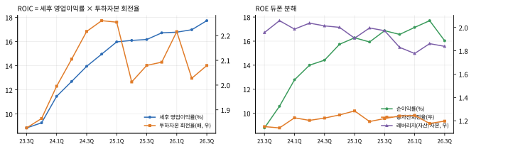

**ROE − ROIC 스프레드**: 2023~25년에는 순차입 상태에서 ROIC(30%대)가 세후 차입비용(3%)보다 훨씬 높아 빚이 ROE를 +2~5%p 올렸습니다. 지금은 순현금(1,223억)이라 레버리지 효과가 거의 없고, 3Q26 외환손실 때문에 ROE가 ROIC보다 1.6%p 낮습니다. **ROE는 '빚'이 아니라 '사업'에서 나온 질 좋은 ROE**입니다. ROIC가 세후 차입비용보다 낮아진 적은 없습니다(반증 신호 해당 없음).

**증분 ROIC와 재투자율 (12분기, 3Q23 → 3Q26)**: 세후 영업이익 +4,186억 ÷ 투하자본 +8,082억 = **증분 ROIC 51.8%**. 재투자율 = (설비투자 8,846억 + 신규 리스 약 1,100억 − 감가 1,801억 + 운전자본 증가 1,844억) ÷ 세후 영업이익 1조 908억 = **92%**. 번 돈 대부분을 다시 투자했고, 그 투자가 기존 ROIC보다 높은 수익을 냈습니다 → '투자 기간'이 아니라 **'고수익 재투자 성장'** 국면. 다만 최근 4분기만 보면(3Q25 → 3Q26) 증분 ROIC가 134%로 튀는데, 이는 밀양2 투자가 이미 끝났고 중국 공장 자본은 아직 이익을 안 낸 시점의 일시적 수치입니다.

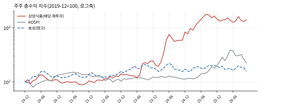

TSR(배당 재투자, Yahoo 수정주가): 1년 −10.3%(KOSPI +26.4%), 3년 +478.7%(연 79.5%, KOSPI +95.1%), 5년 +1,450%(연 73.0%, KOSPI +65.8%). 업종 지수(KOSPI 음식료품) 비교는 자료를 구하지 못해 농심을 참고로만 그렸습니다.

### 현금 체력과 주주환원 실적

<table><tr><th>연도</th><th>지배순이익</th><th>배당 지급(현금흐름표)</th><th>주당배당(원, 중간+결산)</th><th>연결 배당성향(공시)</th><th>자기주식</th></tr> <tr><td>2021</td><td align="right">564</td><td align="right">60</td><td align="right">1,000</td><td align="right">–</td><td align="right">–</td></tr> <tr><td>2022</td><td align="right">798</td><td align="right">135</td><td align="right">1,400 (800+600)</td><td align="right">–</td><td align="right">신탁 매입 68억</td></tr> <tr><td>2023</td><td align="right">1,263</td><td align="right">119</td><td align="right">2,100 (1,000+1,100)</td><td align="right">12.4%</td><td align="right">–</td></tr> <tr><td>2024</td><td align="right">2,720</td><td align="right">194</td><td align="right">3,300 (1,500+1,800)</td><td align="right">9.0%</td><td align="right">–</td></tr> <tr><td>2025</td><td align="right">3,894</td><td align="right">298</td><td align="right">4,800 (2,200+2,600)</td><td align="right">9.2%</td><td align="right"><b>매각 991억</b></td></tr> <tr><td>2026(9M)</td><td align="right">3,716</td><td align="right">437</td><td align="right">중간 3,200</td><td align="right">–</td><td align="right">2주 소각</td></tr></table>

- **공시된 정책**: "안정적인 잉여현금흐름 확보 전까지 연결 배당성향 9~11% 유지, 이후 재검토해 주당배당금 지속 상향", "CAPEX 우선 투자원칙", "현재 자사주 매입·소각 계획 없음"(3Q26 분기보고서 '배당에 관한 사항'). 중간·결산 연 2회.
- **주주환원율(5년, 2021~25)** = (배당 807억 + 자사주 매입 68억) ÷ 지배순이익 9,238억 = **9.5%**. 2025년 자기주식 매각 991억을 빼면(환원의 반대) **−1.3%**입니다.
- **환원 연동성** = 배당 증가율(60 → 298억, +395%) ÷ 순이익 증가율(564 → 3,894억, +591%) = 0.67. 주당배당이 이익과 함께 오르는 **비율(연동)형**이지만, 비율 자체가 낮게 고정되어 있습니다.
- **쌓인 현금의 처리**: ROE가 Ke의 5배인 시기라 '낮은 수익률로 현금을 쌓았다'고 보기는 어렵습니다 — 2025년까지는 번 돈을 거의 다 공장에 넣었습니다. 다만 3Q26 현금+단기금융 8,230억은 중국·베트남 투자 대기 자금으로 보이며, 쓰이기 전까지는 세후 약 2% 수준만 법니다.

## ② 지금까지 가치를 만들어온 구조 — Value Driver

### 비즈니스 모델: 무엇을, 누구에게, 어떻게

<table><tr><th>사업</th><th>2026 1~3분기 매출(비중)</th><th>무엇을</th><th>누구에게 · 어떻게</th><th>현금</th></tr> <tr><td><b>면·스낵</b></td><td>2조 620억 (90.6%) — 수출 1조 8,170억, 내수 2,450억</td><td>불닭볶음면(오리지널·까르보·큰컵 등), 삼양라면, 짱구·사또밥</td><td>해외: 본사 → 해외 판매법인(미·중·유럽·일·인니) → 대형마트·대리상·온라인 / 직수출(로컬 4.5%, 직수출 95.5%). 국내: 특약점·할인점·편의점·쿠팡</td><td><b>현금을 버는 사업</b>. 반복 구매 소비재, 일회성 판매지만 재구매 주기가 짧음</td></tr> <tr><td>소스·조미소재</td><td>768억 (3.4%)</td><td>불닭소스, 벌크 소스·소재</td><td>B2C 51% / B2B 49%, 수출 72%</td><td>성장 중(2024 406억 → 2025 687억)</td></tr> <tr><td>냉동</td><td>549억 (2.4%)</td><td>만두·떡갈비·커틀릿</td><td>케이터링 50%, 특약점 29%, 온라인 12%</td><td>소규모</td></tr> <tr><td>물류 등 용역</td><td>635억 (2.8%)</td><td>삼양로지스틱스 물류, 후레이크 선별</td><td>그룹 외부 물류 고객</td><td>저마진</td></tr> <tr><td>기타</td><td>243억 (1.1%)</td><td>뉴트리션·축산·관광·임대</td><td>–</td><td>–</td></tr></table>

**돈을 언제 받나**: 선수금 구조가 아니라 납품 후 약 한 달 안에 받는 일반 외상 구조(매출채권 23~30일). 장기 계약·구독은 없고, 매 분기 소비자가 다시 사주는 것이 곧 매출입니다. 그래서 **'브랜드가 계속 팔리는가'와 '공장이 얼마나 만들 수 있는가'가 매출의 전부**입니다.

<table><tr><th>분기</th><th>23.1Q</th><th>23.2Q</th><th>23.3Q</th><th>23.4Q</th><th>24.1Q</th><th>24.2Q</th><th>24.3Q</th><th>24.4Q</th><th>25.1Q</th><th>25.2Q</th><th>25.3Q</th><th>25.4Q</th><th>26.1Q</th><th>26.2Q</th><th>26.3Q</th></tr><tr><td>한국(본사·직수출)</td><td align="right">1,835</td><td align="right">2,007</td><td align="right">1,974</td><td align="right">2,050</td><td align="right">2,085</td><td align="right">2,214</td><td align="right">2,115</td><td align="right">2,121</td><td align="right">2,312</td><td align="right">2,227</td><td align="right">2,159</td><td align="right">2,343</td><td align="right">2,629</td><td align="right">2,419</td><td align="right">2,489</td></tr><tr><td>미국법인</td><td align="right">232</td><td align="right">412</td><td align="right">497</td><td align="right">466</td><td align="right">750</td><td align="right">977</td><td align="right">976</td><td align="right">1,127</td><td align="right">1,353</td><td align="right">1,352</td><td align="right">1,600</td><td align="right">1,792</td><td align="right">1,853</td><td align="right">2,074</td><td align="right">2,156</td></tr><tr><td>중국법인</td><td align="right">326</td><td align="right">375</td><td align="right">824</td><td align="right">688</td><td align="right">934</td><td align="right">950</td><td align="right">1,183</td><td align="right">1,126</td><td align="right">1,259</td><td align="right">1,296</td><td align="right">1,893</td><td align="right">1,526</td><td align="right">1,713</td><td align="right">1,864</td><td align="right">2,133</td></tr><tr><td>일본</td><td align="right">62</td><td align="right">60</td><td align="right">57</td><td align="right">58</td><td align="right">59</td><td align="right">63</td><td align="right">62</td><td align="right">80</td><td align="right">74</td><td align="right">87</td><td align="right">80</td><td align="right">99</td><td align="right">100</td><td align="right">112</td><td align="right">111</td></tr><tr><td>인도네시아</td><td align="right">0</td><td align="right">0</td><td align="right">0</td><td align="right">5</td><td align="right">31</td><td align="right">41</td><td align="right">28</td><td align="right">35</td><td align="right">46</td><td align="right">69</td><td align="right">64</td><td align="right">58</td><td align="right">76</td><td align="right">103</td><td align="right">51</td></tr><tr><td>유럽법인</td><td align="right">0</td><td align="right">0</td><td align="right">0</td><td align="right">0</td><td align="right">0</td><td align="right">0</td><td align="right">27</td><td align="right">300</td><td align="right">246</td><td align="right">501</td><td align="right">525</td><td align="right">559</td><td align="right">773</td><td align="right">1,132</td><td align="right">980</td></tr><tr><td>합계</td><td align="right">2,456</td><td align="right">2,854</td><td align="right">3,352</td><td align="right">3,267</td><td align="right">3,858</td><td align="right">4,244</td><td align="right">4,390</td><td align="right">4,789</td><td align="right">5,290</td><td align="right">5,531</td><td align="right">6,320</td><td align="right">6,377</td><td align="right">7,144</td><td align="right">7,703</td><td align="right">7,918</td></tr></table>

판매 법인 소재지 기준(영업부문 주석 '외부고객으로부터의 수익'). '한국'에는 본사의 내수 판매와 본사가 직접 수출하는 물량(동남아·중동 등, 그리고 해외 법인이 없는 국가)이 함께 들어 있습니다. 회사 IR 기준 3Q26 해외 매출은 6,608억(83.5%, +29.4%), 미국법인 2,125억(+36.6%), 중국법인 2,089억(+13.2%), 유럽 869억(+65.5%)입니다(언론 보도). 유럽은 3Q26에 거래선 재편으로 영국법인 매출이 전분기 대비 61% 줄었고, 회사는 4Q까지 영향이 이어진다고 밝혔습니다(2차 자료).

### ①의 숫자를 만든 Value Driver

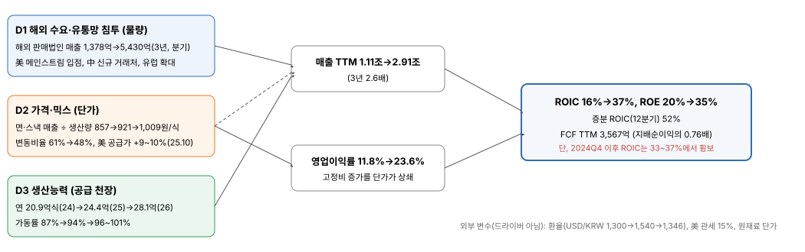

<table><tr><th>드라이버</th><th>무엇인가 (이 회사에 고유한 것)</th><th>①의 어떤 숫자를 만들었나</th><th>보여주는 지표 (과거 값)</th></tr> <tr><td><b>D1. 해외 수요와 유통망 침투 (물량)</b></td><td>'불닭'은 매운맛 챌린지·SNS로 퍼진 <b>카테고리 창조형 브랜드</b>입니다. 미국은 아시안 마트 → 월마트·코스트코 등 메인스트림으로, 중국은 대리상·온라인에서 신규 거래처 확대, 유럽은 2024년 법인 설립 후 급성장. 각국 판매법인이 진열·판촉을 직접 챙깁니다.</td><td>매출 TTM 1.11조 → 2.91조. 해외 판매법인 매출(분기) 1,378억 → 5,430억(3.9배)</td><td>지역별 매출(위 표), 면·스낵 수출 1조 3,051억(2024) → 1조 8,233억(2025) → 1조 8,170억(2026 9개월), 생산량(=판매량 대용) 18.1억식(2024) → 22.9억식(2025) → 연환산 27.6억식(2026)</td></tr> <tr><td><b>D2. 가격·믹스 (단가)</b></td><td>해외에서 <b>프리미엄 가격을 유지</b>합니다(국내 출고가 불닭 40입 36,080원은 3년 동결이지만, 해외 판매가는 높고 2025년 10월 미국 공급가 +9~10%). 해외 직판 비중이 늘수록 1봉당 회사가 가져가는 금액이 커집니다.</td><td>영업이익률 11.8% → 23.6%, 변동비율 61% → 51%</td><td>면·스낵 매출 ÷ 생산량 = 857원(2024) → 921원(2025) → 1,009원/식(2026 9M), 변동비율 분기 66%(1Q23) → 48%(3Q26)</td></tr> <tr><td><b>D3. 생산능력 (공급 천장)</b></td><td>수요가 공급보다 커서 <b>'만드는 만큼 팔리는'</b> 상태가 2024년부터 이어집니다. 밀양1(2022) → 밀양2(2025.06, 6라인, 연 8.3억식) → 중국(2027.01) → 베트남(2029.01). 밀양2는 무인 자동화 공장이라 인력 증가가 상대적으로 작습니다.</td><td>매출의 '계단'(2024Q2, 2025Q3)이 증설 시점과 맞음. 투하자본 회전율 2배 유지</td><td>생산능력 20.9억(2024) → 24.4억(2025) → 연 28.1억식(2026), 가동률 87% → 94% → 92~101%</td></tr></table>

**세 드라이버의 관계**: D1(수요)이 D3(공급)보다 크기 때문에 D2(가격)가 유지됩니다. 만약 공급이 수요를 따라잡거나(중국·베트남 공장 가동 후) 수요가 식으면, 유통사와의 협상력이 약해져 D2부터 흔들릴 수 있습니다. 즉 **D3의 증설은 물량을 늘리지만, 동시에 D2를 지탱하던 '품귀'를 줄이는 양면이 있습니다.**

**드라이버가 아닌 외부 변수**: 환율(원화 약세가 2024~26년 상반기 마진을 도움, 지금은 반대), 미국 관세(15%, 2025.08~; 3Q26 환급 약 200억), 원재료 가격(맥분 하락·팜유 상승). 이들은 드라이버(회사가 가진 구조)가 아니라 드라이버의 결과를 흔드는 바깥 요인이라 따로 둡니다.

### 영업레버리지로 본 ROIC 개선의 원인

ROIC 개선(16% → 37%)을 나눠 보면: **세후 영업이익률 2배(8.9% → 17.7%)가 대부분**이고 투하자본 회전율(1.83 → 2.08배)은 작게 기여했습니다. 이익률 개선은 다시 ① 변동비율 하락(−10%p: 단가·믹스 = D2)과 ② 고정비 비중 변화(매출 대비 24% → 23%로 거의 그대로)로 나뉩니다. 즉 **"가동률이 올라 고정비를 넘어선 효과"는 작고, "단가가 올라 1봉당 마진이 커진 효과"가 큽니다.** 가동률은 이미 2024년부터 높았고(87%+), 늘어난 매출은 주로 **새 설비(밀양2)**에서 나왔습니다 — 설비가 늘면 고정비(감가·인력)도 함께 늘어 레버리지가 작아지는 구조와 일치합니다.

### 드라이버 후보의 과거 값

<table><tr><th>항목</th><th>2024</th><th>2025</th><th>1Q26</th><th>2Q26</th><th>3Q26</th><th>출처·산정</th></tr> <tr><td>생산능력(천식, 면류 3개 공장)</td><td align="right">2,088,555</td><td align="right">2,444,178</td><td align="right">701,764</td><td align="right">701,765</td><td align="right">718,094</td><td align="right">사업의 내용 '생산능력'(2025 사업보고서부터 수량 기준; 이전 보고서는 금액 기준이라 비교 불가)</td></tr> <tr><td>생산실적(천식)</td><td align="right">1,809,332</td><td align="right">2,287,406</td><td align="right">643,264</td><td align="right">711,307</td><td align="right">689,250</td><td align="right">분기 = 누적 차감</td></tr> <tr><td>가동률</td><td align="right">86.6%</td><td align="right">93.6%</td><td align="right">91.7%</td><td align="right">101.4%</td><td align="right">96.0%</td><td align="right">실적 ÷ 능력</td></tr> <tr><td>면·스낵 매출 ÷ 생산량(원/식)</td><td align="right">857</td><td align="right">921</td><td align="right" colspan="3">1,009 (9개월)</td><td align="right">역산(판매량 공시 없음, 생산량으로 대용 — 재고 변동 무시)</td></tr> <tr><td>해외 판매법인 매출(억원)</td><td align="right">8,745</td><td align="right">14,477</td><td align="right">4,515</td><td align="right">5,284</td><td align="right">5,429</td><td align="right">영업부문 주석</td></tr> <tr><td>면·스낵 수출(억원)</td><td align="right">13,051</td><td align="right">18,233</td><td align="right" colspan="3">18,170 (9개월)</td><td align="right">매출 및 수주상황</td></tr> <tr><td>변동비율(분기)</td><td align="right">57.2%(4Q)</td><td align="right">53.3%(4Q)</td><td align="right">52.0%</td><td align="right">50.2%</td><td align="right">48.2%</td><td align="right">성격별 분류</td></tr> <tr><td>고정비(감가 제외, 분기)</td><td align="right">1,045</td><td align="right">1,397</td><td align="right">1,457</td><td align="right">1,871</td><td align="right">1,922</td><td align="right">성격별 분류</td></tr></table>

어떤 드라이버를 추정에 쓸지(예: 생산능력 × 가동률 × 단가 / 지역별 판매량 × 가격)는 2단계 토의에서 정합니다. 생산능력은 '수량'으로 공시되므로(천식) 단가·환율 변화가 섞이지 않는 장점이 있습니다.

### 자본 배분 패턴

- **유형**: 공시된 정책(배당성향 9~11%)이 있는 **비율 방식**. 주당배당은 5년간 1,000 → 4,800원(+380%)으로 이익을 따라 올랐지만 비율은 10% 안팎에서 고정.
- **우선순위**: 증설 > 배당 > 자사주. 2025년에는 오히려 자기주식을 팔아 투자 재원을 마련했습니다. 앞으로 중국(잔여)·원주·베트남(2,186억) 투자가 이어지므로 정책상 배당성향은 당분간 크게 바뀌지 않을 가능성이 큽니다.
- **평가(사용자 기준 '이익에 맞춰 돌려주는가')**: '이익에 비례해 늘린다'는 점은 맞지만 그 비율이 낮습니다. 다만 지금은 남긴 이익이 예금이 아니라 **증분 ROIC 50%대의 증설**로 가고 있어, 쌓아 두는 회사의 'ROE 희석'과는 다릅니다. 투자가 끝난 뒤에도 현금을 쌓는지가 앞으로의 관찰 포인트입니다.

### 왜 이 회사는 이 수준의 ROIC를 낼 수 있나, 사이클과 어떻게 연결됐나

**ROIC 37%의 이유**: (1) 라면은 원재료·설비가 단순해 매출 대비 투하자본이 작고(회전율 2배), (2) 해외에서 '불닭'이라는 브랜드로 일반 라면보다 높은 가격을 받으며(세후 마진 18%), (3) 수요가 공급보다 많아 유통 체인에서 가격 결정력을 가집니다. 경쟁사(농심 등)는 미국에서 현지 생산을 하지만 삼양은 아직 100% 한국에서 만들어 수출 — 관세·환율에 더 노출되지만, 지금까지는 그 노출이 원화 약세로 이익이 되었습니다.

**사이클과의 연결**: 이 회사의 성장은 금리·신용 사이클보다 **브랜드 확산 사이클 + 환율**과 더 연결되어 있습니다. 2022~24년 미국 금리 인상기에도 매출은 늘었습니다. 반면 원화 약세(USD/KRW 1,300 → 1,540)는 2024~26년 상반기 마진을 키웠고, 지금의 원화 강세(→ 1,346)는 그 효과를 되돌리는 중입니다. 원화 1% 강세가 영업이익에 주는 영향은 해외 매출 비중(83%)과 원가 구조로 2단계에서 민감도로 계산해 보겠습니다.

이 기업에 대해 생각하고 계신 투자 아이디어는 무엇인가요?

③(미래 가치 구조)은 사용자의 아이디어가 들어갈 칸이라 비워 둡니다. 아이디어가 위 D1~D3 중 어디에 거는 것인지(또는 새 드라이버인지)부터 함께 보겠습니다.

## 2단계 토의 기록과 연결 표

### 2026-11-22 (1회차) — 사용자 아이디어

**사용자 원문 요약**

드라이버 1.

**Q 사이클**

: 면류 가동률이 100%를 넘을 만큼 추가 수요가 있는 상태에서 중국·베트남 공장 증설로 늘어나는 생산량은 매출 증가로 이어질 가능성이 높다. 미국·유럽의 추가 라면 수요.

드라이버 2.

**코스트 다운**

: 새 공장이 중국·베트남에 있어 유통(물류) 비용을 줄일 수 있다.

드라이버 3.

**P 사이클**

: 가동률 100%를 넘는 수요와 불닭의 해자를 생각하면 늘어나는 원가를 전가할 역량이 있다(원문 '판관비로 전이' — 판매가 전가 뜻인지 확인 중).

리스크: 환율, 농심의 추격.

**①② 드라이버와의 대응**: 사용자 D1 = ② D3(생산능력) + D1(해외 수요) / 사용자 D2 = 새 드라이버(원가) — ②의 변동비율 항목 / 사용자 D3 = ② D2(가격·믹스).

<table><tr><th>아이디어</th><th>지지 근거</th><th>반대 근거·약한 고리</th><th>성립하려면 참이어야 하는 가정</th></tr> <tr><td>D1 Q 사이클</td><td>가동률 2Q26 101%, 3Q26 96%(익산 119%, 원주 101%). 회사는 2026년을 '수요 둔화가 아닌 공급 제약'으로 설명(한화 간담회 2026-03). 중국 자싱 8라인 연 약 11억식(회사), 국내 28.6억식 대비 +39%. 중국 물량이 현지로 가면 밀양1·2를 미국·유럽(단가가 중국보다 50%+ 높다는 증권사 분석)으로 돌릴 수 있음</td><td>① 중국 공장은 <b>중국 판매 100%</b>용 → 국내에서 중국으로 보내던 물량을 대체. 순증 물량은 '빈 국내 설비를 미·유럽이 흡수하는가'에 달림. ② 중국 공장 11억식은 현재 중국 판매량(대략 9~10억식 추정, 가정)보다 큼 → 중국 수요가 더 커져야 공장이 참. 중국법인 성장 +13%(3Q26)로 미국 +37%보다 느리고, 중국 소매판매 10월 +0.4%. 4Q25 중국 재고 조정 이력. ③ 밀양2는 2025년 실제 기여 약 2억식(능력 8.3억식)으로 램프업이 느렸음 → 2027년 기여는 능력의 일부. ④ 베트남은 2029.01 준공, 초기 1라인(건면)뿐 → 12분기 추정 기간(4Q26~3Q29)에는 거의 영향 없음. ⑤ 3Q26 가동률 96%, 밀양 86% — '100% 초과'는 분기·공장에 따라 다름. 4Q25에 특근 종료로 기존 공장 능력 약 10% 감소 이력</td><td>(a) 중국 수요가 연 11억식 이상으로 큼 (b) 미·유럽이 국내에서 풀린 약 9억식+를 흡수 (c) 램프업 7~8개월</td></tr> <tr><td>D2 코스트 다운</td><td>수출제비·운반비 TTM 2,294억(매출 7.9%, 분기 6~12%). 중국 매출 비중 약 25% → 중국분 물류비 상한 대략 500~600억(가정: 지역 비례). 베트남 인건비 한국의 20~25%, 밀가루·팜유 저가 조달(언론). 현지 원가는 현지 통화 → 환율 자연 헤지</td><td>① 물류비 절감 상한이 영업이익(6,887억)의 약 8% 수준이며 전부 사라지지 않음(중국 내 배송, 원주 액상스프를 중국으로 운송). ② 새 공장의 고정비: 프레임 규칙(고정비 ÷ 생산능력, 2025년 203원/식)을 그대로 쓰면 11억식 × 203원 ≈ 2,200억 — 물류 절감보다 큼. 단 이 고정비에는 본사 광고·인건비가 섞여 과대일 수 있음 → 쟁점. ③ 램프업 기간 저가동 비용. ④ 베트남은 기간 밖</td><td>(a) 공장 고정비 증가가 물류·관세·인건비 절감보다 작음 (b) 절감분을 중국 판매가 인하로 넘기지 않음</td></tr> <tr><td>D3 P 사이클</td><td>2025.10 미국 관세 15%를 공급가 9~10% 인상으로 전가, 월마트 소비자가 +14%에도 미국법인 +37%. 변동비율 61%→51%. 매출÷생산량 857→921→1,009원/식(+7.5%, +9.6%)</td><td>① 단가 상승의 일부는 환율: USD/KRW 연평균 1,368→1,420(+3.8%)→1,454(2026 1~9월, +2.4%) → 2025년 단가 상승의 약 절반, 2026년 약 1/4이 환율 몫(대략). 나머지는 가격+해외 직판 믹스. ② 국내는 가격 결정력 약함(삼양라면 출고가 26,400→22,000원 인하). ③ <b>D1과 충돌</b>: 가격 결정력의 근거가 '품귀'인데 Q 사이클(+39%)이 품귀를 줄임. ④ 3Q26 관세환급 제외 이익률 22.3% ≈ 2Q26 22.9%, ROIC 4Q24 이후 횡보 — 마진 확장은 이미 멈춤. ⑤ 농심 녹산 수출공장(연 5억식, 2026 하반기), 신라면 툼바(매운 크림)로 같은 매대 경쟁. 일본 편의점 3사는 농심이 입점, 불닭은 미입점</td><td>(a) 원화 강세에도 외화 판매가를 올려 원화 마진 유지 (b) 공급이 늘어도 할인 없이 판매</td></tr> <tr><td>리스크: 환율</td><td colspan="3">매출 83% 해외, 원가 대부분 원화 → 원화 1% 강세 시 매출 약 240억 감소, 원가가 모두 원화라 가정하면 영업이익의 약 3.5%(상한). 3Q26 외화 관련 손실 681억(영업외). 중국·베트남 현지 생산은 이 노출을 줄임(D2의 숨은 효과)</td></tr> <tr><td>리스크: 농심</td><td colspan="3">농심은 미국 현지 생산(관세 없음), 녹산 수출공장, 툼바. 삼양 면·스낵과 농심 라면 매출 격차 2,733억 → 1,307억(2Q26)으로 축소(언론). 확인 지표 후보: 미국 리테일 점유율(Circana/Nielsen — 자료 요청), 월마트 가격·진열 변화</td></tr></table>

**놓친 변수 후보**: 중국 수요·재고(대리상 재고 조정 이력), 유럽 거래선 재편(영국법인 3Q26 −61% QoQ, 4Q까지 영향), 인건비 급증(3Q26 종업원급여 +52%), 미국 관세 정책 변화(환급·재부과), 단일 브랜드 의존.

**제안하는 매출 계산 구조(토의용, 확정 아님)**: 매출 = Σ지역(판매량 × 단가). 판매량 상한 = 생산능력(국내 + 중국) × 가동률. 국내 능력은 수량(천식) 공시, 중국 능력은 가동 후 공시 예정. 단가는 지역별(중국 < 미국 < 유럽) — 지역별 판매량 자료가 없으면 '면·스낵 매출 ÷ 생산량'을 전사 단가로 쓰고 지역 믹스는 법인 매출 비중으로 근사.

### 연결 표 초안 (토의 중 — 낙관·비관 값은 아직 정하지 않음)

<table><tr><th>가정</th><th>입력 칸</th><th>기본(규칙)</th><th>낙관/비관</th><th>확인 지표(후보)</th><th>반증 신호(후보)</th><th>상태</th></tr> <tr><td>중국 공장 가동·램프업</td><td>생산능력(중국), 가동률</td><td>2027.01 가동, 기존 설비와 같은 가동률(규칙)</td><td>토의</td><td>중국 법인 매출 YoY, 중국 공장 생산 공시</td><td>가동 지연, 중국 법인 매출 역성장</td><td>미정</td></tr> <tr><td>국내 물량의 미·유럽 재배분</td><td>지역 판매량</td><td>최근 4분기 수준 + 확정분</td><td>토의</td><td>미국·유럽 법인 매출, 국내 가동률 유지</td><td>국내 가동률 90% 하회, 재고일수 상승</td><td>미정</td></tr> <tr><td>물류비 절감</td><td>변동비율(지역별)</td><td>작년 같은 분기 변동비율</td><td>토의</td><td>수출제비·운반비 ÷ 매출</td><td>비율 하락 없음</td><td>미정</td></tr> <tr><td>새 공장 고정비</td><td>고정비</td><td>회사 고정비 ÷ 능력 비율 × 새 능력(규칙) — 범위 쟁점</td><td>토의</td><td>가동 분기의 인건비·기타 고정비 실측</td><td>–</td><td><b>쟁점</b></td></tr> <tr><td>가격 전가</td><td>단가</td><td>최근 4분기 단가(오늘 가격)</td><td>토의</td><td>단가(환율 효과 분리), 변동비율</td><td>원화 강세 구간 단가 하락, 프로모션 증가</td><td>미정</td></tr></table>

### 2026-11-22 (1회차 추가) — 사용자의 기존 보고서(2026-08-10 작성) 검토

<table><tr><th>보고서 주장</th><th>이후 사실(원문 대조)</th><th>판단</th></tr> <tr><td>1Q26 원주 96.7%, 익산 110.9% → 여전한 공급 병목</td><td>원문과 일치. 단 같은 분기 밀양 82.3%, 전체 91.7%. 2Q 101.4%, 3Q 96.0%</td><td>맞음, 다만 밀양 여유분이 빠짐</td></tr> <tr><td>2Q26E 매출 7,616억, 영업이익 1,760억</td><td>실적 7,703억 / 1,762억</td><td>정확</td></tr> <tr><td>FCF 2025 −1,397억 → 2026E +2,811억</td><td>최근 4분기(3Q26) FCF 3,567억(무형 취득 포함 기준)</td><td>방향 맞음, 크기 초과 달성</td></tr> <tr><td>CAPA +40%(28→39.3억식) ≈ 해외 매출 성장 26~36% → 공급 과잉 없음</td><td>2026년 1~9월 매출 +32.8% 중 물량(생산량 연환산 +19%)과 단가·믹스·환율(+12%p 내외)이 섞임. 2027년 한 해 능력 +40% vs 컨센서스 해외 성장 26%</td><td><b>약한 고리</b>: 매출 성장률(가격·환율 포함)과 물량 능력을 직접 비교. 물량 기준으로는 2027년 공급이 수요보다 빨리 늘 수 있음</td></tr> <tr><td>현지 생산으로 물류비·관세 획기적 절감 → 마진 레벨업</td><td>물류비 TTM 매출 7.9%, 중국분 상한 500~600억(가정). 새 공장 고정비 미반영</td><td>크기 검증 필요(현재 토의 D2와 같은 쟁점)</td></tr> <tr><td>적정 PER = 1/(r−g), r 8%, g 1~3% → Bear −0.6%</td><td>주가 10월 1,138,000원(Bear 1,279,970원보다 −11%), 11/15 1,233,000원. 이익은 2Q·3Q 모두 예상 이상</td><td>시나리오가 g(배수)만 바꾸고 이익(EPS)은 같아서 하방이 과소 평가됨. 현재 프레임(배수 고정, 드라이버로 BPS가 달라짐)과 반대 구조</td></tr> <tr><td>반도체 쏠림 완화 → 음식료 자금 유입</td><td>KOSPI 8월 말 6,687 → 11월 4,870(−27%), 삼양 1,417,000 → 1,233,000(−13%)</td><td>상대 방어는 맞았으나 절대 하락은 못 피함 — 3단계 이전에는 판단 보류</td></tr> <tr><td>리스크: 환율·낮은 주주환원</td><td>USD/KRW 1,377(8월) → 1,346, 3Q26 외화 손실 681억(언론). 배당성향 정책 9~11% 유지</td><td>둘 다 실현됨</td></tr></table>

보고서의 2026E EPS 74,874원 대비: 1~3분기 EPS 49,329원. 4분기 지배순이익을 1~3분기 평균(약 1,240억) 수준으로 두면 연간 약 6.6만 원으로 약 −11%(추정) — 영업이익이 아니라 3Q 외화 손실 때문.

### 2026-11-22 (1회차 추가 2) — 스터디 발표 녹취(음식료 2027 전망) 검토

출처: 사용자가 준 스터디 발표 녹취(발표자 데이터 출처 미표기 — 2차 자료로 취급, 원 데이터 확인 필요).

<table><tr><th>발표 내용</th><th>사용자 아이디어와의 관계</th><th>판단·검증</th></tr> <tr><td>라면 수출 2026년 1~10월 +25% = 물량 +22.7%, 단가 +3.6%. "삼양 단가 인상 거의 없음 → 2027년 가격 인상이 삼양의 포인트"</td><td>D3(P) 지지 — 아직 쓰지 않은 가격 카드</td><td>수출 단가는 본사 → 해외 판매법인 이전가격이라 소비자가·연결 단가와 다름. 연결 기준 단가(매출÷생산량)는 2026년 +9.6%(원화), 환율 +2.4% 제외 시 약 +7% — 차이는 해외 법인 직판 마진·믹스. 'P 여력'의 근거로는 맞지만 크기는 연결 기준으로 재야 함</td></tr> <tr><td>kg당 수출 단가: 미국 5.2달러, 유럽 4.5~5달러, 중국 3.7달러</td><td>D1 — 중국 공장이 국내 물량을 미·유럽으로 돌리면 단가 상승</td><td>미·유럽이 중국보다 22~41% 높음(증권사 '유럽 50%+'보다 작음). 재배분 효과 = 물량 × 단가 차이로 계산 가능 → 입력값 후보</td></tr> <tr><td>지역별 라면 수출 증가: 중남미 +140%, 유럽 +38%, 미국 +29%, 중국 +24%. 1인당 연 소비 유럽 4개, 미국 15개</td><td>D1 — 미·유럽 추가 수요</td><td>유럽 침투 여지 큼. 단 삼양 유럽은 3Q26 거래선 재편(영국법인 −61% QoQ) — 회사 몫이 업계 성장을 따라가는지 확인 필요</td></tr> <tr><td>미국 점유율: 농심 22%(2023)→34%(2025), 삼양 6~7%→12%</td><td>리스크: 농심 추격</td><td>둘 다 오르는 중 = 시장(파이) 확대 국면. 위협은 '점유율 뺏김'보다 '같은 매대 공급 경쟁'(녹산 10월 가동)과 가격 경쟁</td></tr> <tr><td>CAPA 28.6억 → 39.6억(2027 중국) → 약 50억(2029 베트남)</td><td>D1</td><td>베트남 50억은 8라인 전부 가정. 확정 투자는 건면 1라인뿐 → 12분기 추정에는 넣지 않음(추적 항목)</td></tr> <tr><td>원화 10% 강세 시 영업이익 영향: KT&amp;G −15%, 삼양 −10%, 오리온 −4%</td><td>리스크: 환율</td><td><b>앞선 제 추정(1%당 최대 −3.5%)은 원가를 전부 원화로 둔 상한이라 과대.</b> 수입 원맥·팜유, 해외 법인 비용이 외화라 실제 순노출은 1%당 약 −1% 수준(발표 기준)으로 보는 것이 합리적. 2단계에서 비용 중 외화 비중으로 재추정</td></tr> <tr><td>2027 엘니뇨·비료 가격 → 곡물 가격 상승 → 판가 인상이 중요</td><td>D3 — 원가 상승기에 전가력 시험</td><td>비관 시나리오의 원가 입력(맥분·팜유 단가) 후보. P가 '마진 유지' 수단이 될지 '확대' 수단이 될지 갈리는 지점</td></tr> <tr><td>2027 컨센서스: 삼양 매출 +21.1%, 영업이익 +19.4% → 이익률 정체</td><td>D2·D3(마진 개선)는 컨센서스에 없음</td><td><b>아이디어와 시장 기대의 차이가 여기.</b> 시장은 Q만 넣고 마진은 정체로 봄 → 사용자 D2·D3가 맞으면 컨센서스 대비 이익 상향 여지</td></tr> <tr><td>신규 공장 초기에는 판관비·감가상각이 크게 반영, 해외 공장 감가가 더 클 수 있다는 토론</td><td>D2 반대 근거</td><td>연결 표의 '새 공장 고정비' 쟁점과 같음</td></tr></table>

**새 확인 지표 후보**: 관세청 수출입무역통계 라면(HS 1902.30) 월별 국가별 수출 물량·금액(단가) — 미·유럽·중국 비중과 단가를 매월 볼 수 있어 브리핑 지표로 적합. 미국 리테일 점유율(Circana) — 원 데이터 요청.

### 2026-11-22 (1회차 추가 3) — 사용자 답변 + 증권사 리포트 4종(2026-11-12) 검토

자료: DS투자증권(장지혜), 교보증권(권우정), 한화투자증권(한유정), 키움증권(박상준) — 모두 베트남 공장 공시(11/11) 다음 날 발간. 유안타 음식료 섹터 리포트(2026-10-21), 한국투자증권 코멘트(2026-01-08 기사), 대신증권 3Q25 리뷰 보조 사용.

<table><tr><th>질문</th><th>사용자 답변</th><th>확인한 근거</th><th>정리</th></tr> <tr><td>1. P 사이클</td><td>원가 상승분을 판매가에 반영. <b>이익률 확대</b>로 봄</td><td>2027 영업이익률 전망: DS 23.4%(26년 23.7%), 한화 23.1%(26년 23.9%, 28년 23.6%), 키움 22.7%(26년 23.6%, 28년 25.1%), 유안타 23.9%(유일하게 상승, 근거는 판관비율 하락). 네 곳 모두 <b>추가 가격 인상을 기본 가정에 넣지 않음</b>(유안타·키움은 상향 요인으로만 언급). 가격 전가 전례: 미국 2025.10 관세 대응 10% 인상(한투). 3Q26 영업이익 1,962억에는 관세 환급 200억 포함, 제외 시 이익률 22.3%</td><td><b>이익률 확대 = 컨센서스와 다른 판단(합의)</b>. 단 기준점은 3Q26 24.8%가 아니라 일회성 제외 22~23%대. 확대의 경로가 가격(매출총이익률)인지 판관비율인지 아직 미정</td></tr> <tr><td>2. 중국 공장</td><td>중국 물량은 자싱. 미·유럽은 국내+베트남이 나눠 맡을 것. 중국 고성장은 끝났다고 들음</td><td>중국 법인 성장률(YoY): 1Q26 36.4% → 2Q 44.1% → 3Q 13.2%. 2027F 중국: DS +12.3%, 한화 +20.6%. 대중국 라면 수출 3Q26 +9.7%(7월 −13%). 중국 라면시장은 전통 채널 판매 1H26 −10.6%(China Daily)이나 1Q 배달 채널로 +5.8%라는 보도도 있음. 2027F 미국: DS +36.7%, 한화 +52.1% / 유럽: DS +29.4%, 한화 +68.3%. 1~10월 수출 증가율: 유럽 45.7%, 미국 29.1%, 중국 23.8%(관세청, 한화 인용). 베트남은 유럽·동남아 대응(DS·한화·키움 일치)</td><td><b>사용자 견해와 증권사 시각 일치</b>: 2027 증가분의 중심은 중국이 아니라 미·유럽(국내 공장 재배분). 중국은 두 자릿수 초반~20% 성장 가정. 단, 중국 성장이 더 꺾이면 자싱 11.3억식의 가동률이 쟁점 → 확인 지표: 중국 법인 위안화 매출 YoY</td></tr> <tr><td>3. 베트남</td><td>추정 구간에 들어가지 않나?</td><td>12분기 = 4Q26~3Q29. 베트남 준공 2029.01.31 → <b>1Q29~3Q29가 구간 안</b>. (이전 '구간 밖' 기재는 오류, 정정.) 확정 설비는 건면 1라인뿐, 8라인 기준 최대 11억식. 한화: 2H28 자싱 3교대 전환으로 추가 여력</td><td>기본: 1라인 + 램프업(작게). 낙관: 2027~28 추가 라인 공시. 비관: 지연. <b>자싱 3교대(2H28)도 구간 안 변수로 추가</b></td></tr> <tr><td>4. 새 공장 고정비</td><td>모르겠음. 해외 공장 고정비가 국내보다 작지 않나?</td><td>베트남 노무비 한국 대비 최대 25%(교보). 중국도 낮은 인건비·물류비 절감 언급(DS), 중국 수치는 확인 안 됨. 설비 투자 단가: 자싱 2,072억/11.3억식 ≈ 183원/식 vs 밀양2 1,838억/8.3억식 ≈ 221원/식. 회사 TTM 감가 814억(매출의 2.8%) → 자싱 감가 추정 연 ~140억(PP&amp;E 대비 감가율 적용, 추정). 반대 근거: 밀양2 가동 초기 3Q25 원가율 QoQ +4.9%p(노무비·감가, 대신)</td><td>203원/식(회사 전체 비율)은 광고·본사 인건비까지 포함해 과대 → <b>(b) 공장 직접 고정비(감가+인건비+수선) 방식 제안</b>, 해외 인건비 할인 반영. 단 가동 초기 1~2개 분기는 단위당 고정비 부담 큼</td></tr></table>

### 2026-11-22 (1회차 추가 4) — 사용자 결정

<table><tr><th>항목</th><th>결정</th><th>추적 방법</th></tr> <tr><td>이익률 확대의 경로</td><td>가격(매출총이익률)에 둠. 판관비율은 과거 4년 매출 3.2배에도 17.7%→22.1%로 상승 → 기본 22% 안팎 유지, 하락은 상향 요인</td><td>최근 4개 분기 합산 판관비율·광고선전비율</td></tr> <tr><td>D3 반증 조건</td><td><b>2027년 상반기까지 미국·유럽 가격 인상 미확인 시 D3 약화</b>. 단 이후에도 지속 추적</td><td>가격 인상 보도·IR, 관세청 수출 kg당 단가(미·유럽), 연결 매출총이익률</td></tr> <tr><td>베트남</td><td>현재 공시·리포트 내용 확인 후 결정(아래 표)</td><td>추가 라인 공시</td></tr></table>

### 베트남 공장 — 공시와 리포트 내용 (2026-11-12 기준)

<table><tr><th>출처</th><th>내용</th></tr> <tr><td>공시(11/11)</td><td>투자 2,186억(토지·건축·건면 1라인), 출자 1,311억(131,131,235,979원, 지분 100%; 교보 리포트의 1,313억은 오기), 준공 2029.01.31, 8라인 수용 규모. <b>초기 설비는 건면(튀기지 않고 열풍 건조) 1라인 — 회사 설명·다수 보도로 확인.</b> 나머지 7라인은 유탕면(튀긴 면)으로 채울 예정(연합뉴스·딜사이트, 회사 설명). 해외 건면 설비는 처음. 건면 1라인 생산능력과 생산 품목은 확인 안 됨(단백질 건면 파스타 탱글과의 연관 가능성은 보도 추정)</td></tr> <tr><td>DS</td><td>8라인 시 2029 CAPA 최대 50.6억개. 실적 추정은 2027년까지(베트남 미반영)</td></tr> <tr><td>교보</td><td>8라인 시 약 11억식, 매출 1조 규모 추정. 6라인 +21%, 8라인 +28%. 중국도 6→8라인 확대 전례</td></tr> <tr><td>한화</td><td>8라인 투입 예정으로 서술, 약 11.2억개. 2029.01 본생산 후 추가 라인 순차 가동. 추정은 2028년까지(베트남 미반영)</td></tr> <tr><td>키움</td><td>8라인 시 총 투자 3,500억 이상, 총 50.8억식, 연매출 6조 가능. 추정은 2028년까지(베트남 미반영)</td></tr></table>

### 2026-11-22 (1회차 추가 5) — 3Q26 컨퍼런스콜(유안타 손현정 정리) 검토

2차 자료(증권사 정리본). 회사 원문 IR PDF는 아직 없음.

<table><tr><th>컨콜 내용</th><th>관련 드라이버</th><th>해석</th></tr> <tr><td>해외 가격 인상: 원재료·물류비 부담으로 필요성 검토 중, 국가별 수익성에 따라 필요한 시장에서 추진 가능, 인상률·시점 미확정</td><td>D3 지지(약)</td><td>회사가 인상을 공식 검토 중. 확정 아님</td></tr> <tr><td>2027 원재료(밀가루 등) 연간 계약 1Q27 체결 예정, 단가 2026보다 상승 가능성</td><td>D3 시험대</td><td><b>1Q27 원재료 계약 → 가격 결정 → 사용자의 '2027 상반기' 반증 시점과 일치.</b> 원가가 먼저 오르므로 인상이 없으면 이익률은 하락 방향</td></tr> <tr><td>3Q26 GPM 46.6%, 관세환급 제외 약 44.1%(2Q26 48.1%) — 팜유·포장재·LNG·원화 강세로 원가 부담</td><td>D3 반대</td><td>분기 GPM이 환급 제외 기준 약 4%p 하락. 원가 상승이 이미 진행 중</td></tr> <tr><td>광고선전비율 2Q 5.2% → 3Q 4.2%, 운반비 336억(QoQ −110억, 유가 하락). 하반기 마케팅비 통제 방침</td><td>판관비</td><td>판관비율 하락은 <b>규모의 경제가 아니라 의도적 통제</b>. 유럽 신규 거래선·캐나다·남미 확장 시 되돌아갈 수 있음 → 기본 22% 유지 가정 유지</td></tr> <tr><td>회사 목표: '비용 통제로 연간 전년도 수준의 수익성 유지'</td><td>D3</td><td><b>회사 스스로는 '유지'를 목표로 제시</b>. 사용자의 '확대'는 회사 가이던스보다도 높은 판단</td></tr> <tr><td>4Q26 생산량 QoQ +4~5% 예상, 3Q는 영업일수 감소로 생산 적음</td><td>D1</td><td>자싱 가동 전까지 물량 증가는 제한적(생산 제약 확인)</td></tr> <tr><td>자싱: 시생산 중, 2027.01 본생산 목표 변동 없음, 11.3억식</td><td>D1</td><td>일정 유지 확인</td></tr> <tr><td>중국 3Q 2,089억(YoY +13.2%, QoQ +15.4%) — 중추절·광군제 선출고 포함. 간식 채널 비중 37~38%, ASP는 낮지만 반품·판촉비 부담 적음</td><td>D1(중국)</td><td>3Q에 선출고가 있어 4Q 중국은 QoQ 둔화 가능. 중국 성장 둔화 판단(사용자 견해)과 일치</td></tr> <tr><td>미국 2,125억(+36.6%): 메인스트림 64%, 에스닉 16%, 멕시코 14.6%. 월마트 QoQ +26%. 캐나다 법인 설립, 남미 확장 추진</td><td>D1(미국)</td><td>미국 법인 성장의 일부는 멕시코(미국 밖). 미주 전체로 확장되는 구조</td></tr> <tr><td>유럽 869억(+65.5%), 영국 126억(QoQ −61%): 재무 취약 거래선 교체(프·이·영), 4Q까지 영향, 2027 개선 기대</td><td>D1(유럽)</td><td>4Q26 유럽·영국 매출 약세는 일시 요인으로 구분해 볼 것</td></tr> <tr><td>신규 해외공장: 통상 건설 약 3년, 단축 방안 검토</td><td>베트남</td><td>11/11 베트남 공시로 이어짐. 2029.01 준공과 부합</td></tr> <tr><td>외화 관련 손실 약 681억(미실현 평가손 약 400억, 실현 약 200억)</td><td>환율 리스크</td><td>영업외. 세전이익 1,274억으로 감소</td></tr></table>

### 2026-11-22 (1회차 추가 6) — D3 시나리오 확정

결정: D3는 시나리오로 나눔. 2027 원재료 단가 **+10%**(사용자 결정, 1Q27 실제 계약 단가 나오면 교체). 기본 = 회사 목표(수익성 유지), 확대 = 낙관.

<table><tr><th></th><th>비관</th><th>기본</th><th>낙관</th></tr> <tr><td>가정</td><td>원재료 +10%, 가격 인상 없음</td><td>원가 상승분만큼 인상 — 해외 약 +6% 필요</td><td>해외 +8~12% 인상(중앙 +10%)</td></tr> <tr><td>2027 영업이익률(환율 불변, 판관비율 22% 고정)</td><td>약 18.5%</td><td>약 22.3%</td><td>약 23.5~25.8%(중앙 24.7%)</td></tr> <tr><td>판단 신호</td><td>1Q27 계약 후 상반기 인상 없음, 일회성 제외 GPM 44% 미만 지속</td><td>일부 국가 인상, GPM 44~46%</td><td>미·유럽 인상 확인, GPM 46% 이상</td></tr></table>

계산: 출발 22.3%(3Q26 관세환급 제외), 원재료비 매출 대비 38.4%(TTM, 비용의 성격별 분류) × 10% = 매출의 3.84%p 원가 부담, 가격 인상은 해외 83%에만 적용. **시사점: 회사 목표인 '유지'도 해외 약 6% 인상이 있어야 가능.**

**결정(2026-11-22)**: 환율 민감도 기본값 원/달러 1% 하락 시 영업이익 −1.5%(범위 −1~−2.5%), 세 시나리오에 겹쳐 적용.

**결정(2026-11-22)**: D2 초안 동의. 농심 추격은 별도 항목으로 두지 않고 비관 시나리오의 원인 중 하나로 봄(가격 인상 불가 = D3 비관, 미국 점유율 정체 = D1 비관). 추적 지표만 유지.

### 연결 표 (2단계 최종안, 2026-11-22)

<table><tr><th>드라이버</th><th>입력 슬롯</th><th>비관</th><th>기본</th><th>낙관</th><th>확인 지표 / 반증 신호</th></tr> <tr><td rowspan="4">D1 Q 사이클 (물량)</td><td>국내 공장(약 28억식/년)</td><td colspan="3">가동률 약 100% 유지. 중국 물량이 자싱으로 넘어간 만큼 미·유럽으로 재배분</td><td>분기 생산실적, 관세청 HS 1902.30 미·유럽 수출 물량</td></tr> <tr><td>자싱 가동률(11.3억식) 2027 평균 / 2028</td><td>40% / 70%</td><td>60% / 85%</td><td>70% / 95%</td><td>중국 법인 위안화 매출 YoY. 반증: 2027 중국 매출 성장 한 자릿수</td></tr> <tr><td>중국 매출 성장 2027</td><td>+5%</td><td>+12%</td><td>+20%</td><td>DS +12.3%, 한화 +20.6%. 3Q26 선출고로 4Q26 약세 가능</td></tr> <tr><td>자싱 3교대(2H28)·베트남</td><td>3교대 없음(명목 대비 최대 약 73%), 베트남 지연</td><td>3교대 2H28 반영(한화 전망), 베트남 건면 1라인(불닭 물량 없음)</td><td>3교대 1H28 앞당김, 베트남 유탕면 라인 추가 공시</td><td>회사 공시·IR. 농심 녹산 공장·미국 점유율(Circana)</td></tr> <tr><td>D2 코스트 다운</td><td>운반비 절감 / 새 공장 고정비(매출 대비, 2027)</td><td>0 / +0.6%p → −0.6%p</td><td>−0.3%p / +0.6%p → −0.3%p</td><td>−0.5%p / +0.6%p → −0.1%p</td><td>컨콜 운반비(3Q26 336억/분기), 자싱 가동률. 2028부터 고정비 부담 축소로 D2 플러스 전환</td></tr> <tr><td>D3 P 사이클</td><td>해외 가격 인상(원재료 +5%, 데이터 기준 — 2026-11-22 사용자 결정으로 +10%에서 변경)</td><td>없음 → OPM 약 20.4%</td><td>약 +3% → 약 22.3%</td><td>+8~12% → 25.3~27.6%</td><td>1Q27 원재료 계약 → <b>2027 상반기 내 미·유럽 인상 없으면 D3 약화</b>. 일회성 제외 GPM 44%/46%</td></tr> <tr><td>판관비</td><td>판관비율</td><td colspan="3">약 22% 고정(과거 4년 규모의 경제 없음, 3Q26 하락은 통제)</td><td>판관비율·광고선전비율 TTM</td></tr> <tr><td>환율</td><td>원/달러(기준 1,346, 2026.11)</td><td colspan="3">기준 불변. 1% 하락마다 영업이익 −1.5%(범위 −1~−2.5%) 겹쳐 적용</td><td>분기 평균 환율, 환율효과 제외 성장률, 영업외 외화손익</td></tr></table>

합의: D1 구도(중국 둔화, 미·유럽 재배분), D2 값, D3 시나리오와 반증 시점, 판관비·환율 가정. 쟁점(확인 필요): 자싱 가동률 램프 속도, 중국 운반비 부담 주체, 3교대 규모, 원재료 실제 계약 단가.

### 쟁점 4가지 — 과거 데이터 기반 추론 (2026-11-22, 공시·IR 나오면 교체)

<table><tr><th>쟁점</th><th>쓴 데이터</th><th>추론</th><th>반영</th></tr> <tr><td>1. 자싱 가동률 램프 속도</td><td>밀양2(2025.06 가동, 6라인 8.3억식): 밀양공장 가동률(금액 기준) 2Q25 73% → 3Q25 66% → 2025년 54.6%, 1년 뒤 2026 9M 86.1%(천식 기준). 회사 전체 생산 2024 18.1억식 → 2025 22.9억식. 중국 법인 매출 2026E 약 7,300억, 수출 단가로 환산 시 중국 물량 약 9~10억식(추정)</td><td>새 공장은 첫 2분기 40~60%, 1년 뒤 85% 안팎. 중국 수요(약 10~11억식, 2027)가 자싱 명목 능력(11.3억식)과 비슷해 수요도 상한</td><td>기본 2027 60% / 2028 85% 유지</td></tr> <tr><td>2. 중국 운반비 부담 주체</td><td>구조: 본사 → 중국 판매법인(연결) → 대리상·간식 채널. 컨콜: 3Q26 운반비 약 336억/분기(매출의 약 4.2%)</td><td>절감되는 것은 한국→중국 구간(해상·통관)으로, 법인 간 거래라 누가 내든 연결 비용 → 회사 부담으로 봐도 됨. 중국 내 배송은 자싱이 생겨도 남음. 한중 구간은 미·유럽보다 짧아 평균 운반비율보다 낮을 것. 이전 초안의 7.9%(비용의 성격별 '운반비'는 범위가 넓음) 대신 컨콜 기준 약 4.6% 적용 → 중국 8,500억 × 4.6% × 50% ≈ 195억(매출의 약 0.5%), 짧은 구간 감안해 기본 0.3%p</td><td>D2 절감 하향: 비관 0 / 기본 −0.3%p / 낙관 −0.5%p → 2027 순효과 −0.6 / −0.3 / −0.1%p(2028부터 플러스)</td></tr> <tr><td>3. 3교대로 늘어나는 생산능력</td><td>사업보고서: 국내 면류 2교대 1일 22시간(11h×2). 라인당 명목 능력: 자싱 11.3억/8라인 = 1.41억, 밀양2 8.3억/6라인 = 1.38억 → 자싱 명목 능력은 국내 22시간 기준과 비슷. 한화: 2H28 3교대 전환으로 추가 여력</td><td>중국 근로시간 규정상 2교대가 1일 16시간(8h×2)이라면(확인 안 됨) 3교대 전까지 실제 최대는 명목의 약 73%(16/22), 3교대(24h)로 약 109%. 즉 3교대 효과 ≈ 연 4억식</td><td>낙관 2027 가동률 80% → 70%로 하향(상한 73%). 기본에 3교대 2H28 반영, 비관은 미반영(최대 73%)</td></tr> <tr><td>4. 2027 원재료 계약 단가</td><td>사업보고서 원재료(원/kg): 맥분 887→782→742(2023→2025), 팜유 1,491→1,543→1,776, 원맥 SW 513→405→431. 유안타: 4Q26 소맥 원화 투입가 전년비 약 +17%. 2026 계약 시점(1Q26) 원/달러 평균 약 1,466, 현재 1,346(−8%). 컨콜: 2027 계약 1Q27, 상승 가능성, 포장재·LNG도 상승</td><td>원화 강세가 국제가 상승을 상당 부분 상쇄. 달러 기준 원료가가 +10~15%면 원화 기준 +2~6%. <b>데이터로 보면 +3~5%가 중심, 사용자 결정 +10%는 보수적</b></td><td><b>+5%로 변경(사용자 결정, 데이터 기준)</b>. 비관 약 20.4%, 기본 필요 인상 약 +3%, 낙관 25.3~27.6%. 1Q27 실제 계약 후 교체</td></tr></table>

## 환율 민감도 (2026-11-22 작성)

원화가 강해지면(달러당 원 하락) 삼양식품의 이익은 줄어듭니다. 매출의 83%가 해외인데, 비용은 그보다 적은 비중만 외화이기 때문입니다. 아래에서 영업이익(본업)과 영업외(보유 외화자산 평가) 두 경로로 나눠 봅니다.

### 1) 영업이익 경로

<table><tr><th>구성</th><th>값</th><th>출처·근거</th></tr> <tr><td>외화 매출 비중(a)</td><td>약 83%</td><td>3Q26 해외 매출 비중 83.4%(컨콜). 미국·중국·유럽·일본 등 통화가 섞여 있음(사업보고서: 달러·위안·유로·엔)</td></tr> <tr><td>외화 연동 비용(b)</td><td>매출의 약 25~33%(추정)</td><td>① 수입 원재료: 맥분·팜유를 종속회사 삼양제분에서 매입, 삼양제분은 원료 전량 수입(분기보고서) → 원재료비(매출의 38.4%) 중 약 40~60%가 수입 연동(가정, 확인 안 됨) ≈ 매출의 15~23% ② 해외 법인 현지 비용(광고·운반·수수료 등, 매출의 약 14% 중 70% 가정) ≈ 10%</td></tr> <tr><td>구조 추정: 원화 1% 강세 시 영업이익</td><td>−2.2~−2.6%</td><td>(a−b)/영업이익률 = (0.83−0.25~0.33)/0.223. 모든 통화가 함께 1% 움직인다고 가정한 상한 쪽</td></tr> <tr><td>실제 데이터 점검</td><td>달러 기준 매출 탄력성 약 0.55</td><td>2Q→3Q26 평균 원/달러 1,512→1,383(−8.5%). 키움: 3Q26 매출 QoQ +2.8%, 환율 효과 제외 +7.5% → 환율 효과 −4.7%p. 위안·유로 등은 달러보다 덜 움직여 실제 영향이 작음</td></tr> <tr><td>달러 기준 보정 추정</td><td>원/달러 1% 하락 시 영업이익 약 −1.5%</td><td>0.55 × (1 − b/a) / 0.223. 스터디 발표자 −1%/1%보다 큼</td></tr> <tr><td><b>기본값(제안)</b></td><td><b>−1.5%, 범위 −1~−2.5%</b></td><td>시나리오별 이익률에 겹쳐 적용: 원/달러 1% 하락 ≈ 영업이익률 −0.3%p</td></tr> <tr><td>시차</td><td>원화 강세는 매출에 먼저, 비용에는 늦게</td><td>밀가루 등 원재료는 연간 계약(1Q27 체결, 컨콜) → 단기 충격이 더 크고 계약 갱신 때 일부 상쇄. 통화선도 이익 64억(2025, 사업보고서) — 헤지는 소규모</td></tr></table>

### 2) 영업외 경로 (외화자산 평가)

<table><tr><th>항목</th><th>값</th><th>출처</th></tr> <tr><td>2025년 말 외화금융자산</td><td>USD 현금 1,895억, USD 단기금융자산 289억, USD 매출채권 136억, JPY 51억 등</td><td>2025 사업보고서 연결주석</td></tr> <tr><td>회사 공시 민감도(2025년 말)</td><td>원화 10% 변동 시 세후이익 ±약 164억(USD ±162.9억, JPY ±3.4억, EUR·SGD 반대 방향 소액)</td><td>2025 사업보고서 연결주석</td></tr> <tr><td>2026년 3분기</td><td>현금 7,117억(기초 3,328억), 9개월 현금 환율효과 −481억, 3Q 외화 관련 손실 약 681억(미실현 약 400억)</td><td>3Q26 분기보고서, 컨콜. 분기보고서에는 민감도 표 없음 → 현재 노출은 2025년 말보다 큼(정확한 통화별 금액은 확인 안 됨)</td></tr></table>

### 추적 지표

- 원/달러·원/위안·원/유로 분기 평균(기준: 3Q26 원/달러 1,383, 11월 1,346)
- 회사 실적 발표의 '환율 효과 제외 매출 성장률'과 보고 성장률의 차이
- 영업외 외화손익(분기)

**요청 자료**: IR에 통화별 매출 비중, 외화 연동 원가 비중, 회사가 쓰는 환율 민감도 문의(IR 담당자 이메일·컨콜 질문). 3Q26 IR PDF 원문.

## ③ 미래에 가치가 생기는 구조 — 드라이버 판정 (2026-11-22)

아이디어의 세 드라이버를 ②에서 찾은 드라이버에 대응시키면: **아이디어 D1(Q 사이클)** = ② D3 생산능력 + ② D1 해외 수요·유통망, **아이디어 D2(코스트 다운)** = 새 드라이버(해외 생산의 비용 구조), **아이디어 D3(P 사이클)** = ② D2 가격·믹스. 세 질문(① 수요 ② 위치 ③ 경제성)으로 판정합니다.

<table><tr><th>드라이버</th><th>① 수요</th><th>② 위치(몫)</th><th>③ 경제성</th><th>판정</th><th>숫자가 나올 시점</th></tr> <tr><td><b>D1 Q 사이클</b> (자싱 → 미·유럽 재배분)</td><td>미국 법인 3Q26 2,125억(+36.6%), 유럽 869억(+65.5%), 라면 수출 2026.1~10월 +26%(물량 +22.7%). 중국 2,089억(+13.2%, 선출고 포함)으로 <b>둔화</b> — 숫자 확인</td><td>미국 메인스트림 64%, 월마트 QoQ +26%, 멕시코 14.6%. 미국 점유율 6~7% → 12%(발표 자료, 2차). 유럽·영국은 거래선 교체 중</td><td>ROIC 36.9%(TTM), 12분기 증분 ROIC 52%. 다만 4Q24 이후 ROIC 33~37% 횡보. 국내 공장 가동률 96~101%로 물량은 생산능력에 묶여 있음</td><td><b>지속</b> (중국은 관찰 필요)</td><td>자싱 본생산 2027.01, 1Q27 실적(2027년 5월): 중국 법인 위안화 매출, 생산실적(천식)</td></tr> <tr><td><b>D2 코스트 다운</b></td><td>–</td><td>한국→중국 구간 운반은 그룹 내부 거래라 절감분은 회사 몫</td><td>아직 숫자 없음(자싱 가동 전). 3Q26 운반비 336억(QoQ −110억)은 유가 하락·통제 효과로 드라이버와 별개</td><td><b>관찰 필요</b></td><td>1Q27~2Q27 실적: 운반비율, 자싱 가동률, 새 공장 고정비(인건비·감가)</td></tr> <tr><td><b>D3 P 사이클</b></td><td>수요는 강함(D1과 같음)</td><td>해외 가격 인상 '검토 중, 시점·폭 미확정'(3Q26 컨콜). 전례: 2025.10 미국 약 10% 인상(관세 대응)</td><td>일회성 제외 매출총이익률 2Q26 48.1% → 3Q26 44.1%(팜유·포장재·LNG·원화 강세). 회사 목표는 '전년 수준 수익성 유지'</td><td><b>관찰 필요</b> (기울기는 약화 쪽)</td><td>1Q27 원재료 계약 → <b>2027 상반기까지 미·유럽 인상 없으면 약화</b>(반증 신호)</td></tr></table>

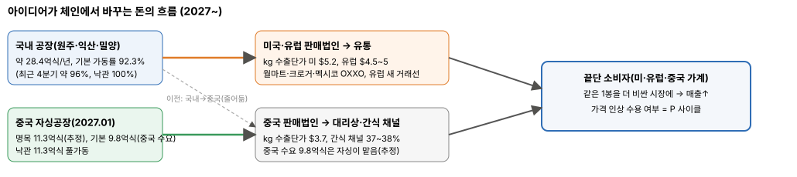

### 유동성·ROIC 경로 가정과 남은 쟁점

- **유동성 가정**: 끝단은 미·유럽·중국 가계 소비(필수소비재, 경기 민감도 낮음). 한국 국고채 10년 4.21%, 회사채 AA− 스프레드 0.688%p(10월, 1월 대비 +0.19%p). 회사는 순현금 1,223억이라 금리 상승은 이자수익을 늘림. **가장 큰 외부 변수는 환율**: 원/달러 1,346원 고정, 1% 하락마다 영업이익 −1.5%(범위 −1~−2.5%). 경계선: 원/달러 1,300원 이하가 이어지면 비관 쪽.
- **ROIC·ROE 경로 가정**: 자싱 가동으로 매출이 늘지만 판관비성 고정비도 물량에 비례해 늘린다(판관비율 약 22% 유지 — 2단계 합의). ROIC는 순투자가 줄며 오르고, ROE는 배당성향 10%로 순현금이 쌓여 내려가는 경로.
- **남은 쟁점(2단계)**: 자싱 가동률이 오르는 속도, 중국 2교대 근무시간(73% 상한 추론의 전제), 3교대 규모, 2027 원재료 실제 계약 단가(+5% 가정), 미·유럽 단가 프리미엄(1.1배 가정), 중국 수요가 자싱 능력을 받쳐 주는지.

## ④ 기업이 미래에 만들어낼 가치 — 12분기 추정 (4Q26~3Q29)

### 계산 구조와 입력값

<table><tr><th>칸</th><th>입력값·규칙</th><th>근거(데이터) / 가정 표시</th></tr> <tr><td>매출 = 기존 공장 + 자싱</td><td>기존 공장: 2026년 같은 분기 매출(1~3Q)을 원/달러 1,346원으로 환산, 4Q는 3Q × 작년(4Q25/3Q25) 계절 관계. 자싱: 11.3억식/4 × 가동률 × 미·유럽 단가</td><td>국내 생산능력은 12분기 동안 증설 없음(밀양2 완전 가동). 평균 단가 1,070원/식(2026 1~3Q 매출÷생산량, 환율 환산). <b>가정</b>: 자싱 1식이 늘 때마다 국내 물량이 미·유럽으로 옮겨가므로 증가분 단가 = 평균 × 1.1(1,177원, 관세청 kg 단가 미 $5.2·유럽 $4.5~5 vs 중국 $3.7 기반). 자싱 물량은 중국 수요(2026 약 8.5억식 추정 × 시나리오 성장률) 이하로 제한</td></tr> <tr><td>가격(D3)</td><td>1Q27부터 원재료 +5%(매출의 1.92%p). 해외 가격 인상 2Q27부터: 비관 0 / 기본 +3% / 낙관 +7%(해외 83%에 적용). 2025.10 미국 공급가 약 9~10% 인상은 이미 2026 기준 매출에 반영돼 있어 그 위에 더하는 추가 인상 폭</td><td>원재료비 매출의 38.4%(TTM 비용 성격별). +5%는 2026 계약 시점 대비 원화 강세(−8%)와 국제가를 합친 데이터 추론(2단계 결정). 기본 +3%는 '수익성 유지'에 필요한 폭</td></tr> <tr><td>변동비</td><td>2026년 같은 분기 변동비율(3Q26은 관세환급 200억 되돌림), 환율 환산으로 비용도 함께 조정. 운반비 절감: 자싱 1식당 비관 0 / 기본 17원 / 낙관 26원</td><td>변동비율 1Q 52.9%, 2Q 51.0%, 3Q 50.9%, 4Q 48.0%. 절감액은 2027 매출의 0.3%p(기본)·0.5%p(낙관)가 되도록 맞춘 값(2단계 합의)</td></tr> <tr><td>고정비(감가 제외)</td><td>2026년 같은 분기 금액(4Q는 3Q × 작년 4Q/3Q). 판관비성 72%는 물량에 비례해 증가. 자싱 인건비 등 분기 25억, 3교대 +12.5억, 베트남 +10억(1Q29)</td><td><b>프레임 기본 규칙과 다른 점</b>: 4Q25 금액(1,397억)이 아니라 계절 관계를 쓴 이유 — 2026년에 인건비·광고가 단계적으로 늘어 4Q25가 지금 수준을 대표하지 않음. 판관비성 비중 72% = 3Q26 (판관비 1,728 − 운반비 336) ÷ 고정비 1,922. 자싱 인건비 25억/분기는 <b>가정</b>(해외 인건비 할인)</td></tr> <tr><td>감가상각</td><td>기존 3Q26 수준 217억 유지 + 자싱 36억 + 원주 액상스프 14억(1Q27~) + 베트남 23억(1Q29~, 비관은 구간 밖) + 유지보수 투자의 10년 상각</td><td>기존 자산 상각 종료 시점: 확인 안 됨(보수적으로 유지). 자싱 2,072억 = 기계 60%(10년)·건물 40%(40년) <b>가정</b></td></tr> <tr><td>설비투자</td><td>유지보수 = 감가상각 대상 취득원가 × 연 5.1%. 남은 증설 1,367억(4Q26 60%, 1Q27 40%), 베트남 2,186억(1Q27~4Q28 균등)</td><td>유지보수율: 증설 없는 6개 분기가 없어 측정 불가 → 설비보완 투자(원주 액상스프 제외 427억/년) ÷ 2025 말 감가 대상 취득원가 8,338억 = 5.1% <b>가정</b>. 자싱 남은 집행액 30%·베트남 집행 시점 <b>가정</b>(공시 일정만 확정)</td></tr> <tr><td>운전자본</td><td>매출채권·재고·매입채무 = 매출 × 2026년 같은 분기 비율(4Q는 4Q25)</td><td>선수금 공시 없음</td></tr> <tr><td>이자·세금</td><td>순현금 × 실효 예금 금리 3.0%, 적용 세율 25.0%</td><td>①의 실효 금리·법인세 주석</td></tr> <tr><td>주주환원</td><td>연결 배당성향 10%(공시 정책 9~11%의 중앙): 3Q 중간배당 = 상반기 순이익 × 10%, 2Q 결산배당 = 전년 순이익 × 10% − 중간배당. 자사주 없음</td><td>공시 배당정책('안정적 FCF 확보 전까지 9~11%, 자사주 매입·소각 계획 없음')</td></tr> <tr><td>환율</td><td>원/달러 1,346원 고정</td><td>2026년 11월 평균. 민감도: 1% 하락 시 영업이익 −1.5%</td></tr></table>

### 기본 시나리오 — 전체 표 (실적 8분기 + 추정 12분기)

<table><tr><th>항목(억원)</th><th>24.4Q</th><th>25.1Q</th><th>25.2Q</th><th>25.3Q</th><th>25.4Q</th><th>26.1Q</th><th>26.2Q</th><th>26.3Q</th><th>26.4QE</th><th>27.1QE</th><th>27.2QE</th><th>27.3QE</th><th>27.4QE</th><th>28.1QE</th><th>28.2QE</th><th>28.3QE</th><th>28.4QE</th><th>29.1QE</th><th>29.2QE</th><th>29.3QE</th></tr><tr><td>자싱 가동률(명목 대비)</td><td align="right">–</td><td align="right">–</td><td align="right">–</td><td align="right">–</td><td align="right">–</td><td align="right">–</td><td align="right">–</td><td align="right">–</td><td align="right">0.0%</td><td align="right">40.0%</td><td align="right">55.0%</td><td align="right">72.0%</td><td align="right">73.0%</td><td align="right">73.0%</td><td align="right">73.0%</td><td align="right">95.0%</td><td align="right">99.0%</td><td align="right">100.0%</td><td align="right">100.0%</td><td align="right">100.0%</td></tr><tr><td>매출</td><td align="right">4,789</td><td align="right">5,290</td><td align="right">5,531</td><td align="right">6,320</td><td align="right">6,377</td><td align="right">7,144</td><td align="right">7,703</td><td align="right">7,918</td><td align="right">7,872</td><td align="right">8,152</td><td align="right">9,292</td><td align="right">10,449</td><td align="right">10,555</td><td align="right">9,479</td><td align="right">9,905</td><td align="right">11,211</td><td align="right">11,282</td><td align="right">10,399</td><td align="right">10,825</td><td align="right">11,403</td></tr><tr><td>변동비율</td><td align="right">57.2%</td><td align="right">53.1%</td><td align="right">52.6%</td><td align="right">56.2%</td><td align="right">53.3%</td><td align="right">52.0%</td><td align="right">50.2%</td><td align="right">48.2%</td><td align="right">48.0%</td><td align="right">54.6%</td><td align="right">51.3%</td><td align="right">51.2%</td><td align="right">48.4%</td><td align="right">53.1%</td><td align="right">51.3%</td><td align="right">51.1%</td><td align="right">48.3%</td><td align="right">53.0%</td><td align="right">51.2%</td><td align="right">51.1%</td></tr><tr><td>고정비(감가상각 제외)</td><td align="right">1,045</td><td align="right">1,005</td><td align="right">1,283</td><td align="right">1,287</td><td align="right">1,397</td><td align="right">1,456</td><td align="right">1,871</td><td align="right">1,922</td><td align="right">2,087</td><td align="right">1,686</td><td align="right">2,236</td><td align="right">2,371</td><td align="right">2,575</td><td align="right">1,854</td><td align="right">2,347</td><td align="right">2,516</td><td align="right">2,723</td><td align="right">2,015</td><td align="right">2,537</td><td align="right">2,559</td></tr><tr><td>감가상각비</td><td align="right">128</td><td align="right">138</td><td align="right">139</td><td align="right">172</td><td align="right">189</td><td align="right">202</td><td align="right">206</td><td align="right">217</td><td align="right">217</td><td align="right">270</td><td align="right">274</td><td align="right">278</td><td align="right">283</td><td align="right">287</td><td align="right">291</td><td align="right">295</td><td align="right">299</td><td align="right">326</td><td align="right">331</td><td align="right">335</td></tr><tr><td>영업이익</td><td align="right">877</td><td align="right">1,340</td><td align="right">1,201</td><td align="right">1,309</td><td align="right">1,392</td><td align="right">1,771</td><td align="right">1,762</td><td align="right">1,962</td><td align="right">1,790</td><td align="right">1,745</td><td align="right">2,013</td><td align="right">2,448</td><td align="right">2,592</td><td align="right">2,301</td><td align="right">2,190</td><td align="right">2,667</td><td align="right">2,812</td><td align="right">2,542</td><td align="right">2,419</td><td align="right">2,679</td></tr><tr><td>영업이익률</td><td align="right">18.3%</td><td align="right">25.3%</td><td align="right">21.7%</td><td align="right">20.7%</td><td align="right">21.8%</td><td align="right">24.8%</td><td align="right">22.9%</td><td align="right">24.8%</td><td align="right">22.7%</td><td align="right">21.4%</td><td align="right">21.7%</td><td align="right">23.4%</td><td align="right">24.6%</td><td align="right">24.3%</td><td align="right">22.1%</td><td align="right">23.8%</td><td align="right">24.9%</td><td align="right">24.4%</td><td align="right">22.3%</td><td align="right">23.5%</td></tr><tr><td>손익분기 매출</td><td align="right">2,741</td><td align="right">2,435</td><td align="right">2,998</td><td align="right">3,331</td><td align="right">3,396</td><td align="right">3,454</td><td align="right">4,168</td><td align="right">4,130</td><td align="right">4,429</td><td align="right">4,309</td><td align="right">5,157</td><td align="right">5,432</td><td align="right">5,534</td><td align="right">4,569</td><td align="right">5,412</td><td align="right">5,752</td><td align="right">5,844</td><td align="right">4,985</td><td align="right">5,872</td><td align="right">5,922</td></tr><tr><td>안전여유율</td><td align="right">42.8%</td><td align="right">54.0%</td><td align="right">45.8%</td><td align="right">47.3%</td><td align="right">46.7%</td><td align="right">51.6%</td><td align="right">45.9%</td><td align="right">47.8%</td><td align="right">43.7%</td><td align="right">47.1%</td><td align="right">44.5%</td><td align="right">48.0%</td><td align="right">47.6%</td><td align="right">51.8%</td><td align="right">45.4%</td><td align="right">48.7%</td><td align="right">48.2%</td><td align="right">52.1%</td><td align="right">45.8%</td><td align="right">48.1%</td></tr><tr><td>지배순이익</td><td align="right">761</td><td align="right">991</td><td align="right">845</td><td align="right">1,102</td><td align="right">956</td><td align="right">1,446</td><td align="right">1,372</td><td align="right">898</td><td align="right">1,350</td><td align="right">1,315</td><td align="right">1,521</td><td align="right">1,849</td><td align="right">1,967</td><td align="right">1,753</td><td align="right">1,684</td><td align="right">2,045</td><td align="right">2,164</td><td align="right">1,968</td><td align="right">1,892</td><td align="right">2,093</td></tr><tr><td>설비투자</td><td align="right">986</td><td align="right">516</td><td align="right">2,733</td><td align="right">827</td><td align="right">414</td><td align="right">344</td><td align="right">689</td><td align="right">656</td><td align="right">948</td><td align="right">984</td><td align="right">437</td><td align="right">437</td><td align="right">437</td><td align="right">437</td><td align="right">437</td><td align="right">437</td><td align="right">437</td><td align="right">186</td><td align="right">186</td><td align="right">186</td></tr><tr><td>FCF</td><td align="right">-84</td><td align="right">180</td><td align="right">-2,137</td><td align="right">309</td><td align="right">252</td><td align="right">1,769</td><td align="right">-120</td><td align="right">1,736</td><td align="right">-28</td><td align="right">846</td><td align="right">464</td><td align="right">1,962</td><td align="right">873</td><td align="right">2,528</td><td align="right">890</td><td align="right">2,134</td><td align="right">1,006</td><td align="right">2,951</td><td align="right">1,313</td><td align="right">2,789</td></tr><tr><td>배당 지급</td><td align="right">0</td><td align="right">0</td><td align="right">134</td><td align="right">164</td><td align="right">0</td><td align="right">0</td><td align="right">196</td><td align="right">241</td><td align="right">0</td><td align="right">0</td><td align="right">266</td><td align="right">284</td><td align="right">0</td><td align="right">0</td><td align="right">382</td><td align="right">344</td><td align="right">0</td><td align="right">0</td><td align="right">421</td><td align="right">386</td></tr><tr><td>순차입금(−는 순현금)</td><td align="right">234</td><td align="right">83</td><td align="right">2,494</td><td align="right">2,445</td><td align="right">1,246</td><td align="right">-394</td><td align="right">-763</td><td align="right">-1,223</td><td align="right">-1,201</td><td align="right">-2,054</td><td align="right">-2,264</td><td align="right">-3,955</td><td align="right">-4,850</td><td align="right">-7,405</td><td align="right">-7,955</td><td align="right">-9,790</td><td align="right">-10,852</td><td align="right">-13,864</td><td align="right">-14,834</td><td align="right">-17,320</td></tr><tr><td>ROIC(TTM)</td><td align="right">33.8%</td><td align="right">36.0%</td><td align="right">32.4%</td><td align="right">33.6%</td><td align="right">35.0%</td><td align="right">37.2%</td><td align="right">34.4%</td><td align="right">36.9%</td><td align="right">36.5%</td><td align="right">36.2%</td><td align="right">35.0%</td><td align="right">37.5%</td><td align="right">38.3%</td><td align="right">41.2%</td><td align="right">39.8%</td><td align="right">41.0%</td><td align="right">39.6%</td><td align="right">42.6%</td><td align="right">42.1%</td><td align="right">43.2%</td></tr><tr><td>ROE(TTM, 평균)</td><td align="right">39.4%</td><td align="right">39.9%</td><td align="right">37.9%</td><td align="right">40.6%</td><td align="right">37.6%</td><td align="right">38.0%</td><td align="right">38.8%</td><td align="right">35.3%</td><td align="right">34.2%</td><td align="right">30.6%</td><td align="right">29.1%</td><td align="right">32.7%</td><td align="right">33.1%</td><td align="right">32.8%</td><td align="right">31.7%</td><td align="right">30.4%</td><td align="right">28.8%</td><td align="right">27.6%</td><td align="right">27.0%</td><td align="right">25.7%</td></tr><tr><td>BPS(원)</td><td align="right">109,525</td><td align="right">121,095</td><td align="right">131,973</td><td align="right">144,929</td><td align="right">166,650</td><td align="right">184,342</td><td align="right">203,212</td><td align="right">208,196</td><td align="right">226,111</td><td align="right">243,572</td><td align="right">260,238</td><td align="right">281,012</td><td align="right">307,119</td><td align="right">330,393</td><td align="right">347,688</td><td align="right">370,271</td><td align="right">398,995</td><td align="right">425,115</td><td align="right">444,645</td><td align="right">467,302</td></tr></table>

실적 분기의 변동비율·고정비·감가상각은 비용 성격별 분류 주석 기준(①과 같음). 실적 FCF = 영업현금흐름 − 유형·무형 취득. 추정 지배순이익 = 순이익 전체(비지배지분 무시). ROE − ROIC: 3Q29 기본 -17.5% — 순현금이 쌓이며 ROE가 ROIC보다 낮아짐(남긴 이익이 예금 금리 3%만 벌기 때문).

### 낙관·비관 요약

<table><tr><th>낙관</th><th>26.4QE</th><th>27.1QE</th><th>27.2QE</th><th>27.3QE</th><th>27.4QE</th><th>28.1QE</th><th>28.2QE</th><th>28.3QE</th><th>28.4QE</th><th>29.1QE</th><th>29.2QE</th><th>29.3QE</th></tr><tr><td>자싱 가동률</td><td align="right">0.0%</td><td align="right">61.0%</td><td align="right">73.0%</td><td align="right">73.0%</td><td align="right">73.0%</td><td align="right">73.0%</td><td align="right">95.0%</td><td align="right">100.0%</td><td align="right">100.0%</td><td align="right">100.0%</td><td align="right">100.0%</td><td align="right">100.0%</td></tr><tr><td>매출</td><td align="right">7,872</td><td align="right">8,850</td><td align="right">10,226</td><td align="right">10,823</td><td align="right">10,897</td><td align="right">9,786</td><td align="right">11,000</td><td align="right">11,772</td><td align="right">11,846</td><td align="right">10,736</td><td align="right">11,176</td><td align="right">11,772</td></tr><tr><td>영업이익</td><td align="right">1,790</td><td align="right">1,978</td><td align="right">2,546</td><td align="right">2,817</td><td align="right">2,953</td><td align="right">2,627</td><td align="right">2,784</td><td align="right">3,124</td><td align="right">3,274</td><td align="right">2,904</td><td align="right">2,795</td><td align="right">3,074</td></tr><tr><td>영업이익률</td><td align="right">22.7%</td><td align="right">22.4%</td><td align="right">24.9%</td><td align="right">26.0%</td><td align="right">27.1%</td><td align="right">26.8%</td><td align="right">25.3%</td><td align="right">26.5%</td><td align="right">27.6%</td><td align="right">27.1%</td><td align="right">25.0%</td><td align="right">26.1%</td></tr><tr><td>지배순이익</td><td align="right">1,350</td><td align="right">1,490</td><td align="right">1,920</td><td align="right">2,126</td><td align="right">2,241</td><td align="right">2,003</td><td align="right">2,136</td><td align="right">2,395</td><td align="right">2,521</td><td align="right">2,251</td><td align="right">2,188</td><td align="right">2,404</td></tr><tr><td>ROIC(TTM)</td><td align="right">36.5%</td><td align="right">37.0%</td><td align="right">38.0%</td><td align="right">42.6%</td><td align="right">44.6%</td><td align="right">47.5%</td><td align="right">45.5%</td><td align="right">47.9%</td><td align="right">46.3%</td><td align="right">50.0%</td><td align="right">47.9%</td><td align="right">49.3%</td></tr><tr><td>ROE(TTM, 평균)</td><td align="right">34.2%</td><td align="right">31.5%</td><td align="right">31.9%</td><td align="right">36.6%</td><td align="right">37.7%</td><td align="right">37.1%</td><td align="right">35.4%</td><td align="right">33.8%</td><td align="right">32.0%</td><td align="right">30.6%</td><td align="right">29.1%</td><td align="right">27.5%</td></tr><tr><td>BPS(원)</td><td align="right">226,111</td><td align="right">245,897</td><td align="right">267,865</td><td align="right">291,564</td><td align="right">321,308</td><td align="right">347,892</td><td align="right">370,456</td><td align="right">396,752</td><td align="right">430,215</td><td align="right">460,098</td><td align="right">482,620</td><td align="right">508,640</td></tr></table>

<table><tr><th>비관</th><th>26.4QE</th><th>27.1QE</th><th>27.2QE</th><th>27.3QE</th><th>27.4QE</th><th>28.1QE</th><th>28.2QE</th><th>28.3QE</th><th>28.4QE</th><th>29.1QE</th><th>29.2QE</th><th>29.3QE</th></tr><tr><td>자싱 가동률</td><td align="right">0.0%</td><td align="right">25.0%</td><td align="right">35.0%</td><td align="right">45.0%</td><td align="right">55.0%</td><td align="right">65.0%</td><td align="right">70.0%</td><td align="right">72.0%</td><td align="right">73.0%</td><td align="right">73.0%</td><td align="right">73.0%</td><td align="right">73.0%</td></tr><tr><td>매출</td><td align="right">7,872</td><td align="right">7,653</td><td align="right">8,401</td><td align="right">9,298</td><td align="right">9,700</td><td align="right">8,983</td><td align="right">9,565</td><td align="right">10,195</td><td align="right">10,298</td><td align="right">9,249</td><td align="right">9,665</td><td align="right">10,229</td></tr><tr><td>영업이익</td><td align="right">1,790</td><td align="right">1,577</td><td align="right">1,571</td><td align="right">1,895</td><td align="right">2,115</td><td align="right">1,957</td><td align="right">1,886</td><td align="right">2,143</td><td align="right">2,285</td><td align="right">2,020</td><td align="right">1,898</td><td align="right">2,136</td></tr><tr><td>영업이익률</td><td align="right">22.7%</td><td align="right">20.6%</td><td align="right">18.7%</td><td align="right">20.4%</td><td align="right">21.8%</td><td align="right">21.8%</td><td align="right">19.7%</td><td align="right">21.0%</td><td align="right">22.2%</td><td align="right">21.8%</td><td align="right">19.6%</td><td align="right">20.9%</td></tr><tr><td>지배순이익</td><td align="right">1,350</td><td align="right">1,190</td><td align="right">1,190</td><td align="right">1,434</td><td align="right">1,607</td><td align="right">1,490</td><td align="right">1,449</td><td align="right">1,644</td><td align="right">1,760</td><td align="right">1,565</td><td align="right">1,489</td><td align="right">1,671</td></tr><tr><td>ROIC(TTM)</td><td align="right">36.5%</td><td align="right">35.6%</td><td align="right">32.5%</td><td align="right">32.5%</td><td align="right">31.6%</td><td align="right">33.6%</td><td align="right">33.4%</td><td align="right">34.9%</td><td align="right">33.6%</td><td align="right">35.4%</td><td align="right">34.3%</td><td align="right">35.3%</td></tr><tr><td>ROE(TTM, 평균)</td><td align="right">34.2%</td><td align="right">30.0%</td><td align="right">26.9%</td><td align="right">28.7%</td><td align="right">27.8%</td><td align="right">27.5%</td><td align="right">27.3%</td><td align="right">26.8%</td><td align="right">25.6%</td><td align="right">24.4%</td><td align="right">23.5%</td><td align="right">22.5%</td></tr><tr><td>BPS(원)</td><td align="right">226,111</td><td align="right">241,902</td><td align="right">254,177</td><td align="right">270,053</td><td align="right">291,382</td><td align="right">311,167</td><td align="right">326,370</td><td align="right">344,289</td><td align="right">367,649</td><td align="right">388,425</td><td align="right">403,670</td><td align="right">421,804</td></tr></table>

**그림 ④-1. 매출과 영업이익률 — 실적 8분기와 시나리오별 12분기**

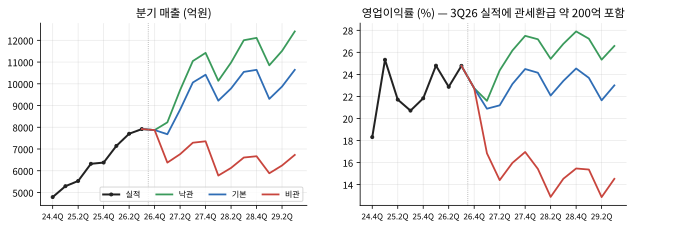

**그림 ④-2. ROIC·ROE 경로 — WACC·Ke 기준선**

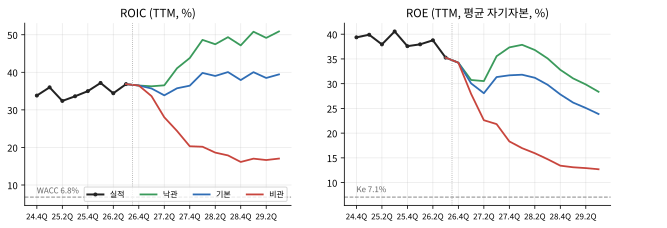

**그림 ④-3. BPS와 순현금 경로**

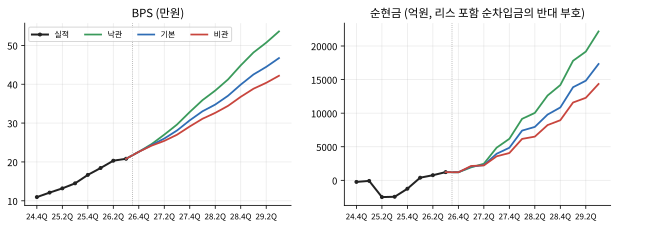

**그림 ④-4. 손익분기 매출과 자싱 가동률**

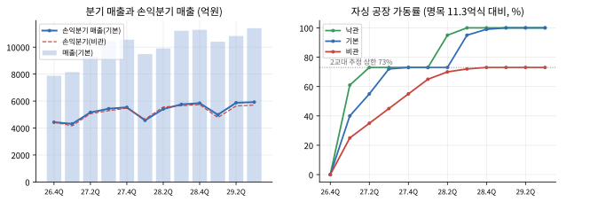

손익분기 매출 = (고정비 + 감가상각) ÷ (1 − 변동비율). 자싱 가동으로 고정비가 늘어도 매출이 더 빨리 늘어 안전여유율이 유지됩니다.

**12분기 마지막 해(4Q28~3Q29)는 안정 상태인가**: 자싱은 3교대 후 가동률 100%(기본)에 도달하지만, 베트남 공장이 1Q29에 막 가동(건면 1라인)해 감가상각·고정비가 새로 붙은 직후입니다 — 일시적 비용이 조금 남아 있습니다(절대가치 2번에 적음).

### 컨센서스 비교

<table><tr><th>2027년</th><th>매출</th><th>영업이익</th><th>이익률</th></tr><tr><td>DS(11/12)</td><td align="right">37,351</td><td align="right">8,724</td><td align="right">23.4%</td></tr><tr><td>한화(11/12)</td><td align="right">39,550</td><td align="right">9,140</td><td align="right">23.1%</td></tr><tr><td>키움(11/12)</td><td align="right">39,986</td><td align="right">9,058</td><td align="right">22.7%</td></tr><tr><td>유안타(10/21)</td><td align="right">38,545</td><td align="right">9,210</td><td align="right">23.9%</td></tr><tr><td>우리 비관</td><td align="right">35,053</td><td align="right">7,159</td><td align="right">20.4%</td></tr><tr><td>우리 기본</td><td align="right">38,448</td><td align="right">8,798</td><td align="right">22.9%</td></tr><tr><td>우리 낙관</td><td align="right">40,796</td><td align="right">10,294</td><td align="right">25.2%</td></tr></table>

<table><tr><th>분기(매출 / 영업이익)</th><th>우리 비관</th><th>우리 기본</th><th>우리 낙관</th><th>DS</th><th>한화</th><th>키움</th></tr><tr><td>26.4Q</td><td align="right">7,872 / 1,790</td><td align="right">7,872 / 1,790</td><td align="right">7,872 / 1,790</td><td align="right">8,061 / 1,809</td><td align="right">8,040 / 1,860</td><td align="right">7,958 / 1,750</td></tr><tr><td>27.1Q</td><td align="right">7,653 / 1,577</td><td align="right">8,152 / 1,745</td><td align="right">8,850 / 1,978</td><td align="right">8,442 / 2,054</td><td align="right">8,640 / 2,040</td><td align="right">8,788 / 1,933</td></tr><tr><td>27.2Q</td><td align="right">8,401 / 1,571</td><td align="right">9,292 / 2,013</td><td align="right">10,226 / 2,546</td><td align="right">9,102 / 2,029</td><td align="right">9,700 / 2,130</td><td align="right">9,792 / 2,151</td></tr><tr><td>27.3Q</td><td align="right">9,298 / 1,895</td><td align="right">10,449 / 2,448</td><td align="right">10,823 / 2,817</td><td align="right">9,604 / 2,236</td><td align="right">10,050 / 2,310</td><td align="right">10,257 / 2,396</td></tr><tr><td>27.4Q</td><td align="right">9,700 / 2,115</td><td align="right">10,555 / 2,592</td><td align="right">10,897 / 2,953</td><td align="right">10,203 / 2,405</td><td align="right">11,170 / 2,650</td><td align="right">11,149 / 2,579</td></tr></table>

- 2027 영업이익: 컨센서스 4곳 8,724~9,210억(이익률 22.7~23.9%) vs 우리 기본 8,798억(22.9%) — **±10% 안**. 매출도 기본과 비슷해, **시장은 자싱 물량을 이미 숫자에 넣었고 가격 인상에 따른 이익률 확대는 넣지 않았습니다**. 컨센서스는 기본과 낙관 사이에서 기본 쪽에 붙어 있습니다.
- 낙관(2027 영업이익 10,294억)은 컨센서스보다 약 13% 높습니다 — 이 차이가 **아이디어(P 사이클 +7% 추가 인상, 자싱 빠른 가동)를 숫자로 표현한 값**입니다. 차이의 출처는 연결 표의 D3(가격) 행과 D1(자싱 가동 속도) 행입니다.
- 분기별로는 4Q26 영업이익(우리 1,790억 vs 1,750~1,860억)이 맞습니다. 2027년 상반기는 우리 기본이 10~15% 낮은데(환율 1,346원 고정, 원재료 +5%를 1Q27부터 넣고 가격 인상은 2Q27부터), 하반기는 비슷합니다.
- 순차입금: 한화는 2027 말 순현금 5,080억, 키움은 순차입금비율 −30% — 우리 기본 2027 말 순현금 4,850억과 비슷합니다(설비투자 가정 차이 작음).

### 민감도 (기본 시나리오)

<table><tr><th>바꾼 가정</th><th>2027 영업이익</th><th>이익률</th><th>3Q29 BPS</th><th>3Q29 ROE</th></tr> <tr><td>기본(그대로)</td><td align="right">8,798</td><td align="right">22.9%</td><td align="right">467,302</td><td align="right">25.7%</td></tr><tr><td>미·유럽 단가 프리미엄 1.1 → 1.0배</td><td align="right">8,567</td><td align="right">22.7%</td><td align="right">459,534</td><td align="right">25.2%</td></tr><tr><td>유지보수 투자율 5.1% → 3.5%</td><td align="right">8,809</td><td align="right">22.9%</td><td align="right">468,277</td><td align="right">25.8%</td></tr><tr><td>유지보수 투자율 5.1% → 7.0%</td><td align="right">8,784</td><td align="right">22.8%</td><td align="right">466,145</td><td align="right">25.6%</td></tr><tr><td>판관비성 고정비 비중 72% → 100%(모든 고정비가 물량 비례)</td><td align="right">8,241</td><td align="right">21.4%</td><td align="right">448,777</td><td align="right">24.3%</td></tr><tr><td>판관비성 고정비 비중 72% → 50%</td><td align="right">9,235</td><td align="right">24.0%</td><td align="right">481,857</td><td align="right">26.7%</td></tr></table>

- **환율**: 원/달러가 1,346원에서 5% 내리면(약 1,280원) 영업이익 약 −7.5%(2027 기본 약 −660억), 5% 오르면 +7.5%. 비관 시나리오의 이익률 하락(가격 인상 없음)과 환율 하락이 겹치면 2027 영업이익은 6,600억 안팎까지 내려갈 수 있습니다.
- **금리**: 순현금 회사라 예금 금리 1%p 변화는 세후 순이익 기준 2027년(평균 순현금 약 3,500억) 약 ±26억, 2029년(순현금 약 1.7조) 약 ±130억 — 이익의 1~5%로 작습니다. 할인율 쪽 영향은 상대가치에서(Ke ±0.5%p → 오늘 적정 주가 약 ∓1.3%).

## 절대가치 평가 — 시나리오별로 쌓이는 장부가치

<table><tr><th>시나리오</th><th>최근 BPS(3Q26)</th><th>1년 뒤 BPS(3Q27)</th><th>3년 뒤 BPS(3Q29)</th><th>3년 뒤 ROE(TTM, 평균)</th><th>3년 뒤 EPS(TTM)</th><th>3년 뒤 ROE(기초 자기자본)</th><th>ROE로 본 적정 PBR(점검)</th><th>밴드 점검</th></tr><tr><td>비관</td><td align="right">208,196</td><td align="right">270,053</td><td align="right"><b>421,804</b></td><td align="right">22.5%</td><td align="right">86,087</td><td align="right">25.0%</td><td align="right">4.54배</td><td align="right">정상</td></tr><tr><td>기본</td><td align="right">208,196</td><td align="right">281,012</td><td align="right"><b>467,302</b></td><td align="right">25.7%</td><td align="right">107,742</td><td align="right">29.1%</td><td align="right">5.34배</td><td align="right">정상</td></tr><tr><td>낙관</td><td align="right">208,196</td><td align="right">291,564</td><td align="right"><b>508,640</b></td><td align="right">27.5%</td><td align="right">124,306</td><td align="right">31.3%</td><td align="right">5.79배</td><td align="right">정상</td></tr></table>

- 적정 PBR = (3년 뒤 ROE(기초) − 2%) ÷ (Ke − 2%), Ke 7.07%. 밴드 중앙값 5.60배와 비교해 비관 4.54 · 기본 5.34 · 낙관 5.79배로 **모두 '정상'(중앙값의 절반~2배 안)**. 참고로 10년 중앙값 2.51배는 기본·낙관이 2배 이상이라 '밴드 배수 신뢰 낮음'이 붙었습니다. 이유: 10년 밴드의 대부분(2016~2023)이 ROE 10~25% 시절이라 ROE 25~33% 시나리오와 맞지 않았습니다.
- 마지막 해에 일시적 비용이 남음: 베트남 공장 1Q29 가동 직후 감가상각(분기 23억)·고정비(10억), 자싱 3교대 직후 인건비. 숫자는 고치지 않고 적기만 합니다.
- 기준선 참고: 지금 조정 ROE(기초) 45.3% ÷ Ke × 최근 BPS = 1,335,304원 ("ROE가 지금 그대로 영원히 갈 때의 가치" — 조정 ROE가 일회성 외화손실을 빼서 높게 나온 점 주의).
- 주주환원 영향: 배당성향 10%라 이익의 90%가 순현금으로 쌓이고(3Q29 기본 순현금 17,320억), 그 돈은 예금 금리 3%만 법니다 → 3년 뒤 ROE가 지금(35%)보다 낮아지는 주된 이유입니다. 회사가 '안정적 FCF 확보 후 재검토'하겠다고 한 배당 정책이 바뀌면 이 경로가 바뀝니다(추적 항목).

<table><tr><th>할인율 구성</th><th>값</th></tr><tr><td>무위험 금리(국고채 10년, 2026-10 평균, ECOS)</td><td align="right">4.21%</td></tr><tr><td>β(KOSPI 주간, 2년, 조정)</td><td align="right">0.334 (상관계수 0.005 — 추정 불안정)</td></tr><tr><td>MRP = 8.383%(한공회 2026) + 1 × (0.688 − 0.501)%p</td><td align="right">8.57%</td></tr><tr><td><b>Ke</b></td><td align="right"><b>7.07%</b> (β ±0.2 → 5.4% ~ 8.8%)</td></tr><tr><td>WACC</td><td align="right">6.79%</td></tr></table>

## 상대가치 평가 — 장부가치 × 이 회사의 평소 배수

### 1. 현재 배수 (2026-11-20 종가 1,233,000원, 시가총액 92,882억)

<table><tr><th></th><th>PER</th><th>PBR</th><th>배당수익률</th><th>FCF 수익률</th></tr> <tr><td>최근 4분기 실적(TTM)</td><td align="right">19.9배 (조정 19.0배)</td><td align="right">5.92배</td><td align="right">0.47% (주당 5,800원)</td><td align="right">3.8%</td></tr> <tr><td>향후 12개월 컨센서스(DS 4Q26~3Q27)</td><td align="right">15.3배</td><td align="right">없음</td><td align="right">없음</td><td align="right">없음</td></tr> <tr><td>향후 12개월 ④ 기본(4Q26~3Q27)</td><td align="right">15.4배</td><td align="right">4.39배(3Q27 BPS)</td><td align="right">0.59%</td><td align="right">3.5%</td></tr></table>

조정 PER은 3Q26 외화 관련 손실 등 일회성(영업외)을 뺀 조정순이익 4,901억 기준. 컨센서스 선행 배수는 참고용.

### 2. 자기 과거 PBR 밴드 (배수의 기준)

**그림 상대-1. 주간 PBR(2022-04-01~2026-11-20, 244주)과 ROE(TTM, 평균 자기자본)**

자료: 주가 Yahoo Finance 주간 종가(2차), BPS = KIND 분기·반기·사업보고서 원문의 지배기업 소유주지분 ÷ 유통주식수(공시 시점 반영: 1~3Q는 분기 말+45일, 4Q는 다음 해 3/31). 2025년 4분기 이전 자기주식 74,887주는 기간 내 일정하다고 가정(확인 안 됨). 4Q26 컨센서스 점은 FnGuide 대신 DS투자증권 4Q26F 순이익(1,319억)으로 계산.

<table><tr><th>분위수</th><th>최저</th><th>하위 10%</th><th>하위 25%</th><th>중앙값</th><th>평균</th><th>상위 25%</th><th>상위 10%</th><th>최고</th><th>현재</th></tr> <tr><td>PBR(배)</td><td align="right">1.68</td><td align="right">1.88</td><td align="right">2.02</td><td align="right"><b>5.60</b></td><td align="right">5.32</td><td align="right">7.90</td><td align="right">9.50</td><td align="right">12.24</td><td align="right"><b>5.92</b> (역사적 상위 47%)</td></tr></table>

- **배수가 ROE를 따라 움직였나, 기대를 따라 움직였나**: 2016~2023년 ROE 10~25% 동안 PBR은 대체로 1.6~3배. 2016.9~2017.12, 2023.8, 2024.5~6 세 번 크게 튀었는데, 각각 불닭 해외 판매가 처음 급증한 시기(2016~17, 원인 상세 확인 안 됨), 밀양2공장 투자 결정(2023.8), 1Q24 영업이익 서프라이즈(시장 기대 +90% 상회, 교보) 때입니다. 2024년 이후는 ROE가 34~39%로 올라서며 PBR이 5~12배 구간으로 '레벨이 바뀌었습니다' — 기대만이 아니라 ROE가 따라왔습니다.
- **어느 기간을 믿을지(가격 계산은 2022Q2~, 나머지는 참고)**:

<table><tr><th>밴드 기간</th><th>하위 25%</th><th>중앙값</th><th>상위 25%</th><th>비관 오늘 적정가</th><th>기본</th><th>낙관</th></tr><tr><td>2022Q2~(가격 계산 기준, 244주)</td><td align="right">2.02</td><td align="right"><b>5.60</b></td><td align="right">7.90</td><td align="right">1,963,319원</td><td align="right">2,176,741원</td><td align="right">2,370,766원</td></tr><tr><td>최근 10년(2016-11~, 참고)</td><td align="right">2.00</td><td align="right"><b>2.51</b></td><td align="right">5.26</td><td align="right">892,661원</td><td align="right">990,597원</td><td align="right">1,079,694원</td></tr><tr><td>2019-01~(해외 비중 50%, 참고)</td><td align="right">1.97</td><td align="right"><b>2.51</b></td><td align="right">6.03</td><td align="right">891,379원</td><td align="right">989,177원</td><td align="right">1,078,149원</td></tr><tr><td>2023-08 이후(밀양2 결정, ROE 25%↑)</td><td align="right">5.34</td><td align="right"><b>6.91</b></td><td align="right">8.52</td><td align="right">2,417,624원</td><td align="right">2,680,050원</td><td align="right">2,918,598원</td></tr><tr><td>2024-05 이후(ROE 30%↑)</td><td align="right">6.18</td><td align="right"><b>7.61</b></td><td align="right">9.07</td><td align="right">2,660,435원</td><td align="right">2,949,053원</td><td align="right">3,211,397원</td></tr></table>

첫 줄이 가격 계산에 쓴 기준이고 나머지는 참고값입니다. 저배수 구간(2016~2023)을 많이 넣을수록 적정가가 낮아지고, 2023-08 이후만 쓰면 더 높아집니다. 판단은 "3년 뒤 ROE 25~33%의 회사에 시장이 어느 배수를 줄 것인가"에 달려 있습니다.

### 3. 시나리오별 적정 주가

<table><tr><th>시나리오</th><th>3년 뒤 BPS</th><th>오늘 적정 주가</th><th>현재가 대비</th><th>연 기대수익률</th><th>현재가가 정당하려면 필요한 3년 뒤 PBR</th><th>참고: 12개월 목표가(1년 뒤 BPS × 중앙값)</th></tr><tr><td>비관</td><td align="right">421,804</td><td align="right"><b>1,963,319원</b></td><td align="right">+59.2%</td><td align="right">+25.9%</td><td align="right">3.49배 (밴드 하위 44%)</td><td align="right">1,512,374원</td></tr><tr><td>기본</td><td align="right">467,302</td><td align="right"><b>2,176,741원</b></td><td align="right">+76.5%</td><td align="right">+30.5%</td><td align="right">3.14배 (밴드 하위 43%)</td><td align="right">1,573,751원</td></tr><tr><td>낙관</td><td align="right">508,640</td><td align="right"><b>2,370,766원</b></td><td align="right">+92.3%</td><td align="right">+34.5%</td><td align="right">2.88배 (밴드 하위 39%)</td><td align="right">1,632,841원</td></tr></table>

오늘 적정 주가 = 3년 뒤 BPS × 5.60배 ÷ 1.0707^(2.863년) + 그 사이 배당의 현재가치. 기준일 2026-11-20 → 3Q29 말(2029-09-30).

<table><tr><th>시나리오</th><th>하위 10% 배수</th><th>하위 25%</th><th>중앙값(적정)</th><th>상위 25%</th><th>상위 10%</th></tr><tr><td>비관</td><td align="right">673,174원</td><td align="right">721,413원</td><td align="right"><b>1,963,319원</b></td><td align="right">2,762,253원</td><td align="right">3,314,984원</td></tr><tr><td>기본</td><td align="right">747,435원</td><td align="right">800,878원</td><td align="right"><b>2,176,741원</b></td><td align="right">3,061,853원</td><td align="right">3,674,204원</td></tr><tr><td>낙관</td><td align="right">815,023원</td><td align="right">873,192원</td><td align="right"><b>2,370,766원</b></td><td align="right">3,334,175원</td><td align="right">4,000,696원</td></tr></table>

<table><tr><th>시나리오</th><th>그 사이 받을 주당 배당(지급 예정월)</th><th>현재가치</th></tr><tr><td>비관</td><td>2027-04 3,525원, 2027-08 3,159원, 2028-04 4,036원, 2028-08 3,902원, 2029-04 4,518원, 2029-08 4,054원</td><td>20,726원</td></tr><tr><td>기본</td><td>2027-04 3,525원, 2027-08 3,765원, 2028-04 5,065원, 2028-08 4,563원, 2029-04 5,587원, 2029-08 5,124원</td><td>24,611원</td></tr><tr><td>낙관</td><td>2027-04 3,525원, 2027-08 4,528원, 2028-04 5,797원, 2028-08 5,495원, 2029-04 6,525원, 2029-08 5,893원</td><td>28,257원</td></tr></table>

**그림 상대-2. 시나리오별 오늘 적정 주가(굵은 선 = 중앙값 배수, 상자 = 하위~상위 25%, 수염 = 하위~상위 10%)와 연 기대수익률**

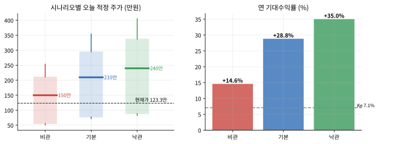

**바닥(= 비관 오늘 적정 주가) 1,963,319원** — 현재가보다 높습니다. 다만 이 바닥은 고배수 체제 유지 가정 위에 있습니다(10년 밴드 바닥은 892,661원).

### 4. 현재 주가에 담긴 시장 기대

- 현재가가 정당하려면 3년 뒤 PBR이 비관 3.49배 · 기본 3.14배 · 낙관 2.88배 필요합니다. 2022Q2~ 밴드로는 각각 하위 44% · 43% · 39% 위치 — **중앙값(5.60배)보다 낮은 배수**입니다. 즉 "고배수 체제가 유지되면 시나리오가 실현된 뒤 지금보다 낮은 배수만 받아도 되는 가격"입니다. 10년 밴드로는 각각 하위 71% · 67% · 62%로 중앙값(2.51배)과 상위 25%(5.26배) 사이입니다. 2024년 이후 배수(최저 5.04배)와 비교하면 셋 다 그보다 낮은 배수만 있어도 되는 가격입니다.
- **현재가가 요구하는 초과수익 지속 기간 N**:

<table><tr><th>시나리오</th><th>정상화 도착점 ROE(기초)</th><th>N(정상화)</th><th>정상화 안 한 ROE</th><th>N(참고)</th></tr><tr><td>비관</td><td align="right">26.6%</td><td align="right">7.8년</td><td align="right">25.0%</td><td align="right">8.5년</td></tr><tr><td>기본</td><td align="right">30.6%</td><td align="right">6.0년</td><td align="right">29.1%</td><td align="right">6.4년</td></tr><tr><td>낙관</td><td align="right">32.8%</td><td align="right">5.1년</td><td align="right">31.3%</td><td align="right">5.4년</td></tr></table>

정상화: 마지막 해(4Q28~3Q29)의 감가상각을 유지보수 투자 수준으로 바꿔 세후로 순이익 조정(유지보수 투자율 5.1%는 측정 기간이 없어 둔 가정 — 증설이 계속된 시기의 설비보완 투자로 잰 값). 남긴 이익 90%가 다시 쌓여 BPS를 키우고, N년 뒤 ROE가 Ke로 내려온다고 봄. 첫 회차라 N의 추이는 다음 브리핑부터 누적합니다.

- **증권사 목표주가와의 차이**: DS 190만원(2027 EPS 86,854원 × PER 22배), 한화 180만원, 키움 185만원. 우리 기본 2027 EPS는 약 88,298원으로 DS와 비슷 — **차이는 이익이 아니라 배수**입니다. DS의 PER 22배는 2021~25년 평균 PER 28배를 할인한 값으로, 우리 기본 2027년 말 BPS(약 30.7만원)로 나누면 PBR 약 6.2배로, 2024년 이후 밴드(하위 25% 6.18배)에 해당합니다. 우리 계산은 2022Q2~ 밴드 중앙값 5.60배를 써서 DS가 쓴 배수(약 6.2배)와 가깝습니다(10년 중앙값 2.51배를 쓰면 낮게 나옵니다).
- **그 기대는 무엇에 대한 것인가**: 교보는 "베트남 증설 공시가 중국 증설 때(PER 17배 → 24배)처럼 리레이팅 계기", 키움은 "4년간 두 자릿수 성장, 가격 인상 없이도 연매출 6조 가능(베트남 8라인)". 시장 가격에는 **베트남 8라인 전부 가동(2029년 이후)과 그 뒤의 성장**이 들어 있습니다 — 우리 12분기 구간 밖이거나(2029년 이후), 기본에 넣지 않은 것(추가 라인 미공시)입니다. 사용자 아이디어(P 사이클 이익률 확대)는 시장 숫자에 아직 없습니다.

### 5. 현재가 위치와 손익비

**그림 상대-3. 과거 날짜별 적정 주가와 주가**

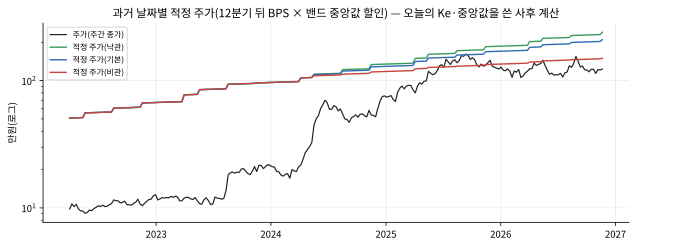

각 날짜에 공시돼 있던 마지막 분기 + 12분기 뒤 BPS(실적이면 실제, 추정 구간이면 시나리오) × 밴드 중앙값 5.60배를 그 날짜로 할인. 2022년 이전 배당은 넣지 않음(영향 연 0.5% 미만). 오늘의 Ke·중앙값과 지금 시나리오를 쓴 사후 계산입니다.

> [!WARNING]
> **현재가 위치**: 현재가 1,233,000원는 **비관 오늘 적정 주가(1,963,319원)보다 37.2% 낮습니다**. 기본 대비 43.4% 낮고 낙관 대비 48.0% 낮습니다. 오를 여지 = 낙관 − 현재가 = 1,137,766원, 내릴 여지 = 현재가 − 비관 = -730,319원(마이너스). **손익비는 계산되지 않습니다**(비관에서도 현재가보다 높음). 손익비 2:1이 되는 가격 2,099,134원, 3:1이 되는 가격 2,065,181원 — 어떤 손익비를 기준으로 쓸지는 사용자가 정합니다. **이 위치는 고배수 체제 유지 가정 위에 있습니다. 10년 밴드로는 현재가가 낙관 적정가(1,079,694원)보다 높습니다.**  
> **시장이 우리 시나리오보다 더 좋게 보는 것**(연결 표에 빠졌을 수 있는 낙관 조건): ① 베트남 유탕면 7라인 추가와 2029년 이후 성장 ② 2024년 이후의 높은 배수(PBR 5~12배)가 유지된다는 전제 ③ 미국·멕시코·캐나다·남미 확장. 이 중 ①과 ②를 낙관 시나리오에 넣을지는 사용자 판단이 필요합니다(아래 질문).

**쉬운 말 결론**: 이 회사가 앞으로 3년간 장부가치(BPS)를 연 27~35%씩 쌓는다고 봅니다(비관~낙관). 2022Q2~ 이후의 배수(중앙값 5.6배)를 계속 받으면 지금 가격은 낮고(연 기대수익률 비관 +25.9%, 기본 +30.5%, 낙관 +34.5%), 10년 평균적인 배수(2.5배)로 돌아가면 지금 가격은 높습니다(같은 순서로 -4.4%, -0.9%, +2.1%). 어느 쪽이 맞는지는 2024년 이후 20%대 영업이익률이 유지되는지에 달려 있습니다.

### 6. 비교 기업 배수 (참고)

<table><tr><th>회사</th><th>선정 이유</th><th>PBR</th><th>PER(TTM)</th><th>ROE</th><th>출처</th></tr><tr><td>농심(004370)</td><td>라면 73%(2025 매출 총액 기준), 같은 라면을 국내·미국·중국에 판매</td><td>0.69배</td><td>11.3배</td><td>6.2%</td><td>직접 계산(3Q26 분기보고서, 2026-11-20 종가 341,500원, 유통주식 5,834,188주)</td></tr><tr><td>닛신식품HD(2897.T)</td><td>즉석면 중심(일본·미주·중국), 다만 냉장·과자 등 포함</td><td>1.69배</td><td>20.3배</td><td>9.1%</td><td>사이트 기준(kabuyoho 2026-10-23: PBR 1.69배, ROE 9.14%; PER은 시가총액 9,210억엔 ÷ 2026.3 순이익 454억엔)</td></tr> <tr><td><b>삼양식품</b></td><td>라면(면스낵) 약 90%</td><td>5.92배</td><td>19.9배</td><td>35.3%</td><td>직접 계산</td></tr></table>

제외: 오뚜기(라면 비중이 절반 미만으로 알려짐 — 확인 안 됨), 팔도(비상장), 토요스이산(즉석면 비중 확인 안 됨). 비교 기업 PBR 중앙값 1.19배 대비 삼양은 약 398% 프리미엄, PER 중앙값 15.8배 대비 +26%. 프리미엄의 이유는 **ROE 수준(35% vs 6~9%)**입니다 — 반면 PER 프리미엄은 +26%에 그쳐, 시장은 삼양의 높은 자본 효율은 PBR로 쳐 주지만 이익 1원에는 보통 식품회사보다 조금 높은 값만 매기고 있다는 뜻입니다. 적정 주가 계산에는 쓰지 않습니다.

## 요청 자료 (우선순위 순)

1. **3Q26 IR PDF 원문**(법인별 영업이익, 판매량) — 삼양식품 홈페이지 → 투자정보 → IR 자료실 → '2026년 3분기 실적' PDF 첨부. 지역별 매출·관세 환급을 원문으로 바꿉니다.
2. **자싱공장 가동 일정·초기 가동률·근무 형태(2교대 시간)** — 4Q26 실적 컨퍼런스콜(2027년 2월 예상) 녹취·증권사 정리본. 73% 상한 추론과 3교대 규모를 확인합니다.
3. **국고채 3·10년, 회사채 AA− 3년 11월 월평균** — ECOS → '1.3.2.2 시장금리(월,분기,년)' → 2026.11 → CSV(12월 초 공표 후).
4. **KOSPI PER·PBR 5년 월별**(내재 MRP 점검, k 회귀) — 한국거래소 정보데이터시스템(data.krx.co.kr, 로그인) → 통계 → 지수 → 주가지수 → 'PER/PBR/배당수익률' → KOSPI → 2년씩 나눠 CSV.
5. **한국 CDS 5년 월별(2023~2026)** — 증권사 HTS '해외 CDS' 화면 또는 investing.com 'South Korea CDS 5 Years' 스크린샷.
6. **KOSPI 음식료품 업종지수 월별(2021~2026)** — 정보데이터시스템 → 통계 → 지수 → 주가지수 → '개별지수 시세 추이' → '음식료품' → CSV.
7. **통화별 매출 비중·외화 원가 비중, 회사 환율 민감도** — IR 담당자 문의 또는 컨콜 질문.
8. **FnGuide 분기 컨센서스(4Q26~4Q27)** — comp.fnguide.com → 삼양식품 → 컨센서스 화면 스크린샷(지금은 증권사 리포트 3곳으로 대신함).
9. (있으면) **2016~2021년 자기주식 수 변동** — 사업보고서 '주식의 총수 등'. 과거 BPS의 주식 수 가정을 확인합니다.

## 숫자 블록 (JSON)

다음 브리핑이 이어 쓸 핵심 숫자. 항목 설명은 \_desc. schema\_version 2(진행중 파일의 v1에 시나리오·가치평가 항목 추가).

---

숫자 블록: [data/samyang-foods-framework-20261122.json](data/samyang-foods-framework-20261122.json) · 원본은 같은 이름의 HTML(로컬 보관)
